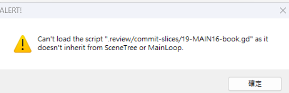

# [MAIN-18] 防止驗收腳本誤啟動警告

> 狀態：完成

## 內文

### 需求

Godot 專案、可直接執行的驗收入口與介面元件需要有清楚的啟動方式。錯把不可獨立執行的腳本或檢視用快照當成遊戲入口時，應能立即說明如何選擇正確入口並結束，不留下長駐錯誤視窗或卡住的驗收程序。一般遊戲啟動與玩家存檔行為維持正常。

### 來源

2026-10-13 使用者回報 Godot 顯示無法將 `.review/commit-slices/19-MAIN16-book.gd` 作為主執行腳本載入，提示該腳本未繼承 SceneTree/MainLoop。該快照是介面元件；當時實際啟動方式尚未確認，因此本票驗收入口辨識與失敗收束，不推定錯誤由特定操作造成。

### 驗收條件

- [x] 專案啟動、場景型驗收及可獨立執行的腳本型測試，各有清楚且可重複使用的入口。
- [x] 非獨立入口的介面元件與檢視快照不會被誤認為可執行測試；誤選時會指出正確的啟動方式。
- [x] 無效入口、測試錯誤或逾時會產生可辨識的失敗結果並結束，不留下長駐錯誤視窗或無限等待程序。
- [x] 正常啟動仍進入遊戲主場景；一般遊戲的存檔載入與保存不受驗收入口改善影響。
- [x] 驗收入口的失敗與逾時案例不會讀寫玩家預設存檔。

### 測試流程

1. 以一般專案啟動方式進入遊戲，確認主場景正常顯示，既有存檔可載入並保存。
2. 依各入口說明啟動一個場景型驗收、一個可獨立執行的測試，以及一個介面元件測試；確認各自回報正確結果。
3. 嘗試將檢視快照或介面元件當成獨立入口，確認錯誤說明清楚並快速結束，不顯示長駐錯誤視窗。
4. 使用有界測試期限觸發逾時，確認回報失敗、程序結束，且玩家預設存檔未被變更。

---

# 跟其他票的關係

- Blocks：無
- Blocked by：無
- Related：MAIN-3、MAIN-17

---

實作固定基準：`7ce236a`；分支：`feature/island-experience`。

# Commit-1

### 問題
提交快照被當作獨立入口時出現長駐警告；本輪亦查到一次我方將一般場景驗收腳本錯當獨立程式的啟動。

### 改動
驗收開始前辨識正確入口，介面元件、快照與無效路徑在引擎啟動前就明確回報失敗。提交快照改為純文字，已確認屬本 Session 的錯誤驗收程序關閉。逾時只收束本次啟動的程序，不關閉其他遊戲或編輯器。入口說明區分遊戲、場景驗收與獨立腳本；任意手動啟動不屬此防護範圍。

### 驗收
主 Session 獨立重跑 13 項入口與收束測試，全部通過；原有 63 個驗收入口均可辨識，沒有改動測試選擇或通過標記。實際引擎的獨立腳本、場景、預設主場景及存檔保護均通過；故意讓獨立測試引擎逾時，2.141 秒內回報並收束。正常原生啟動錄製 180 格，主 Session 實際查看主場景，0 個 ERROR。玩家預設存檔與備份雜湊在本輪前後相同；這不表示先前存檔事件已恢復。

### 測試結果與截圖
[13 項局部測試](images/MAIN-18-preflight-tests.log) · [實際啟動與逾時報告](images/MAIN-18-entrypoint-acceptance.json) · [證據索引](images/MAIN-18-evidence.json) · [入口使用說明](../../design/runtime/godot-entrypoints.md)。完整套件交 CI；這是入口驗收，不是真人試玩或動畫品質通過。

分支：`feature/island-experience`；票況進行中，程式與證據提交：[0cefb0a](https://github.com/deadline314/Snapland/commit/0cefb0a)。

# Commit — 2026-10-20 重驗入口與存檔保護並結案

固定開始 SHA：`67906d9`；分支：`codex/delivery-batch-20261020`。

重新核對全部五項已交付驗收，修正入口說明中「main 只有設計」的過時指引。現有 91 個正式入口全部可辨識；Godot 4.7.2 的專案主場景啟停、獨立時間測試、場景型照片測試與存檔保護實測通過，另以真實引擎觸發有界逾時並確認收束。13 項入口反例也再次通過，錯選介面元件、快照、外部路徑及混合入口均不能啟動引擎。

[本輪入口與結果反例](images/MAIN-2-ci-budget-20261020-python.log) · [91 個入口及七項實際引擎檢查](images/MAIN-18-entrypoints-20261020.log) · [實際逾時收束](images/MAIN-18-timeout-20261020.log)。本輪使用各項獨立絕對存檔，不啟動玩家預設進度；既有原生啟動圖與先前 Windows 預設存檔前後雜湊保留在 Commit-1，該圖本輪重新查看，不標成新截圖或本輪 Windows 驗收。全部驗收條件已有對應證據，票況完成；任意繞過入口防護的手動引擎指令不在本票範圍。
