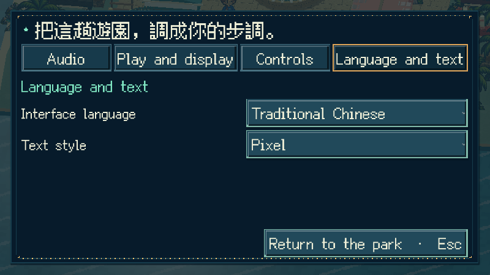

# [MAIN-19] 建立可擴充多語系框架

> 狀態：完成

## 內文

### 需求

遊戲為未來不同語系建立可持續擴充的文字、格式與資源管理。語系、字型偏好可保存，未翻譯或缺少資源時安全回到原文；遊戲、任務、服飾與收藏的識別不隨譯文改變。對外只列出完成發布條件的語系，未完成翻譯可在隔離驗收中測試，不讓玩家誤以為全作已翻譯。

### 來源

2026-10-14（Asia/Taipei）使用者肯定這輪方向，希望遊戲換用像素字體，同時考量未來不同語系並建立框架，繼續完善整個島。沿用免捲動、文字不重疊、分類有層次及真實原生畫面驗收的規範。

### 驗收條件

- [x] 語系及文字資源集中管理，新增語系以資料為主；未翻譯、缺少或無效語系回到繁中安全預設，記錄具體問題。
- [x] 文字格式支援變數與語序調整，任務、物品、角色、拍貼等識別在切換後保持不變。
- [x] 語系和字體偏好可保存、重開及安全載入，既有收藏與設定保留。
- [x] 切換文字呈現時保留目前選單位置、對話進度及操作；較長語句可完整閱讀，主要控制不重疊或靠額外捲動才能看見。
- [x] 有可實際操作的語系驗收資料，包含長文字及不同文字方向；未發布語系與完整翻譯完成度清楚區分。
- [x] 有至少六個方向的第一手研究、原生截圖及局部測試紀錄，不以字串測試冒充完整語系翻譯驗收。

### 測試流程

1. 使用隔離存檔查看設定，調整語系與字體偏好，重開核對保存。
2. 在選單與對話進行中切換，確認目前位置、進度及返回操作保持正常。
3. 以驗收語系顯示長句、變數及不同文字方向，確認版面、字形與內容識別。
4. 使用缺少譯文、無效語系及損毀偏好，確認回退、具體紀錄與進度安全。

---

# 跟其他票的關係

- Blocks：無
- Blocked by：無
- Related：MAIN-6、MAIN-10、ART-23、ART-25、ART-27

---

## 開始基準

`bbba056`；`feature/island-experience`。

# Commit-1

## 內文

問題：介面與故事文字缺少可擴充的語系管理，切換呈現容易失去選單位置，也可能破壞舊設定與未來版本留下的資料。

改動：加入集中語系資料、具名變數、原生複數規則、安全回退與可保存的字體偏好。設定新增固定的語言與文字分類；切換時保留分類、焦點、對話行與揭字進度。正式只列完整繁中，英文與 RTL 留在隔離 QA，未完成翻譯不顯示成可發布語系。

驗收：主 Session 獨立重跑正常／損毀資料、缺譯文、變數重排、複數、舊存檔及未知擴充設定的存讀測試。切換前後完整進度內容相等，英文建立的設定切回繁中也能更新實際文字並保留焦點。原生畫面包含六組字體與語系、三種解析度；只證明框架與呈現，沒有宣稱英文或阿拉伯文已完整翻譯。分支 `feature/island-experience`，固定開始基準 `bbba056`。

### 測試結果

[六組原生文字與語系紀錄](images/MAIN-19-native-language-verification.json)；[共同局部測試摘要](../Snapland-art/images/ART-27-verification.json)。語系、核心存檔、Main 整合、設定、對話與受影響介面測試均通過，無 ERROR。完整套件交 CI。

### 截圖與來源

[RTL 與多語字形 QA](images/MAIN-19-rtl-qa-gallery.png)；[八個方向的第一手來源與取捨](../../design/runtime/typography-localization.md)；[研究頁截圖與99張正式UI畫面索引](../Snapland-art/[ART-27]完善像素字體與多語可讀性.md)。

### 歷史交付狀態

當時框架局部驗收通過；未發布語系需逐語系完成翻譯、校對與全內容驗收。島嶼工作分支尚有既有動畫／完整試聽票待驗，本票隨整組交付保留進行中，沒有把未驗成果併入 main。

### 遠端交付

`feature/island-experience`；[本次來源提交](https://github.com/deadline314/Snapland/commit/dd53b97be2ce8be5f3a2e71d2b8e0f9412bdfb80)。正式存檔與備份雜湊與本輪開始相同。

# Commit-2：主線重驗並完成框架交付

本輪從已整合的主線重新核對集中語系、變數／複數、缺譯文與損毀資料的安全回退、偏好存讀、未知未來設定保留，以及切換語系時的收藏識別、選單焦點與對話進度。全部局部檢查通過；未發布語系仍不出現在正式選項，也不把英文或 RTL QA 寫成全作翻譯。

與 ART-27 一起補上高行距 RTL 的雙尺寸暫停條件：所有主要入口與繼續／離開完整可見、不重疊，文字與字型不縮小；原中文三尺寸的 Tab／滑鼠返回及設定流程保持通過。原生六組語系／字型與最終標準／窄視窗 RTL 畫面均有可查證資料，具體查看的畫面另列。框架程式及本輪修正已整合 [b441722](https://github.com/deadline314/Snapland/commit/b441722168491a213a867ddfc21701de773f2671)，原先等待工作分支整組交付的阻塞已解除，本票完成。

[本輪語系與版面執行紀錄](../Snapland-art/images/ART-27-text-20261020-locale-and-tall-pause.log) · [原生驗證與具體範圍](../Snapland-art/images/ART-27-text-20261020-verification.json) · [共同第一手研究與回歸方法](../../design/runtime/typography-localization.md)。最終相關執行 exit 0、0 ERROR；故意缺譯文／無效語系的 WARNING 保留，不稱完整翻譯或真人試玩。
