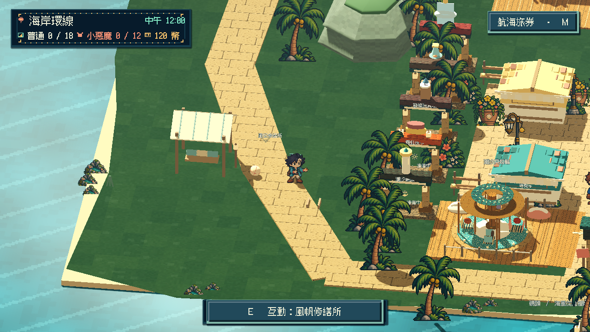
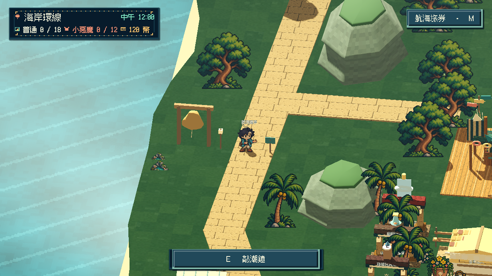
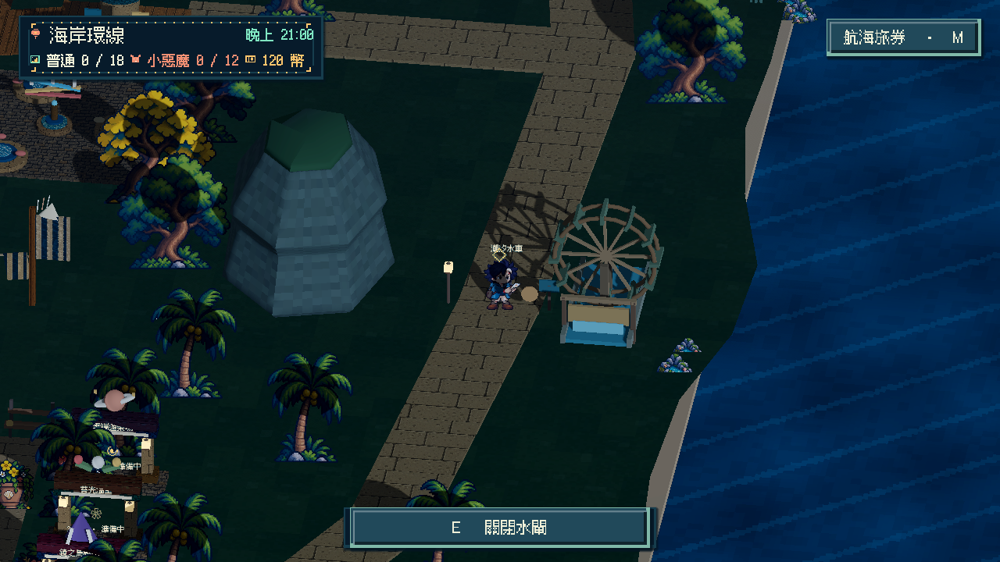

# [MAIN-21] 加入海岸自由互動與環境回應

> 狀態：完成

開始基準：`244536b3c14c7d42110e45e0791ebe04ad4c7c6b`；分支：`codex/finish-runtime-batch-20261020`。

## 內文

### 需求
海岸探索途中有直接在世界裡玩的物件與可見的因果反應，讓散步不只是在不同地點開啟小遊戲、閱讀說明或領拍貼。保持清楚動線和節制介面，玩家能隨時離開、再回來玩。

### 來源
2026-10-20（Asia/Taipei）使用者要求每張地圖更生動、增加自由互動與可玩的內容；介面減負、合理使用版面，減少重疊資訊及不必要捲動。本票先完成已開放海岸的完整小批，不代表未開放園區已建成。

### 驗收條件
- [x] 海岸至少三種不同自由互動有可觀察結果，其中至少一項能由玩家控制方向或節奏；不以說明文字替代可玩內容。
- [x] 互動沿探索路線可發現、無須進入計分面板，不改變金幣、拍貼、任務或平台成就。
- [x] 暫停、對話、失焦、離開及重訪安全；降低動態保留必要因果與操作，日夜可辨認。
- [x] 原生實際輸入、前後畫面與短片、受影響局部驗證可審閱；研究來源及採用理由有紀錄。

### 測試流程
1. 使用獨立存檔走近每種物件，以鍵盤或滑鼠操作並查看結果。
2. 檢查方向／節奏控制、自由離開、重訪、時段及降低動態。
3. 對比完整進度，確認自由遊玩不發獎或損壞進度，保存原生證據。

---

# 跟其他票的關係

- Blocks：無
- Blocked by：無
- Related：MAIN-11、MAIN-15、ART-3、ART-20

# Commit-1

## 內文

海岸原本多數地標只能閱讀一段說明。現在在風帆修繕所旁可踢海漂球，從不同側面接近能改變實際滾動方向，走開後也能回球架拿回；聽潮鐘亭能按自己的節奏敲四音短句，鐘身跟著擺動；潮汐水車可打開或關閉水閘，門板、水流和真實轉速一起改變。這些操作都留在場景裡，沒有計分、結果面板或收藏獎勵。附近提示直接說明下一個動作。

先比較 Nintendo、House House、A Short Hike、Team ASOBI、Donut County 與 Godot 的不同方向，保留第一方文字實際閱讀範圍及圖片取得限制；[研究與取捨](../../design/runtime/entry-and-freeplay-flow.md)。沒有將商品介紹或數值測試當成玩家喜好、音色品質或完整遊玩認證。

原生操作發現球架原先太靠近球、會搶走側面的踢球選擇，已移到旁邊並追加最近互動回歸。水閘移到從步道看得到的一端，加上門架及開閘落水，讓環境結果可辨認。自由遊玩暫停／失焦時凍結，恢復時保留球的動量；降低動態停次要擺動及水車，但保留球的必要移動、閘門位置和水流狀態。

### 測試結果

| 項目 | 結果 |
|---|---|
| 真實物理、方向與拿回、四次敲鐘、開關水閘 | 通過；追加球架不搶側面互動反例 |
| 暫停、對話／面板阻擋、失焦、遊戲隱藏、恢復、降低動態與場景釋放 | 通過；整份存檔位元不變 |
| 既有園區布局與可走動線 | 通過；0 ERROR |
| 既有入口與 Main 整合 | 通過；0 ERROR |
| CI 入口／完成契約 | 新增自由互動套件，原有套件保留；23 項 Python 契約通過 |
| 原生實際 E／Escape 輸入 | 最終 31.75 秒、0 ERROR；兩側踢球、拿回、四敲、暫停與夜間／降低動態閘門通過 |

原生測試在站點間有定位，時段／降低動態由隔離 fixture 切換；沒有冒充全程步行或時段面板操作。已實看踢球、鐘與水閘前後原尺寸圖，以及影片的均勻抽樣；影片為 1280×720、20 FPS、150 幀／7.5 秒，完整解碼 0 錯誤。不宣稱人類完整連續觀看、即時效能或音效主觀試聽。

[實際操作短片](images/MAIN-21-play-20261020-play.mp4) · [原生報告](images/MAIN-21-play-20261020-report.json) · [原生日誌](images/MAIN-21-play-20261020-native.log) · [物理與生命週期測試](images/MAIN-21-play-20261020-freeplay.log) · [布局測試](images/MAIN-21-play-20261020-layout.log) · [原先球架搶互動的拒收紀錄](images/MAIN-21-play-20261020-rejected-recall.log) · [啟動檢視工具的拒收紀錄](images/MAIN-21-play-20261020-rejected-capture.log) · [證據雜湊](images/MAIN-21-play-20261020-manifest.json)。

本票結案限已開放海岸三種自由互動；所有園區的內容豐富度及整體美術仍依其他票接續。
