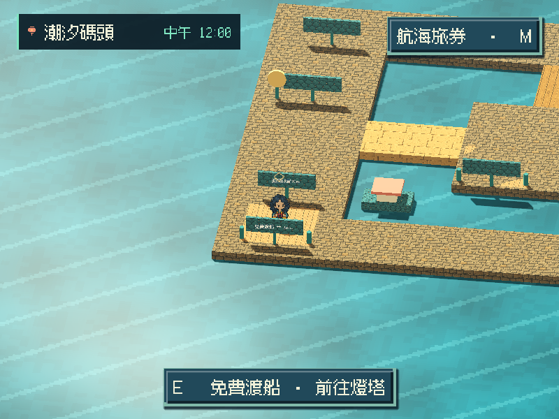
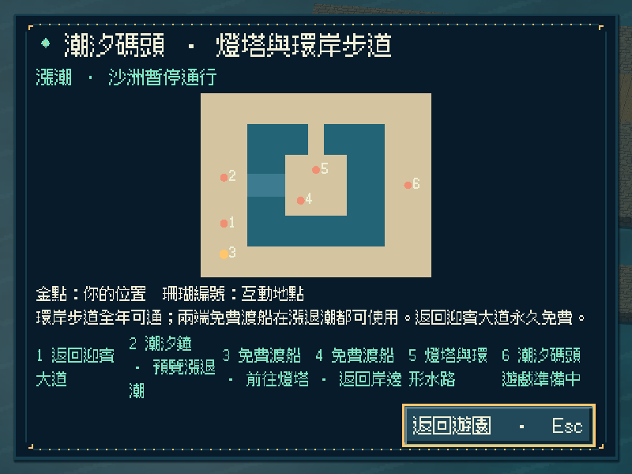
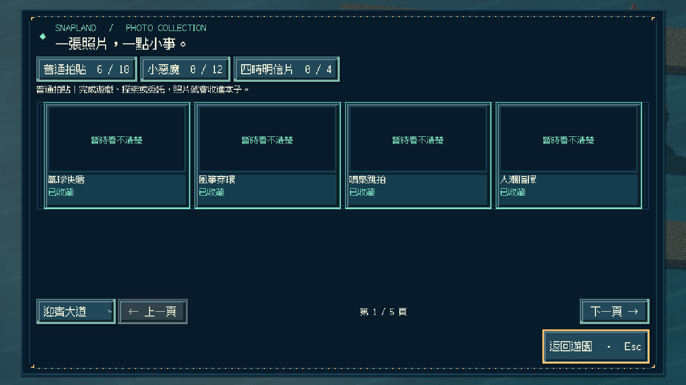
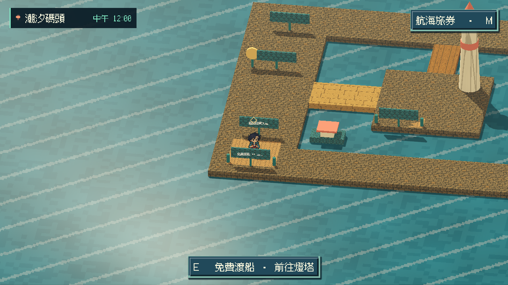

# [MAIN-24] 開放潮汐碼頭往返與保存

> 狀態：完成

## 內文

### 需求
收集六張不同的普通拍貼後，可從迎賓大道前往潮汐碼頭，在燈塔岸線、沙洲與環形水路自由走動，隨時免費返回，重開遊戲保留所在園區。

### 來源
2026-11-12 使用者要求完成整個遊戲並自主開票交付。既定潮汐碼頭設計包含六張入場門檻、退潮捷徑與漲潮免費渡船；目前入口只有準備中告示。

### 驗收條件
- [x] 未滿六張時顯示所差張數，達標即可往返，不消耗收藏或金幣。
- [x] 潮汐碼頭有獨立可探索的燈塔岸線、沙洲與環形水路；路標、互動與入場站位清楚可達。
- [x] 可預覽漲退潮；退潮路徑可通行，漲潮有免費渡船，任何潮位都能返回迎賓大道，不必等待真實時間。
- [x] 重開保留所在園區；舊存檔、損壞位置與保存失敗安全恢復，既有收藏、外觀、任務與船上序章不受損。
- [x] 暫停、設定、地圖與收藏顯示符合目前園區，未實作的遊戲及其他園區不冒充可玩；降低動態、800×600 與放大文字可操作。
- [x] 往返重入、門檻、保存與舊版回歸測試，以及原生與打包驗證附票。

### 測試流程
1. 分別使用未滿與達到六張普通拍貼的隔離存檔，核對入場提示與收藏未被消耗。
2. 走過碼頭、燈塔、沙洲及兩種潮位的返回動線，重複往返並切換外觀、設定與視窗尺寸。
3. 在潮汐碼頭關閉並重開；另載入舊版、錯誤位置及無法保存的測試檔，核對原進度仍完整。
4. 使用輸出包重做入場、返回與重開流程，保存原生畫面與測試結果。

---

# 跟其他票的關係
- Blocks：無
- Blocked by：無
- Related：MAIN-4、ST-6

---

# 開始
此票交付園區旅行與可探索動線；各款遊戲及角色故事各依其需求驗收。

---

# Commit-1

## 內文

迎賓大道的潮汐碼頭路口現在會核對六張普通拍貼資格，未滿時說明所差張數；達標後前往獨立的碼頭、燈塔與環岸步道，不消耗收藏或金幣。潮汐鐘可立即預覽，沙洲在退潮開放，升潮不會把人物留在水中；兩端渡船與返回迎賓永久免費。

重開會回到保存的園區。保存失敗仍留在原區，舊進度、外觀與任務保持完整；往返只保留目前世界，不疊加整個迎賓場景。區域地圖、收藏與選單如實說明所在位置；迎賓原照片仍可查看，碼頭未開放的玩法不冒充可玩或授予拍貼。

### 測試結果

| 項目 | 結果 |
|---|---|
| 保存與跨程序重開 | Windows／Linux 通過；新舊與損壞位置、重置、兩向保存失敗與未知資料保留均有核對 |
| 地形與原區回歸 | 7,017 項地形、碰撞、潮位、渡船與重入斷言通過；原區接地、行走、配置與船上舞台 5／5（含匯入） |
| 新增旅行檢查 | 本機 4／4（含匯入）通過，門檻、免費返回、設定、遊戲取消與重入核對通過 |
| 跨平台與完成判定 | Linux 3／3（含匯入）及 33 項入口／完成契約測試通過，不忽略額外錯誤 |
| 原生尺寸與外觀 | 800×600 降低動態／1.25 文字、1280×720、1920×1080／1.25 文字；每組實際往返 11 張、分開重開 10 張，外觀與原進度保持一致 |
| 獨立輸出包 | 預設光影下完成同一套往返 11 張、分開重開 10 張，沒有非預期 ERROR |
| Windows 成品 | 新遊戲、保存於碼頭後啟動與關閉通過；原十二款遊戲圖資檢查通過，且不改掉保存位置 |
| 完整雲端驗證 | [執行 43255587138](https://github.com/deadline314/Snapland/actions/runs/43255587138) 通過；183 項 Python 測試與全部 107 項遊戲檢查 |

原生流程使用明確標記的六張既有迎賓拍貼測試資料建立入場資格，不表示真人取得或試玩；旅行前後收藏、金幣、任務與造訪紀錄保持不變，沒有新增碼頭獎勵。程式化操作也不代表真人試聽。實作提交：`85955a9`、`f40f2d5`、`4dad8a2`；驗證內容基準：`00b29d7`。

### 截圖

[證據索引](images/MAIN-24-harbor-20261113-evidence-index.md)；[完整原生畫面、測試與審查](images/MAIN-24-harbor-20261113-evidence.zip)；[成品來源與指紋](images/MAIN-24-harbor-20261113-verification.json)。
