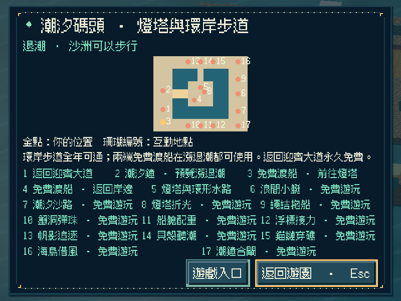
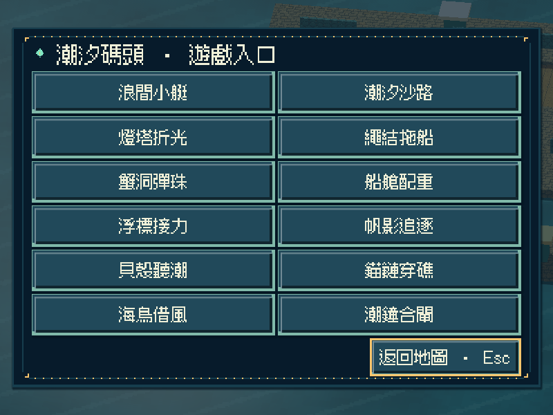
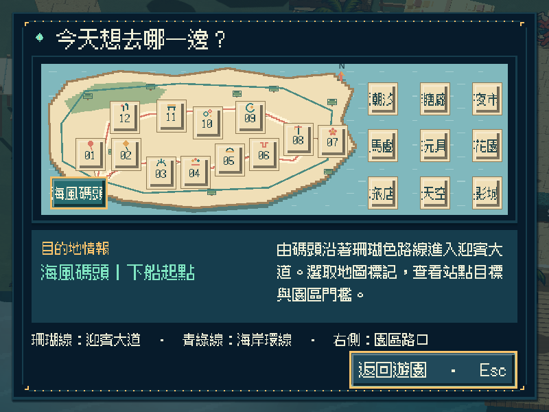
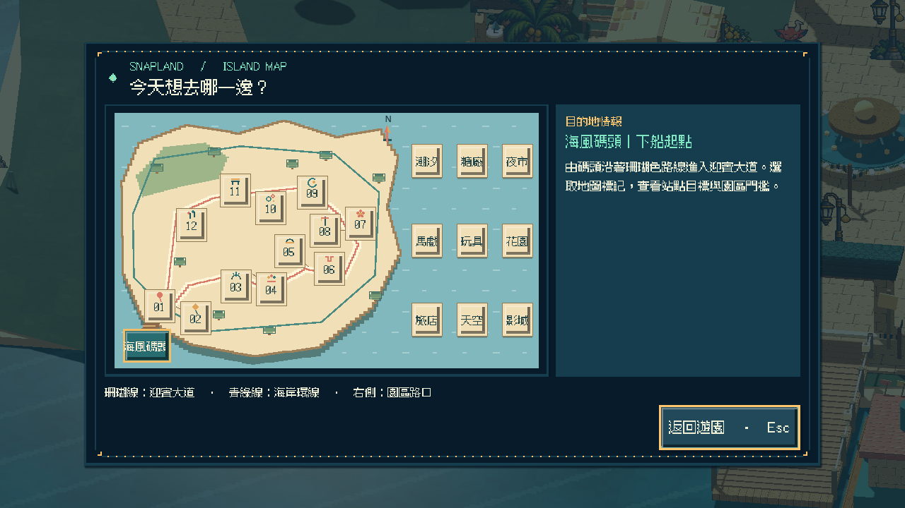
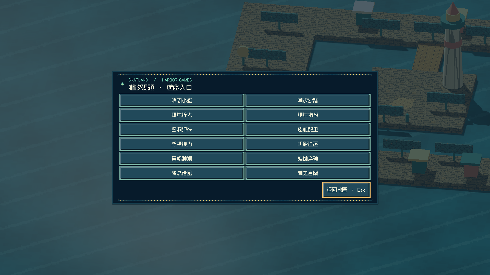
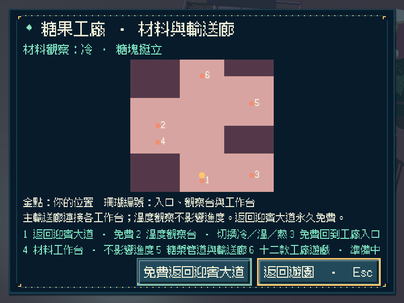

# [MAIN-27] 修正區域地圖小視窗操作

> 狀態：完成

## 內文

### 需求
碼頭十二款遊戲全部開放後，地圖內的玩法入口橫向擠出視窗，連帶拉寬地圖與地點名稱；迎賓地圖的小視窗也會切掉目的地情報與返回操作。提供獨立、完整展開的遊戲入口頁及適合視窗的地圖配置，讓玩家在放大文字下能查看全部地點、開啟每一款玩法及返回。

### 來源
2026-11-17 接續使用者要求完成所有票、維持既有功能。MAIN-26 小視窗回歸觀察到碼頭地圖原有內容寬度約 3713，超過 800 視窗；十二款玩法入口需要隨已交付內容合理排列。

### 驗收條件
- [x] 碼頭地圖在 800×600 放大文字、1280×720、1920×1080 內保持合理寬度，所有地點文字清楚，十二款入口完整展開且不用捲動。
- [x] 十二款玩法入口都可查閱並開啟正確說明，返回操作隨時可見，不要求水平捲動尋找按鈕。
- [x] 工廠與迎賓地圖、原有遊戲入口與收藏不受損；局部測試及原生畫面附票。
- [x] 迎賓地圖在小視窗完整顯示目的地情報與返回，十二個站點及九個園區目標保持清楚、可操作且不重疊；開啟後調整視窗也正常。

### 測試流程
1. 三種視窗查看碼頭地圖及遊戲入口頁，核對最後一個地點、第十二款玩法、完整可見寬度與返回按鈕。
2. 逐一開啟玩法說明並返回，確認正確遊戲；再查看工廠與迎賓地圖。

---

# Commit-1

## 內文

原本碼頭地圖把十二款玩法排在固定橫列，小視窗會把地圖、按鈕與返回擠出畫面。現在地圖保留清楚的遊戲入口，另頁完整展開十二款玩法；每個入口開啟原本正確的說明，返回與 Esc 回到地圖。

迎賓地圖依視窗寬度切換並排或上下配置，目的地情報與返回完整可見，十二站與九個園區路口保持原有內容、位置關係與操作範圍。路口說明如實顯示開放條件，不再把已開放區域一概標成準備中。

### 測試結果

| 項目 | 結果 |
|---|---|
| 受影響局部回歸 | 17 項套件通過，原有完成判定保持一致 |
| 修正後地圖／旅行／像素介面回歸 | 四項通過；圖例另有局部確認 |
| 十二款原有遊戲入口與結果回歸 | 全數通過，保留原斷言 |
| 真實小視窗與放大文字 | 全部站點、園區路口、情報、按鈕與返回完整可見，目標不重疊 |
| 開啟中調整視窗及重置 | 配置正確、節點數固定，返回層級不妨礙重置 |
| 三種原生視窗 | 各五張畫面、十二個實際說明入口逐一通過，無錯誤或退出資源保留 |
| 匯入及設計／連結驗證 | 通過 |

原生證據為獨立存檔與腳本按鈕操作，非真人遊戲試玩。[原始紀錄、來源快照與全部畫面](images/MAIN-27-evidence.zip)。

### 截圖

# 跟其他票的關係

- Blocks：無
- Blocked by：MAIN-26
- Related：SG-40、SG-41

---
