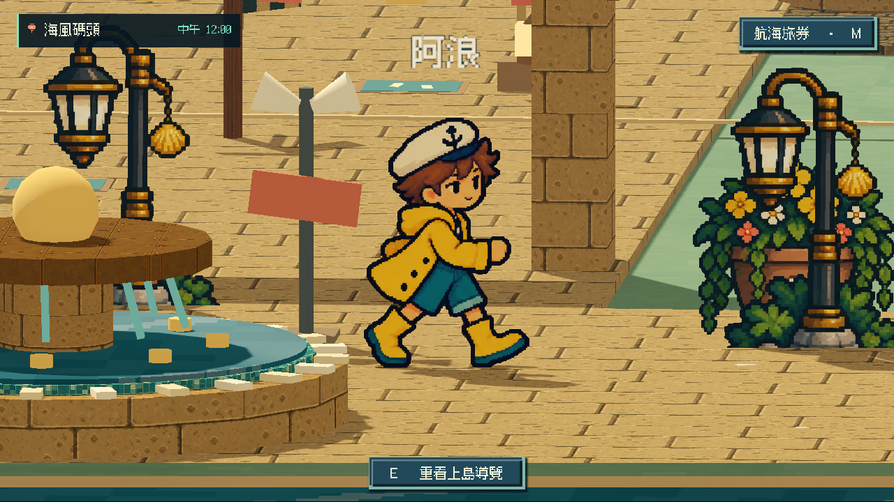
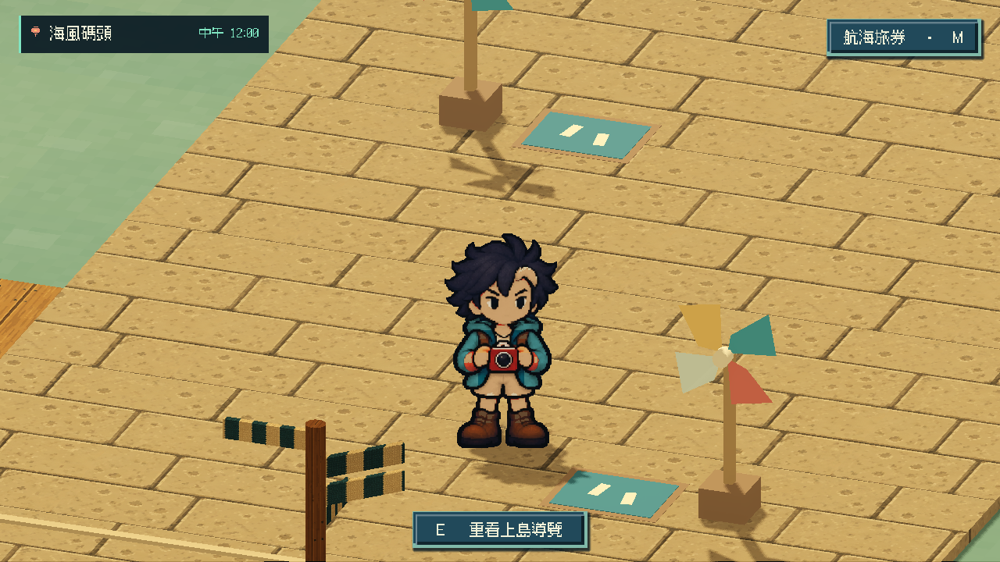
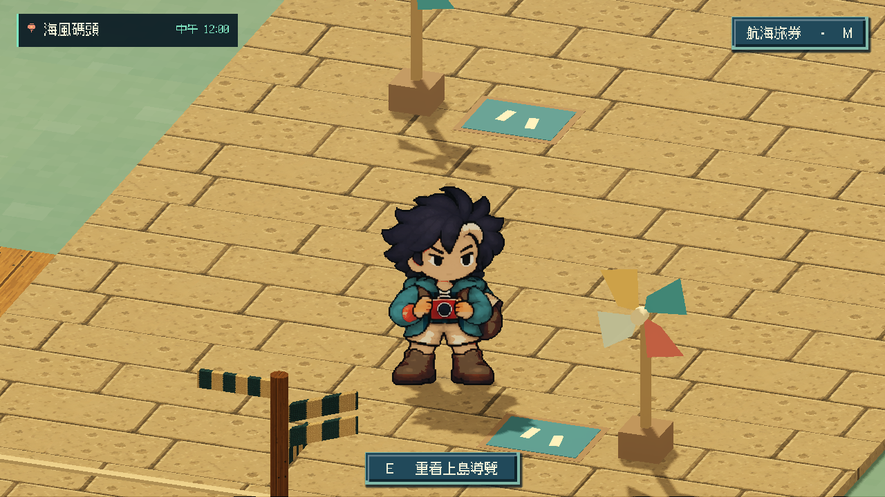

# [MAIN-33] 修復原生接地檢視遮擋

> 狀態：完成

## 內文

### 需求
角色腳底與身體的原生檢視，在目前場景的阿浪中間姿勢出現部分身體被遮擋，完整入口無法繼續。需要釐清實際阻擋來源，在保留完整身體、深度、腳底與地面接觸檢查的前提下修復驗證取景或相關呈現，讓現行內容可如實完成檢視。

### 來源
2026-11-18 ART-17 降低動態檢查補修時，完整原生接地入口在進入該段前，回報阿浪一張中間姿勢的 47406 個身體像素中有 307 個被遮擋。已保留原始失敗；此問題與舊角色入口的位置及來源假設分開追蹤。

### 驗收條件
- [x] 保存實際失敗與原生畫面，辨識阻擋位置、來源及其與取景／角色呈現的關係。
- [x] 維持原有全身、深度、腳底及接觸判斷，不以降低門檻或忽略錯誤通過；受影響姿勢與鏡頭條件可完成驗證。
- [x] 完整入口的角色及主角相關檢查、降低動態與恢復可完成，保存實際截圖及局部紀錄。
- [x] 使用隔離存檔，乾淨退出並逐票提交、同步 main。

### 測試流程
1. 使用獨立存檔執行完整原生接地檢視，保存第一個實際遮擋失敗及畫面。
2. 核對原本鏡頭、被阻擋身體部位與相關場景深度，修正後重做受影響條件。
3. 完整執行其餘姿勢、降低動態與恢復；腳本取景與數值檢查不當作真人遊玩或整套動畫自然度驗收。

---

# 跟其他票的關係

- Blocks：無
- Blocked by：無
- Related：MAIN-32、ART-15、ART-17

---

# Commit-1

## 內文

原本低俯角的阿浪靴子被噴水池外圈遮住；繼續檢查也發現主角靴子與大道路牌重疊。原圖及介入後還原的對照確認實際遮擋來源。現在分別調整角色與主角的檢視方位，保留正式場景、姿勢、來源及原俯角，維持零身體遮擋與原有腳底接觸判斷。

完整原生入口完成 27 個既有檢查片段並保存 27 張原圖，包括三位角色、降低動態與恢復、主角八方向待機、指定行走及三種動作。這是腳本取景及數值檢查，不代表真人遊玩或整套動畫自然度驗收。

### 測試結果

| 項目 | 結果 |
|---|---|
| 原始失敗與還原對照 | 阿浪 307 個遮擋像素，移除干擾的私有對照為 0，還原回到 307 |
| 完整原生檢視 | 27／27 段身體像素大於 0、遮擋為 0；27 張原圖 |
| 隔離環境與退出 | Godot 4.7.2，獨立存檔，退出 0，完整標記 1 次、0 ERROR，無資源或音訊殘留訊息 |
| 既有材質警告 | 15 筆，與修復前相同 |
| 其他執行內容及相依來源 | 1190 份雜湊一致 |

### 截圖

[原圖、失敗及還原對照、完整紀錄與審查](images/MAIN-33-evidence.zip)
