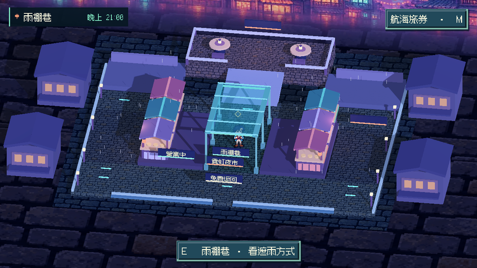

# [MAIN-37] 開放霓虹夜市往返與探索

> 狀態：完成

## 內文

### 需求

開放第四區「霓虹夜市」。持六張不同普通拍貼可自由入場，並免費返回迎賓大道。玩家可走過環形攤街、雨棚巷和屋頂餐桌，查看雨棚與營業狀態，並在地圖辨認路線及返回入口。夜市以自選開市狀態呈現，後續玩法與故事依實際交付開放。

### 來源

2026-11-26，使用者要求完成工廠後繼續後續章節。園區與故事設計指定第六張拍貼開放夜市，並規劃環形攤街、雨棚巷和屋頂餐桌。

### 驗收條件

- [x] 五張普通卡顯示差額，六張不同普通卡能從實際夜市門口入場，不扣卡與幣。
- [x] 攤街環路、可遮雨的雨棚巷及屋頂路線可走通，越界有安全回復。
- [x] 營業切換即時反映在環境與地圖，可反覆使用。
- [x] 地圖、收藏冊和返回入口可在小視窗操作。內容數量依實際開放範圍呈現。
- [x] 返回迎賓大道位置正確，夜市存檔可重新開啟；舊區往返、收藏及設定仍有效。
- [x] 局部、原生及封裝驗證通過，PM 保留驗證摘要與一張代表截圖。

### 測試流程

1. 以五張及六張普通拍貼先後開啟夜市門口，驗證未達及達成資格。
2. 走攤街兩端、雨棚巷與屋頂，切換營業、查看地圖、返回後再次入場。
3. 關閉並重開確認存檔，檢查舊區及不同視窗尺寸。

---

# 跟其他票的關係

- Blocks：無
- Blocked by：無
- Related：無

# Commit-1

## 內文

霓虹夜市可在六張不同普通拍貼後開放。可走環形攤街、玻璃雨棚及屋頂餐桌，切換營業，或循原門及地圖免費返回。營業切換會反映在招牌、燈光及地圖。夜市天際線和路面光影持續區分前後景。地圖以圖示標記入口、屋頂路線和實際互動位置。降低動態效果時會停下雨線及燈光變化。

### 驗證摘要

- Godot 驗證實際碰撞走路、避雨、坡道、越界回復與營業重複切換。四區存檔往返、寫入失敗回滾，以及工廠和潮汐碼頭小視窗地圖回歸通過。215 項 Python 與五組設計驗證通過。
- 800×600、1280×720、1920×1080 原生遊玩流程各通過 49、49、49 項，新程序重開各通過 6、6、6 項。
- Windows 內嵌 EXE 驗證通過 49 項，重開通過 6 項。均以隔離存檔和腳本輸入驗證。

