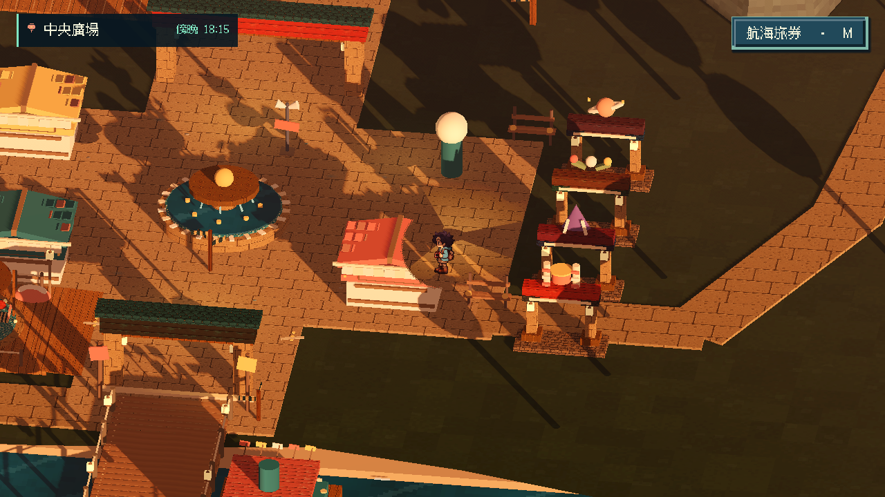

# [MAIN-39] 減少迎賓大道遮擋效果的重複更新

> 狀態：完成

## 內文

### 需求

迎賓大道維持玩家在建物後方可辨識的遮擋效果。無遮擋或畫面穩定時減少不必要的投影、材質更新與暫時配置。行走、鏡頭變動、材質切換、縮放和拍照仍能正確呈現。

### 來源

2026-11-26，使用者要求改善已開放章節的燈光、動畫及效能。現有遮擋控制器即使畫面靜止，每畫格仍投影角色、走訪材質並重寫多個 shader 參數。

### 驗收條件

- [x] 無遮擋或畫面穩定時，不重複送出相同的 shader 更新。
- [x] 玩家移動、建物遮擋、鏡頭與視窗變動時，裁切範圍、角色完整輪廓及漸變一致。
- [x] 場景重建、材質更換、拍照和降低動態效果均可更新、還原，無跨場景殘留。
- [x] 局部回歸和原生畫面驗證通過，以相同場景量測更新次數，PM 留必要摘要與一張截圖。

### 測試流程

1. 在相同場景量測靜止、移動及遮擋期間的更新，並比較畫面。
2. 走入及離開遮擋區，重複切換鏡頭、視窗、材質、拍照及降低動態。
3. 檢查既有角色姿勢、視覺裁切與燈光行為。

---

# 跟其他票的關係

- Blocks：無
- Blocked by：無
- Related：無

---

# Commit-1

## 內文

靜止時停止重複送出相同的遮擋更新。移動、縮放、換裝與淡出時仍會更新遮擋範圍。場景移除後可重複登錄同一組節點，舊的碰撞器和訊號正確清除。

### 測試結果

| 項目 | 結果 |
|---|---|
| 相同場景各 120 幀 | 露天靜止 3,720 → 0 次，遮擋靜止 3,720 → 0 次，清除遮擋後靜止 4,560 → 0 次。遮擋中移動仍為 3,720 次。 |
| 局部回歸 | 獨立遮擋比較 42 項、建物遮擋、日照、角色八方向步態、世界角色動作、夜市地形及 5 項設計檢查通過。 |
| 原生畫面 | Windows 相容渲染器 15/15。含四個時段、換裝、降低動態、視窗縮放及走出遮擋。 |

### 截圖

