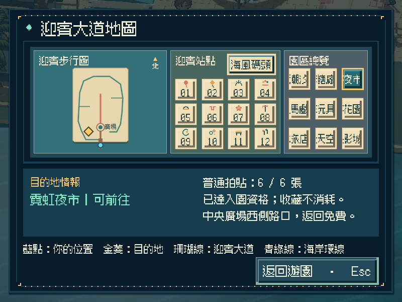

# [MAIN-42] 讓迎賓地圖標示實際方位

> 狀態：完成

## 內文

### 需求

開啟迎賓大道地圖即可看見目前位置，選取設施或開放園區時能辨認實際方位及地標。區分步行圖與園區總覽，保留原本的站點、園區資訊、入場門檻和操作。

### 來源

2026-11-26 使用者要求改善地圖、介面與遊戲指引，延續迎賓大道的動線完善。園區設計要求以地圖指引設施及路線。

### 驗收條件

- [x] 步行圖顯示北向及玩家所在點。實際走到另一處再開地圖，標記跟隨新位置。
- [x] 選取迎賓站點或已開放園區時，地圖標示實際目的地，資訊說明所屬方位。園區總覽的排列不會被誤認成步行方向。
- [x] 全部十二個站點、九個園區選項及返回在 800×600、125% 文字下可查看和操作。切換目的地不移動角色、不消耗收藏。
- [x] Godot 局部回歸及原生視窗驗證通過，保留一張有代表性的截圖。

### 測試流程

1. 在迎賓大道透過旅券開啟地圖，檢查當前位置和北向。關掉地圖、步行後重開。
2. 選取西側夜市與東側糖果工廠，核對標記及門檻。再以鍵盤切換站點與園區並返回。
3. 在 800×600、125% 文字與寬視窗下核對命中區、文字與返回位置。

---

# 跟其他票的關係

- Blocks：無
- Blocked by：無
- Related：ART-35

---

# Commit-1

## 內文

迎賓大道地圖以藍點顯示玩家位置，選取站點或園區路口後，金菱會標出實際方位。迎賓站點與園區總覽各有固定按鈕。開啟資料後仍可返回原地繼續步行。

### 測試結果

| 項目 | 結果 |
|---|---|
| 地圖、收藏、成就 | 實際旅券入口、北向步行重開、東西側路口、縮放及全部選項局部回歸通過 |
| 像素介面及區域旅行 | 三種視窗的選項命中區、入場門檻、返回及收藏回歸通過 |
| Godot 原生視窗 | 800×600 及 1280×720 以 125% 文字驗證實際標記像素、鍵盤返回及步行更新 |

### 截圖

