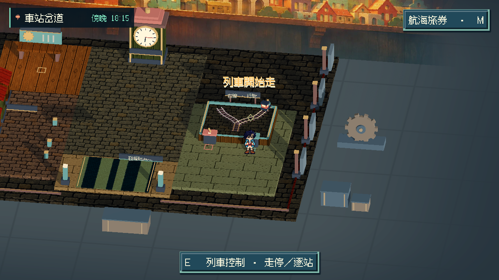

# [MAIN-45] 開放發條玩具城探索

> 狀態：完成

## 內文

### 需求

達到三十張不同普通拍貼後，玩家可從迎賓大道進入發條玩具城，步行探索積木街、車站岔道、維修台及發條鐘樓。玩家可親自切換示範列車的路線、暫停和重置，並從原路或地圖免費返回迎賓大道。

### 來源

2026-11-26 玩家要求繼續後續章節、增加可重玩的探索內容，並改善地圖、光影與操作。園區設計指定三十張普通拍貼、車站岔道、可暫停的排演及機關重置。

### 驗收條件

- [x] 29 張不同普通拍貼時入口顯示還差一張，30 張時可入場。入場及免費返回保留收藏與遊園幣。
- [x] 四個區域以實際步道相連，各有可辨識的地景與標示，玩家可安全抵達並沿路返回。
- [x] 車站切換後，示範列車行經所選的實際岔道。暫停可原處繼續，維修台一鍵恢復停靠與預設線位。
- [x] 減少動態時可逐站觀察同一路線。列車展示不妨礙步行，探索維持原有收藏與遊園進度。
- [x] 北向地圖顯示實際位置、步道和岔道狀態。縮小視窗與放大字級時仍可操作，重開會恢復所在區域。

### 測試流程

1. 從迎賓大道的實地入口分別以 29 張和 30 張普通拍貼操作，核對資格與原有收藏。
2. 步行走遍四個地點，在車站試兩條岔道、暫停和切換減少動態。走向維修台重置列車。
3. 開啟地圖確認動線與免費出口，分別由地圖和實地出口返回，並使用隔離存檔重開。

---

# 跟其他票的關係

- Blocks：無
- Blocked by：無
- Related：MAIN-44

---

# Commit-1

30 張不同普通拍貼可進入發條玩具城。積木街、車站、維修台與鐘樓以步道相連。車站可選左線或右線及暫停原處，列車沿所選線來回。減少動態時可逐站觀察，維修台能恢復左線與停靠。

工坊外圍採低對比分區地坪，陳列木箱與發條齒輪。車站後側的單一看板顯示所選岔道及列車狀態。

### 測試結果

| 項目 | 結果 |
|---|---|
| Godot 4.7.2 局部 | 玩具城實體路線、存檔、旅行、旅券、入口標示、夜市、馬戲團與劇情 8 組通過 |
| 原生 800×600，字級 125%，減少動態 | 流程 112 項，重開 13 項 |
| 原生 1280×720，字級 125% | 流程 111 項，重開 13 項 |
| 原生 1920×1080，字級 125% | 流程 110 項，重開 13 項 |
| 設計規格 | park、games、story、items、links 5 項通過 |
| Python | 215 項通過 |

