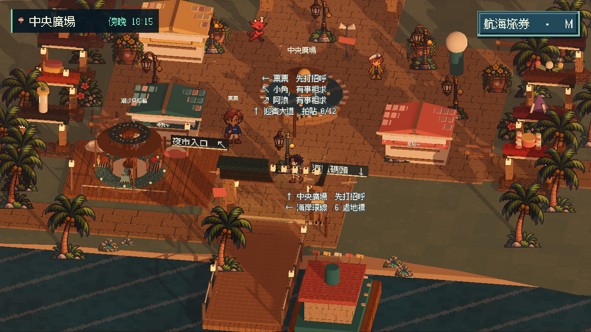

# [MAIN-46] 改善慢步反向與煞停手感

> 狀態：完成

## 內文

### 需求

歡迎廣場高速行走時同時切換慢步和反向，角色向舊方向的滑行要縮短。慢步仍適合在攤位與動線狹窄處精準移動，手把與鍵盤維持一致的換向回饋。

### 來源

2026-11-26 使用者要求從頭打磨遊戲操作手感。歡迎廣場目前快步切入慢步時，向舊方向的煞停距離會增加。

### 驗收條件

- [x] 快步同時切慢步及反向時，停下並開始往新方向移動的時間與舊方向位移均比現況縮短。
- [x] 同方向切到慢步時平順降速；正常起步、放開方向、慢步速度、坡道與碰撞維持原有行為。
- [x] 原生測試覆蓋實際鍵盤及手把輸入，確認角色朝向、步態、減少動態設定及可用的觸控替代操作正常。

### 測試流程

1. 在歡迎廣場空地快步直走，同一拍按慢步及反向，記錄原生物理幀與舊方向位移。
2. 維持同方向切慢步，再依次測試放開慢步、放開方向以及坡道和牆邊。
3. 重複手把與觸控操作，確認減少動態設定下依然保留轉身與煞停回饋。

---

# 跟其他票的關係

- Blocks：無
- Blocked by：無
- Related：MAIN-39、MAIN-43

---

---

# Commit-1

## 內文

快步時同時按 Shift 和反方向，角色會先煞住舊方向，再依慢步速度轉身。手把接近正向時也會接到原有急轉動畫。真正的斜走仍用八方向步態。減少動態保有方向與速度回饋。

### 測試結果

| 檢查 | 結果 |
|---|---|
| 鍵盤慢步反向 | 60 Hz 原生量測由 27 物理幀縮至 10 幀，約 450 → 167 毫秒。切換後沿舊方向位移由 0.315 降至 0.108 公尺。 |
| 保持方向切慢步 | 降速由 17 幀縮至 7 幀。放開方向仍為 10 幀、約 0.040 公尺。 |
| 800×600、1280×720、1920×1080 | 實際鍵盤、手把事件、現有旅券觸控、坡道和減少動態每種尺寸各 13 項通過，字級 125%。輸入由程式執行。 |
| 受影響功能 | 7 組 Godot 測試通過，覆蓋實際步態、暫停與跨區動線。 |

### 截圖

