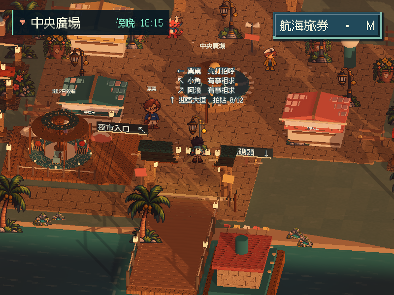

# [MAIN-49] 聚焦迎賓路標指引

> 狀態：完成

## 內文

### 需求

從碼頭走進中央廣場時，舊方向與新的角色指引會同時顯示。畫面應只呈現當前附近的一組方向，讓玩家容易找到票票及下一段步道。

### 來源

2026-11-26 使用者要求打磨迎賓畫面、地圖與功能引導。MAIN-46 與 ART-38 的實際路線畫面均看到碼頭與中央廣場同時提示先打招呼。

### 驗收條件

- [x] 在碼頭登島時，可讀到中央廣場與海岸環線的方向。
- [x] 步行抵達中央廣場後，只顯示當地引導。回程會切回碼頭，交界處短距離折返時引導維持穩定。
- [x] 三處實體路標、進度文字、任務結果、地圖與旅券沿用既有行為。
- [x] 在原生 800×600 與 1280×720、字級 125% 時，完成一次碼頭到廣場的實際往返驗證。

### 測試流程

1. 從迎賓大道的海風碼頭向北走到中央廣場，確認方向提示交接後無重複文字。

2. 在交界處短距離來回，再沿路返回碼頭。檢查原有路標仍在並可打開地圖與旅券。

---

# 跟其他票的關係

- Blocks：無
- Blocked by：無
- Related：MAIN-42、MAIN-46、ART-38

---

---

# Commit-1

## 內文

三處迎賓路標依玩家位置接手。中央廣場抵達後只顯示廣場引導，離開後回到碼頭指引。接手保留 0.5 公尺門檻，交界附近的小幅折返不會反覆跳動。

### 測試結果

Godot 4.7.2 原生 800×600 與 1280×720、字級 125% 的腳本化步行分別通過 24 與 24 項檢查。各取樣 1,383 與 1,383 個物理幀，同時至多一組引導。往返、交界折返、旅券地圖與存檔資料核對通過。島嶼配置、劇情與旅券／相簿局部回歸通過。

