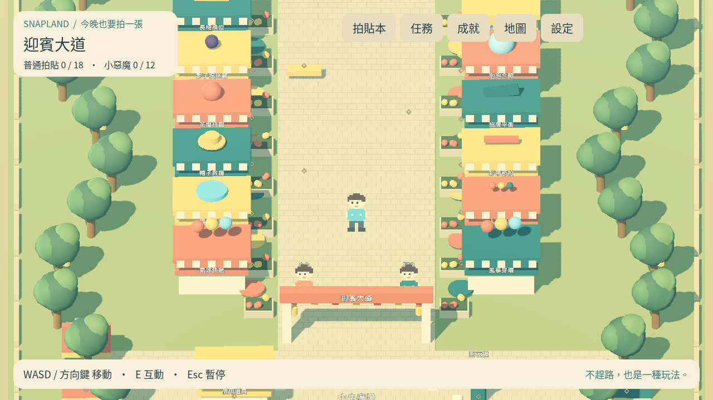

# [MAIN-4] 建立主廣場與園區路口

> 狀態：完成

## 內文

### 需求

玩家從碼頭走到主廣場、迎賓大道及其他九區可辨識的入口。

### 來源

使用者於 2026-10-11（Asia/Taipei）要求從上島開始實作主區域、迎賓大道全部小遊戲及共用系統；其他園區先做路口。每項實作前研究業界實例並保存圖例；本票是可執行第一版，品質以實際驗收為準。

### 驗收條件

- [x] 角色可移動、碰撞、互動並往返碼頭、廣場與迎賓大道。
- [x] 其他九區顯示園區名稱、收藏門檻與施工提示，不消耗收藏。

### 測試流程

1. 啟動遊戲，進入本票內容，依畫面提示實際操作。
2. 核對本票每項驗收條件，測試返回、重試、重開與輔助情境。
3. 保存原生畫面截圖與局部測試摘要；無法確認的項目保持未勾選。

---

# 跟其他票的關係

- Blocks：無
- Blocked by：MAIN-3
- Related：MAIN-1、SG-1、ST-1

---

## 開始基準

c1b7b19；feature/island-first-park。

## 業界研究

參見 [園區與介面研究](../../design/runtime/world-research.md)，來源在實作前讀取。

# Commit-1

## 內文

問題：碼頭、主廣場及園區入口尚無可走動場景。

改動：現在可步行往返三個主要地帶，另九區顯示入口、收藏門檻與準備中提示。

驗收：原生移動、碰撞、互動與返回通過；日夜及迎賓大道畫面已查看。

分支：`feature/island-first-park`；開始基準：`c1b7b19`；[程式 commit](https://github.com/deadline314/Snapland/commit/f2d6b84919a91d534082660a12aec5a9b44eaa2c)。

### 測試結果

| 項目 | 結果 |
|---|---|
| 受影響局部驗證 | 本票相關runtime與主場景整合通過 |
| 原生畫面 | GPU擷取並查看；程式化操作驗收 |
| 遠端CI | 帳戶限制，工作未啟動；未重試 |

### 研究與圖例

[園區與介面研究](../../design/runtime/world-research.md)。圖例為審閱參考，不是本作遊戲素材或試玩證據。

### 截圖

[整組驗收、票況與存檔事故紀錄](../first-playable-delivery.md)。

# 2026-10-20 現行第一版結案

重新核對目前碼頭、廣場、迎賓大道與九區路口；主場景整合與園區布局通過，其他九區維持園區名稱／門檻／準備中，沒有假稱已開放九張可玩地圖。本輪海岸原生實際行走255.59m、六處E觀察與回碼頭，以及含兩支線315.50m的物理往返另有MAIN-11證據；保留碰撞、實際上坡與回程，不靠關閉碰撞通過。

[現行布局／原生路線範圍](images/MAIN-11-coast-20261020-verification.json) · [完整物理路線](images/MAIN-11-coast-20261020-physics-route.json)。既有實作與原程式f2d6b84已在main，本輪核對當前規則及證據，不把早期feature狀態當目前阻塞。舊Windows圖仍屬歷史；本輪無頭功能檢查、原生自動輸入與合成UI各按實際範圍記錄，沒有新Windows EXE、真人試玩或聽感認證。

本票按第一版路口／收藏流程範圍結案；MAIN-11完整探索、ART-1光影／ART-17動畫、各玩法精修及更豐富的世界互動仍照各票驗收。
