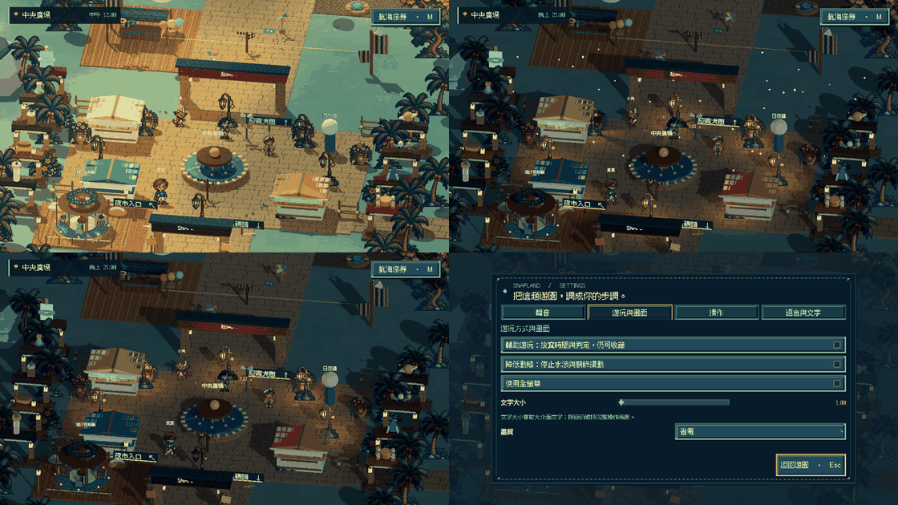

# [MAIN-51] 提供畫質選項與夜間效能調整

> 狀態：完成

## 內文

### 需求

夜間每幀成本約為白天的四倍，而且沒有任何畫質選項可讓較弱的電腦降低負擔。提供畫質等級，調整光照與渲染設定讓畫面更有層次，並在維持觀感下降低夜間成本。

### 來源

2026-11-27 使用者要求畫面不要死板、圖片要融入場景、背景要有動畫與互動，並調整光照、渲染與效能。

### 驗收條件

- [x] 設定中可選擇畫質等級，切換後立即生效並保存。
- [x] 最低等級可關閉高成本效果，畫面仍完整可玩。
- [x] 夜間同一視點的每幀成本低於調整前。
- [x] 各時段的色調與陰影層次較調整前清楚，像素角色不糊。
- [x] 畫質選項有一句話以內的說明。

### 測試流程

1. 在同一視點量測四個時段調整前後的每幀成本。
2. 切換各畫質等級並重開遊戲，確認保存。
3. 比對調整前後的同視點畫面。

---

# 跟其他票的關係

- Blocks：無
- Blocked by：無
- Related：ART-39、MAIN-39、MAIN-47

---

# Commit-1

## 內文

每次換區、開啟衣櫃或進入有角色的小遊戲時，角色圖集都會重新解碼並逐像素掃描一次，約花一秒，是換區停頓的主要來源。
現在角色圖集只在第一次使用時解碼，之後的畫面直接共用同一份來源；各畫面仍保有自己的資料表，畫出的角色與原本逐像素相同。
同一台機器量測：前往其他區域由約 1.3 秒降到約 0.4 秒，回到迎賓區由約 1.7 秒降到約 0.8 秒；角色、衣櫃、髮型與世界整合檢查通過。畫質選項與夜間成本尚未處理。

### 測試結果

| 項目 | 結果 |
|---|---|
| 前往其他六區（每次） | 約 1.3 秒 → 0.4 秒 |
| 回到迎賓區 | 約 1.7 秒 → 0.8 秒 |
| 第二個角色畫面的建立 | 約 0.92 秒 → 0.04 秒 |
| 共用來源檢查 | 通過 12 項 |
| 角色繪製、衣櫃、髮型、世界整合 | 通過 |

# Commit-2

## 內文

沒有任何畫質選項，較弱的電腦無法降低負擔；畫面色調偏平，夜間每盞有影子的路燈要多畫六次場景。開票時量到的「夜間成本四倍」經重新量測是切換時段當下的瞬間尖峰，穩定後夜晚約比白天多兩成。
現在設定的遊玩與畫面分頁多了畫質選項（高、標準、省電），切換立即生效並保存：標準把路燈影子減為一盞並降低陰影解析度，省電再關閉路燈影子、環境陰影、泛光、雲影與飄塵並減少同時點亮的路燈。高畫質加上不會模糊像素圖的邊緣平滑與輕微的對比、飽和調整，角色與場景一起變得更立體；路燈影子改用較省的做法，外觀相同。
同一次執行內交替量測夜間廣場：路燈影子改動前後為 3.41→2.72 毫秒與 2.63→2.55 毫秒，繪製數 2671→2587；省電等級為 2456。這台機器的每幀時間差距接近量測誤差，較弱硬體上的實際效益尚未驗證。

### 測試結果

| 項目 | 結果 |
|---|---|
| 畫質等級檢查 | 通過 |
| 七區世界、日夜光照、島嶼佈局、設定介面、整合 | 通過 |
| 夜間繪製數（調整前／高／省電） | 2676／2589／2456 |
| 夜間路燈影子改動（同次交替量測） | 3.41→2.72、2.63→2.55 毫秒 |

### 截圖

