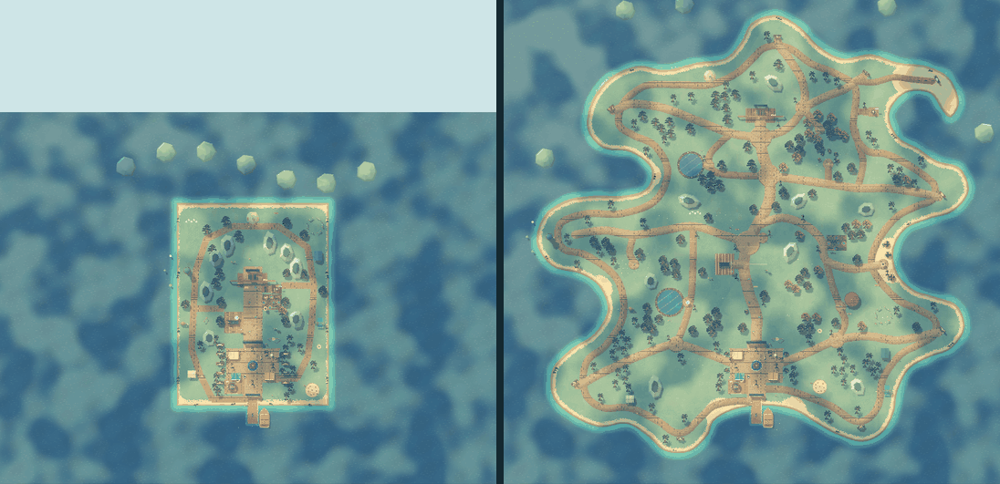

# [MAIN-55] 擴大迎賓島並改成自然海岸

> 狀態：完成

## 內文

### 需求

迎賓島是 72 × 96 公尺的矩形，碼頭、廣場與大道排成一條直線，十二款小遊戲入口擠在三十公尺內。把島擴大並改成有岬角與海灣的自然形狀，道路彎曲分岔，設施拉開，留出草地、樹林與水景。

### 來源

2026-11-27 使用者指出小島太小、東西太擠、形狀方正，希望像 Bomberman Land 3 一樣是一座大樂園：各種風格的區域融成同一張地圖，地圖上直接有互動與不用進關卡的小遊戲。規劃見 design/01-park/island-master-plan.md。

### 驗收條件

- [x] 島的海岸線是不規則的曲線，俯視時看不到矩形輪廓與筆直的岸邊。
- [x] 可步行面積至少是原本的四倍，並預留各主題區的接點。
- [x] 相鄰兩個小遊戲入口至少相隔 14 公尺，設施之間有草地、樹林或水景。
- [x] 道路有彎曲與岔路，從碼頭到任一迎賓小遊戲都有清楚的路與指標。
- [x] 海岸、草地、沙灘與水面的分層沿新的海岸線成立，岸浪貼著實際岸線。
- [x] 所有既有互動點、任務、探索點、海岸環線與往各區的閘口都保留且走得到。
- [x] 場景節點與繪製數量在迎賓區預算內，換區與啟動時間不高於擴大前。

### 測試流程

1. 以俯視全島畫面比對擴大前後的輪廓與設施間距。
2. 從碼頭步行到十二款小遊戲、六處海岸地標與九個閘口。
3. 切換四個時段並量測節點數、繪製數與建立時間。

---

# 跟其他票的關係

- Blocks：MAIN-56
- Blocked by：ART-44、ART-47
- Related：MAIN-11、MAIN-53、MAIN-57

---

# Commit-1

## 內文

迎賓島原本是一塊 72 × 96 公尺的矩形，下船後碼頭、廣場、大道一條線走到底，十二款小遊戲全擠在大道兩旁，九個閘口貼在廣場邊。

現在是一座約 205 × 207 公尺的島：碼頭在兩道岬角圍出的海灣裡，東岸有帽子沙灘，東北有沙洲圍住的潟湖，西岸有一道峽灣和燈塔岬。可以走的地方是原本的 4.47 倍。迎賓大道從拱門往北彎成 S 形，在三個路口分岔成二十條彎路與小徑，總長約 1.6 公里；十二款小遊戲各自在不同的地方（工坊、草坡、湧泉池、路口、沙灘、涼亭、花圃、潮池、林間空地、觀景台、池畔、劇台），最近的兩個相隔 17 公尺，中間是草地、樹叢、花叢與兩座池塘。九個閘口移到島的邊緣，各在一條通往該區方向的路底；海岸環線沿新的海岸繞一圈，六處地標都還在線上。碼頭、廣場與拱門的位置沒有變，導覽、拍貼本、設定、日夜鐘、兩位任務角色、三個探索點、倒影大道、貝殼輪、海漂球與踏板風車都保留。五款即時小遊戲與六個小互動也跟著移到新的草地上：踩螃蟹在碼頭東邊，追帽子在花叢裡，彩旗繞行在東南草原。

沙灘、草地、鋪面沿整條海岸一層一層往內退，草地到水邊至少隔 2.6 公尺的沙；沙灘斜著伸進水裡，淺水與岸浪跟著真正的岸線走。走進海裡會停在岸邊，不會被彈回去。旅券地圖畫出新的島形與所有道路，藍點與目的地都落在島上。每個路口有指標，寫著各方向的小遊戲與收集進度，或閘口在哪一岬；入夜後每個小遊戲入口與閘口旁都有一盞燈。

驗收時用同一個俯視鏡頭比對擴大前後（下圖，左右同比例）。讓角色的碰撞體從碼頭沿可走的地面走到 44 個固定互動點，全程沒有被擋住，也沒有被岸線修正位置，並確認每個點都能只走鋪面抵達；另外以實際的移動輸入從碼頭一路走過十二款小遊戲、六處海岸地標與九個閘口，共 1,516 公尺，27 處全部走到，沒有瞬間位移。以原生畫面在 27 個站點、四個時段量測繪製數，並逐張看過二十多個地面視角（含夜晚）。擴大前的數字與擴大後在同一份程式基礎上量測，都含即時小遊戲。

### 測試結果

| 項目 | 擴大前 | 擴大後 |
|---|---:|---:|
| 可步行面積 | 6,156 m² | 27,489 m²（4.47 倍） |
| 小遊戲入口最近間距 | 約 4 m | 17.0 m |
| 場景節點（上限 2600） | 2,368 | 2,470 |
| 單一視點繪製數，清晨最高（上限 2200） | 1,585 | 943 |
| 單一視點繪製數，白天最高 | 1,792 | 992 |
| 單一視點繪製數，黃昏最高 | 1,845 | 1,113 |
| 單一視點繪製數，夜晚最高 | 2,556 | 1,570 |
| 場景建立時間（換區） | 878–886 ms | 777–788 ms |
| 場景建立時間（啟動後第一次） | 2,091 ms | 2,088 ms |

| 項目 | 結果 |
|---|---|
| 島形檢查（新增）與島嶼配置檢查（改寫） | 通過 |
| 迎賓島與各區既有測試 27 組 | 通過 27 / 27 |
| 設計資料驗證 | 0 錯誤 |
| 執行 log | 無 ERROR |

### 截圖

