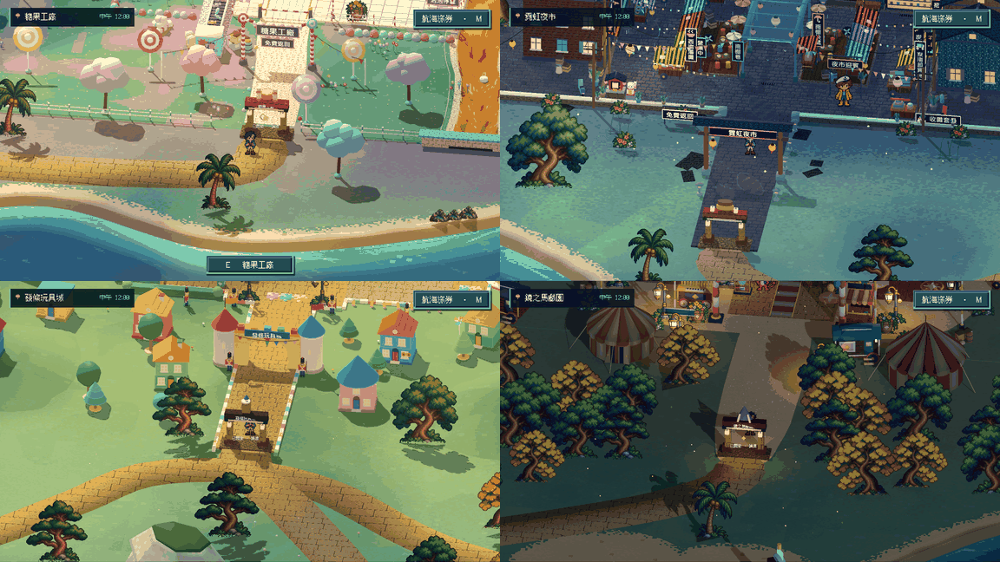

# [MAIN-56] 把主題區接成一張連續地圖

> 狀態：進行中

## 內文

### 需求

六個主題區是各自獨立載入的平台，從廣場邊的閘口瞬間切換。把它們接到同一座大島上，用走的就能到，相鄰區域之間有地面、植栽與光線的過渡帶，拍貼門檻改成路上的閘門。

### 來源

2026-11-27 使用者指出小島太小、東西太擠、形狀方正，希望像 Bomberman Land 3 一樣是一座大樂園：各種風格的區域融成同一張地圖，地圖上直接有互動與不用進關卡的小遊戲。規劃見 design/01-park/island-master-plan.md。

### 驗收條件

- [x] 從迎賓廣場可以一路步行到六個主題區，途中沒有切換畫面。
- [ ] 相鄰區域之間有至少十公尺的過渡帶，地面、植栽與道具逐漸變化，沒有筆直的分界。
- [x] 走進各區時天色、環境光與空氣粒子逐漸變成該區的樣子，離開時漸變回來。
- [x] 未達拍貼門檻的區域由路上的閘門擋住且看得到裡面，達到後永久打開。
- [x] 旅券地圖可快速移動到已開放的區域，存檔會記住玩家所在的區域與位置。
- [x] 遠處區域不更新也不佔用燈光預算；任何位置的節點與繪製數量都在預算內。
- [x] 各區原有的互動、小遊戲入口、劇情合照與存檔資料全部保留。

### 測試流程

1. 從碼頭依序步行經過六個主題區再回到廣場。
2. 在兩區交界來回走，觀察地面與光線的漸變。
3. 以未達門檻與已達門檻的存檔各測一次閘門，並重開遊戲確認位置。
4. 在各區量測節點數、繪製數與每幀成本。

---

# 跟其他票的關係

- Blocks：無
- Blocked by：MAIN-55
- Related：MAIN-24、MAIN-26、MAIN-37、MAIN-44、MAIN-45、MAIN-48、ART-43

---

# Commit-1

## 內文

原本六個主題區各是一塊獨立載入的平台，要從廣場邊的閘口瞬間切換過去，島上走不到。
現在六區都接在同一座大島上：潮汐碼頭在西南海灣、苔光溫室在東南、糖果工廠在東側半島、霓虹夜市在西北谷地、發條玩具城在正北丘上、鏡之馬戲團在東北林間，各有道路從廣場一路通過去。走近一區時，草地顏色、植栽、天色、環境光與空氣粒子在約十四公尺、邊緣不規則的過渡帶內逐漸變成該區的樣子，離開時再漸變回島上；夜市在谷地裡白天也保持夜色與霓虹光暈。拍貼門檻變成路上的鐵柵閘門，未達門檻時關著、從柵欄間看得到裡面，達到門檻時打開並慶祝，之後一直開著。旅券地圖與「返回迎賓大道」改成在同一張地圖上移動；存檔記住所在區域與位置，位置已不能站時改到該區入口，舊存檔也從該區入口開始。遠處的區域會休眠，不更新、不顯示、不佔燈；第一次走近時分十幾個畫面逐步建好，走路不會卡住。各區原有的互動、潮汐與渡船、溫度台、百葉窗、列車岔道、夜市營業燈、影子台、小遊戲入口與劇情合照都還在。
驗收方式：以方向鍵實際從碼頭走到六區再走回廣場，共約 1415 公尺，全程沒有切換畫面、沒有瞬移；六區在正午與夜晚，從島上道路、過渡帶與區內各截一張逐一檢視。

### 測試結果

| 項目 | 結果 |
|---|---|
| 主題區接島檢查（閘門、步行可達、各區機制、光線漸變、休眠、存檔位置與舊存檔） | 通過 |
| 區域移動、島嶼佈局、六區各自、日光、主程式整合、劇情合照與補拍 | 通過 |
| 實際步行：碼頭 → 六區 → 廣場 | 約 1415 公尺，無切換、單步最大 0.10 公尺 |
| 單一畫面繪製數（22 個位置，正午與夜晚） | 129 到 1465（上限 2200） |
| 同時亮燈 | 每個位置最多 8 盞 |
| 每區第一次建立 | 280 到 670 毫秒，分 10 到 16 個畫面，單一畫面最多 50 毫秒 |
| 節點數 | 島嶼本體約 2570；每區 126 到 221；六區全建好約 3770（含介面） |
| 幀率（原生視窗，同上 22 個位置） | 約 125 到 210 FPS |

### 尚未完成

- 過渡帶目前靠草地顏色與植栽漸變；島這一側還沒放各區風格的道具（例如積木邊石、糖果管線、燈串），部分區域自己的鋪面邊緣仍是直線，所以第二條驗收尚未勾選。

### 截圖

