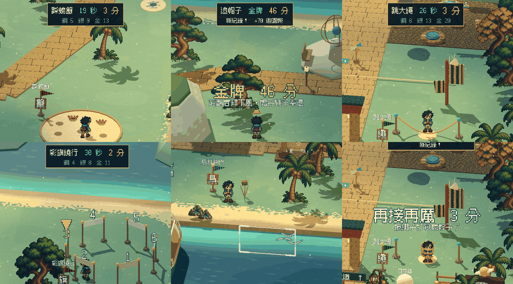

# [MAIN-57] 加入地圖上的即時小遊戲

> 狀態：完成

## 內文

### 需求

所有小遊戲都要走到攤位、看說明再切換畫面進關卡，地圖本身只有少數不計分的互動。加入直接在地圖上進行的即時小遊戲：走過去按一下就開始，用同一個鏡頭，十五到四十秒結束，並建立可以持續增加內容的共用流程。

### 來源

2026-11-27 使用者指出小島太小、東西太擠、形狀方正，希望像 Bomberman Land 3 一樣是一座大樂園：各種風格的區域融成同一張地圖，地圖上直接有互動與不用進關卡的小遊戲。規劃見 design/01-park/island-master-plan.md。

### 驗收條件

- [x] 地圖上至少有五個即時小遊戲，分屬至少四種不同的玩法類型。
- [x] 靠近時有一行提示，按下互動後三秒內開始，全程不切換畫面也不開啟說明頁。
- [x] 每個即時小遊戲只用移動與一到兩顆按鍵，十五到四十秒結束，可隨時走開中止。
- [x] 結束時在原地顯示分數與銅銀金，失敗有好笑的演出；最佳成績會保存，第一次達到各級時獲得遊園幣。
- [x] 另有至少六處不計分的小互動（搖樹、鞦韆、敲鐘之類），每種都有動態回應。
- [x] 新增一個即時小遊戲只需要一份設定與自己的玩法，不需要改動共用流程。
- [x] 原有的攤位小遊戲、拍貼門檻、任務與存檔不受影響；開啟減少動態後都可遊玩。

### 測試流程

1. 在迎賓區找到五個即時小遊戲各玩一次，其中一個故意失敗、一個中途走開。
2. 重開遊戲確認最佳成績與遊園幣保留。
3. 試六處不計分互動，並在減少動態下重玩一個即時小遊戲。

---

# 跟其他票的關係

- Blocks：無
- Blocked by：無
- Related：MAIN-21、MAIN-55、SG-66

---

# Commit-1

## 內文

地圖上原本只有踢球、敲鐘、水閘這類不計分的小東西，想玩有成績的遊戲一定要走到攤位、看說明、切換畫面。

現在迎賓區散布五個插著三角旗的立牌：踩螃蟹（岸邊沙坑）、追帽子（北側草地）、跳大繩（廣場旁）、彩旗繞行（東北角）、鳥群快門（碼頭邊）。走近出現一行提示，按下互動後原地倒數三下就開始，鏡頭不變，倒數時頭上只有一句「要做什麼」。畫面上方的小牌顯示剩餘秒數、分數與銅銀金目標；回合 25 到 35 秒，越到後面越快。結束時頭上顯示獎牌、分數和一句評語，立牌的三顆圓點記下最佳獎牌，第一次拿到銅、銀、金各得 10、20、40 遊園幣。失敗各有演出：螃蟹全體出洞揮螯、站著不動會被紅螃蟹夾得原地跳、被大繩纏成一捆、海鷗戴著帽子在頭上繞圈、太早按快門只拍到尾巴。走出場地或按選單鍵會直接結束且不留成績；其他面板開啟時計時暫停。

另有六處不計分的小互動：搖椰子樹掉椰子並驚起麻雀、推鞦韆、搖響許願風鈴、踩噴水洞被水柱頂起、依序踩會唱歌的踏石、在長椅旁停留等鴿子飛來。

新增一個即時小遊戲只要在位置設定表加一列並寫它自己的玩法；設定表會檢查編號不重複、兩款至少相隔 14 公尺、離既有互動點 4 公尺、所有位置都在可走範圍內。

以模擬玩家把五款各玩出金牌與較低獎牌，確認中途走開、暫停、減少動態、存檔重讀與存檔失敗時的行為；原生畫面逐款看過遊玩中與結算。玩家實際試玩的手感尚未驗證。

### 測試結果

| 項目 | 結果 |
|---|---|
| 即時小遊戲測試（共用流程、五款規則、六處互動、位置設定、存檔） | 通過 |
| 場景規範檢查、園區配置、環境生物、海岸與大道自由互動、主場景整合、介面外框等 19 組既有測試 | 通過 |
| 迎賓區場景節點 | 2251 → 2368（上限 2600） |
| 廣場視點繪製數 | 1690 → 1747（上限 2200） |
| 原生畫面 | 35 張，無 ERROR |

### 截圖

