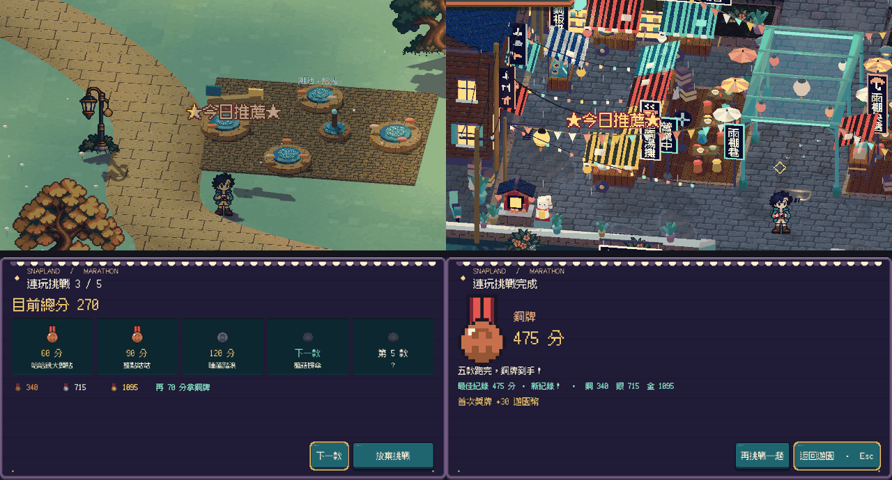

# [MAIN-58] 加入每日推薦攤位與連玩挑戰

> 狀態：完成

## 內文

### 需求

每次進入樂園都是同樣的攤位與同樣的獎勵，缺少「今天去哪玩」的理由。加入每日推薦攤位，以及把幾款小遊戲串成一趟的連玩挑戰，讓已玩過的內容也有新的玩法。

### 來源

2026-11-27 使用者要求在票做完後盤點還缺什麼，多新增多樣化、不會讓玩家厭倦或一直重複同一件事的內容。目前樂趣集中在「走到攤位玩一款」，樂園本身缺少變化；做法參考 design/00-principles/simple-fun-minigames.md「樂園層可借用的低成本做法」與 Bomberman Land 3 的園區事件。

### 驗收條件

- [x] 每天（依遊戲內日期）有三個推薦攤位，地圖與攤位旁有清楚標記，在推薦攤位拿到獎牌時遊園幣加倍。
- [x] 可以開始一趟連玩挑戰：隨機抽五款已開放的街機小遊戲，每款回合縮短，依總分給獎牌；中途可以放棄。
- [x] 連玩挑戰有自己的最佳紀錄，第一次達到各級獎牌時給一次性獎勵。
- [x] 推薦與挑戰的說明各只有一行，滑鼠提示只講重點。
- [x] 原有的拍貼、門檻、單款獎牌與存檔不受影響；舊存檔可正常載入。

### 測試流程

1. 連續兩個遊戲內日期查看推薦攤位是否不同。
2. 在推薦攤位拿到獎牌確認遊園幣加倍。
3. 完成一趟連玩挑戰、再中途放棄一趟，重開遊戲確認紀錄保留。

# Commit-1

## 內文

樂園每天都一樣，玩過的攤位沒有再回去的理由。
現在每天依當地日期挑出三個已開放的攤位當「今日推薦」（盡量來自三個不同園區，同一天重開遊戲結果不變）：島上攤位頭頂飄著「★今日推薦★」、地圖上的站點與園區入口掛星號、區域地圖的攤位加金圈與彩帶、旅券上一行列出攤名；在推薦攤位拿到獎牌時，獎牌遊園幣加倍，每級每天一次。
旅券新增「連玩挑戰」：隨機串起五款已開放的街機小遊戲，每款回合與獎牌線都減半，中間有一張小卡顯示每款分數、目前總分與距下一面獎牌還差幾分；五款結束看總分與獎牌，最佳紀錄保留，第一次拿到各級獎牌給遊園幣；比賽中或小卡上都能放棄，直接回到園區。連玩不發拍貼，拍貼仍只在各攤位取得。
原生畫面以真實按鍵玩完第一款、在小卡按 Enter 進第二款、再從暫停選單放棄，回到園區且挑戰清空；另以快轉跑完一整趟確認結算卡。

### 測試結果

| 項目 | 結果 |
|---|---|
| 推薦與連玩規則、加倍、存檔與主畫面流程（新測試） | 通過 |
| 街機基底與五款街機規則 | 通過 6 / 6 |
| 參與結算、區域進度、即時小遊戲獎牌 | 通過 3 / 3 |
| 主場景整合、島嶼入口、收藏與地圖介面、介面外殼、啟動 | 通過 6 / 6 |
| 執行 log | 無 ERROR |

### 截圖

---

# 跟其他票的關係

- Blocks：無
- Blocked by：無
- Related：MAIN-57、SG-66

---
