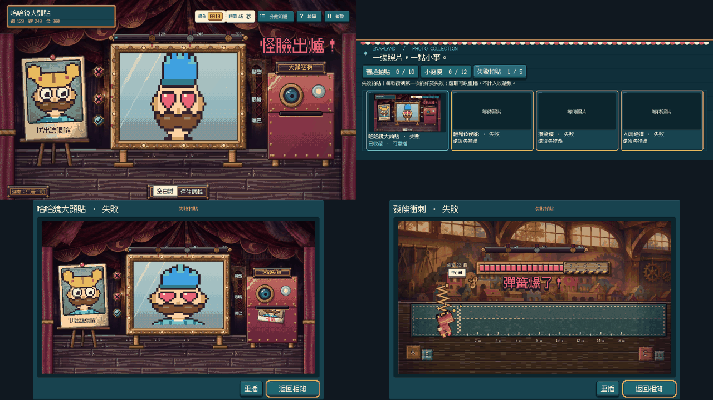

# [MAIN-59] 收藏好笑的失敗拍貼

> 狀態：完成

## 內文

### 需求

街機小遊戲失敗時會印出怪臉或糊掉的照片，但看完就消失了。讓這些失敗畫面也能收藏，把失敗變成值得一看的紀念，而不是只有扣分。

### 來源

2026-11-27 使用者要求在票做完後盤點還缺什麼，多新增多樣化、不會讓玩家厭倦或一直重複同一件事的內容。目前樂趣集中在「走到攤位玩一款」，樂園本身缺少變化；做法參考 design/00-principles/simple-fun-minigames.md「樂園層可借用的低成本做法」與 Bomberman Land 3 的園區事件。

### 驗收條件

- [x] 每款街機小遊戲的專屬失敗畫面第一次出現時，會存成一張失敗拍貼。
- [x] 收藏冊有失敗拍貼的分頁，可以翻看並重播該次的失敗演出。
- [x] 失敗拍貼不計入開區門檻與普通拍貼數量，也不佔用原有分頁。
- [x] 存檔大小增加有上限，舊存檔可正常載入。
- [x] 收藏冊分頁與按鈕符合既有介面風格，滑鼠提示一句話。

### 測試流程

1. 故意在兩款街機小遊戲失敗，確認各得到一張失敗拍貼。
2. 到收藏冊翻看並重播。
3. 重開遊戲確認保留，並確認開區門檻數字不變。

# Commit-1

## 內文

街機小遊戲失敗時的怪臉、撞門、彈簧爆炸等演出看完就消失，失敗只剩扣分。
現在每款街機小遊戲第一次出現專屬失敗演出時，會拍下當下畫面並記住那一刻的場景；收藏冊在有街機的園區多一個「失敗拍貼」分頁，依園區列出每款的失敗拍貼，選取後會在相框裡把那次失敗重新演一遍，可按「重播」再看。結算卡會提示「失敗拍貼入冊」。同一款之後再失敗不會覆蓋，練習回合與倒數示範不會留下；失敗拍貼不算進普通、小惡魔拍貼數量與開區門檻，存檔有張數與大小上限，舊存檔照常讀取。
原生畫面以真實按鍵在哈哈鏡大頭貼與發條衝刺各失敗一次，兩款都存下失敗拍貼；收藏冊分頁顯示 1 / 5，兩段重播都演出怪臉印出與彈簧爆開，普通拍貼數維持 30。

### 測試結果

| 項目 | 結果 |
|---|---|
| 失敗拍貼規則、每款一次、上限、分頁與重播（新測試） | 通過 |
| 十四款街機小遊戲與街機基底 | 通過 15 / 15 |
| 推薦與連玩、參與結算、區域進度、啟動 | 通過 4 / 4 |
| 收藏與地圖介面、旅行收藏冊、照片檢視 | 通過 3 / 3 |
| 執行 log | 無 ERROR |

### 截圖

---

# 跟其他票的關係

- Blocks：無
- Blocked by：無
- Related：SG-66、MAIN-7

---
