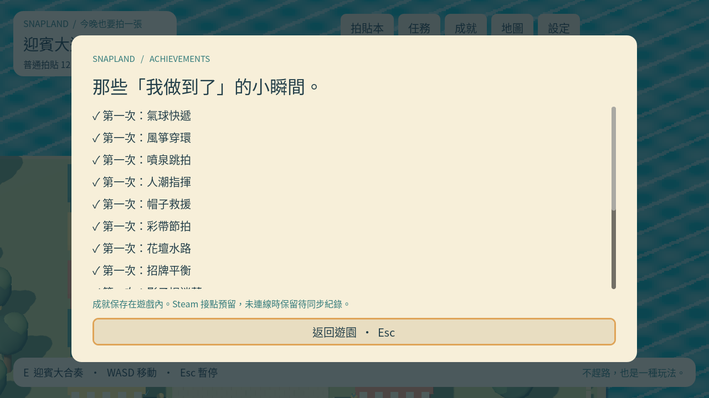

# [MAIN-5] 建立遊戲成就與平台接點

> 狀態：完成

## 內文

### 需求

各小遊戲、園區通關與小惡魔全集提供遊戲內成就，預留 Steam 接口。

### 來源

使用者於 2026-10-11（Asia/Taipei）要求從上島開始實作主區域、迎賓大道全部小遊戲及共用系統；其他園區先做路口。每項實作前研究業界實例並保存圖例；本票是可執行第一版，品質以實際驗收為準。

### 驗收條件

- [x] 迎賓十二款各有獨立成就、十二款通關與十二惡魔全集各有成就。
- [x] 成就保存且不重複授予；Steam 未連線仍能遊玩並保留待同步成果。

### 測試流程

1. 啟動遊戲，進入本票內容，依畫面提示實際操作。
2. 核對本票每項驗收條件，測試返回、重試、重開與輔助情境。
3. 保存原生畫面截圖與局部測試摘要；無法確認的項目保持未勾選。

---

# 跟其他票的關係

- Blocks：無
- Blocked by：MAIN-3
- Related：MAIN-1、SG-1、ST-1

---

## 開始基準

c1b7b19；feature/island-first-park。

# Commit-1

## 內文

問題：玩家尚無可保存的遊戲內成就。

改動：十二款首次完成、迎賓全通關、小惡魔全集有獨立成就，離線可記下待平台同步成果。

驗收：原生12款通關及12惡魔入檔；重複授予、重開保存及平台成功／失敗回饋局部測試通過。

分支：`feature/island-first-park`；開始基準：`c1b7b19`；[程式 commit](https://github.com/deadline314/Snapland/commit/f2d6b84919a91d534082660a12aec5a9b44eaa2c)。

### 測試結果

| 項目 | 結果 |
|---|---|
| 受影響局部驗證 | 本票相關runtime與主場景整合通過 |
| 原生畫面 | GPU擷取並查看；程式化操作驗收 |
| 遠端CI | 帳戶限制，工作未啟動；未重試 |

### 研究與圖例

[核心與成就研究](../../design/runtime/core-research.md)。圖例為審閱參考，不是本作遊戲素材或試玩證據。

### 截圖

[整組驗收、票況與存檔事故紀錄](../first-playable-delivery.md)。

# 2026-10-20 結案核對

重新核對本輪核心回歸：十二款個別成就、迎賓通關與惡魔全集、去重及平台成功／失敗回饋均通過。新程序重開仍保留ACH_GAME_001與待同步事件；成就列表三尺寸原生導覽已在ART-24重驗。這是遊戲內成就與平台接點，沒有Steam SDK實際上線／overlay／跨機同步認證；原票要求預留接口與離線保存已達成。

目前正式進度、交易與重整後介面已核對在main；不將無法解析的早期feature提交連結當合入證明。舊Windows圖與本輪Linux／llvmpipe證據分開；沒有新Windows EXE、真人試玩或聽感認證。

[六份比較、驗證流程與限制](../../design/runtime/progress-restart-verification.md) · [兩程序實際結果](images/MAIN-6-restart-20261020-verification.json) · [核心回歸](../Snapland-art/images/ART-23-verify-20261020-core-runtime-tests.log) · [衣櫃回歸](../Snapland-art/images/ART-23-verify-20261020-wardrobe-runtime-tests.log) · [設定／換裝三尺寸](../Snapland-art/images/ART-25-verify-20261020.json)。全域CI後段仍有其他票的角色素材缺口，本結案不等於全案綠燈。
