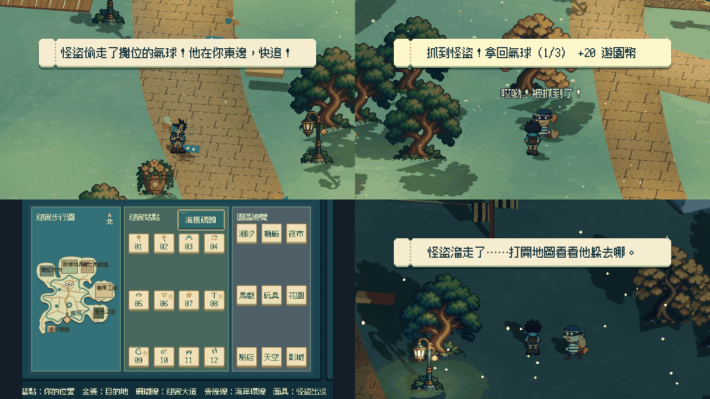

# [MAIN-60] 加入在園區巡遊的怪盜事件

> 狀態：完成

## 內文

### 需求

園區裡的角色都待在固定位置，走動時不會遇到意外。加入一位會在園區各處出沒的怪盜：偶爾偷走東西逃跑，玩家追上並抓到他三次可以拿到特別的紀念品，讓逛園區時有驚喜。

### 來源

2026-11-27 使用者要求在票做完後盤點還缺什麼，多新增多樣化、不會讓玩家厭倦或一直重複同一件事的內容。目前樂趣集中在「走到攤位玩一款」，樂園本身缺少變化；做法參考 design/00-principles/simple-fun-minigames.md「樂園層可借用的低成本做法」與 Bomberman Land 3 的園區事件。

### 驗收條件

- [x] 怪盜不定時在玩家附近出現，偷走一樣看得見的東西後逃跑，畫面有一行提示。
- [x] 追上並靠近按互動即可抓到；逃太遠會在別處再出現，地圖上顯示大約位置。
- [x] 抓到三次後得到一件只有這個事件能拿到的服裝或紀念章，並有短短的收場對話。
- [x] 事件不會在小遊戲、對話或選單中觸發，也不會擋住攤位與劇情；可以在設定中暫停出現。
- [x] 開啟減少動態後追逐仍可完成；進度保存，舊存檔可正常載入。

### 測試流程

1. 在園區閒逛直到怪盜出現，追上抓住一次。
2. 讓他逃走一次，確認他在別處再出現。
3. 抓滿三次拿到獎勵，重開遊戲確認保留。

---

# 跟其他票的關係

- Blocks：無
- Blocked by：無
- Related：MAIN-56、MAIN-57

---

# Commit-1

## 內文

園區裡的角色都待在原地，逛園區時不會遇到任何意外。
現在每逛幾分鐘，畫面外會冒出一位戴面具、披斗篷、扛著麻布袋的怪盜，偷走氣球、假人的帽子、碼頭的魚或棒棒糖招牌，伴隨音效與一行提示告訴玩家他在哪個方向。他會邊跑邊回頭吐舌、停下來挑釁；玩家落後太多時他會放慢等人，靠近後按互動就能抓到，每次給 20 遊園幣；追逐後段若直線衝過去，他會閃開一次。玩家走開超過約 35 公尺，他會一陣煙消失，之後躲到島上另一個地方，地圖上以面具與淡色圓圈標出大概位置。抓滿三次後有三句收場對話，並在成就的島嶼里程碑蓋上只有這個事件能拿到的「怪盜的面具」紀念章。
小遊戲、即時小遊戲、對話、選單、搭乘、移動轉場、劇情拍照與上島序章期間都不會出現或移動；不會站在攤位、劇情點與遊戲台旁，也不會進入閘門未開的主題區。設定的「遊玩方式與畫面」多了「怪盜出沒」開關可暫停出現；開啟減少動態時不跳躍、不閃避，照樣抓得到。抓到次數與紀念章會存檔，舊存檔照常載入。
原生畫面確認了怪盜出現時的提示、靠近抓到他時的暈眩姿勢與提示、讓他逃走後的提示，以及地圖上的面具標記；他和主角並排時身高與像素粗細相近，夜晚也受燈光影響。

### 測試結果

| 項目 | 結果 |
|---|---|
| 怪盜事件測試（出現條件、追逐與抓到、逃走後換地方、三次獎勵只給一次、設定暫停、舊存檔、節點數不變） | 通過 |
| 受影響的引擎測試（即時小遊戲、園區變化、島嶼佈局、區域移動、主場景整合、介面、場景規範、啟動） | 通過  13 / 13 |
| 資料驗證與 Python 測試 | 0 錯誤，217 / 217 |
| 島嶼世界節點數（怪盜出現、被抓、逃走前後） | 2578 → 2578 |

### 截圖

