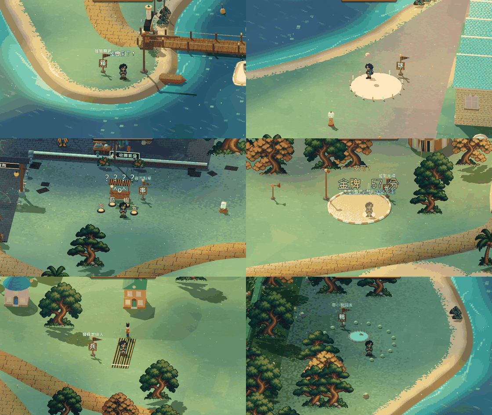

# [MAIN-61] 讓各主題區也有地圖上的即時小遊戲

> 狀態：進行中

## 內文

### 需求

不用進關卡的即時小遊戲只在迎賓區有。讓每個主題區至少有兩個符合該區主題的即時小遊戲與兩處小互動，走到哪裡都有可以順手玩的東西。

### 來源

2026-11-27 使用者要求在票做完後盤點還缺什麼，多新增多樣化、不會讓玩家厭倦或一直重複同一件事的內容。目前樂趣集中在「走到攤位玩一款」，樂園本身缺少變化；做法參考 design/00-principles/simple-fun-minigames.md「樂園層可借用的低成本做法」與 Bomberman Land 3 的園區事件。

### 驗收條件

- [ ] 潮汐碼頭、糖果工廠、霓虹夜市、鏡之馬戲團、發條玩具城、苔光溫室各有至少兩個即時小遊戲，玩法類型和迎賓區的五款不重複。
- [ ] 各區另有至少兩處不計分的小互動，每種都有動態回應。
- [ ] 沿用既有的即時小遊戲流程：靠近一行提示、三秒內開始、十五到四十秒結束、原地顯示分數與獎牌、最佳紀錄保存。
- [ ] 位置與該區的攤位、動線和劇情互動保持距離，可以走到。
- [ ] 各區節點與繪製數量在預算內；原有互動與存檔不受影響。

### 測試流程

1. 在每個主題區各玩一個即時小遊戲並拿到獎牌。
2. 試各區的小互動。
3. 重開遊戲確認最佳紀錄保留。

---

# 跟其他票的關係

- Blocks：無
- Blocked by：無
- Related：MAIN-57、MAIN-56

---

# Commit-1

## 內文

不用進關卡的即時小遊戲與小互動原本只在迎賓區，六個主題區走過去只有攤位可玩。
現在每個主題區各有兩款地圖上的即時小遊戲與兩處小互動，大多擺在主題區外圍的草地與沙灘上，和攤位、劇情互動、入口道路分開：
潮汐碼頭「接飛魚」（站上光圈接住跳上岸的魚，河豚別接）、「搖晃疊貨」（吊鉤擺到船上方時放貨，疊歪會整疊倒進海裡）；
糖果工廠「頂糖球」（跑到影子下把巨大糖球頂回天上）、「糖果分流」（站在左右踏板上，讓糖滾進同色桶，走錯會被噴回來）；
霓虹夜市「撈金魚」（沿著盆邊走，金魚游到網下時撈，紙網會破）、「夜市點單」（記住客人點的串，照順序踩烤盤）；
鏡之馬戲團「追聚光燈」（一直站在聚光燈裡，燈會越縮越小還會突然衝走）、「猜杯子」（盯住藏球的杯子，走過去掀開）；
發條玩具城「滾球打罐」（站到罐子正前方滾球，架子後來會左右滑）、「發條木頭人」（兵兵轉頭時不准動，被看到就跳到遠端）；
苔光溫室「澆花救急」（花垂頭時走過去澆水）、「帶小鴨回家」（碰到小鴨牠就跟在後面，帶進池塘）。
十二款的玩法和迎賓區五款都不同，流程完全沿用：靠近一行提示、按鍵後倒數不到三秒、回合十五到四十秒、原地顯示分數獎牌與一句評語、最佳紀錄與首次金幣存在同一份存檔。走出範圍、打開選單或主題區休眠都會結束回合，不記錄成績。
小互動有船鐘、蟹簍、糖球機、果凍、燈籠串、招財貓、驚喜盒、喇叭、陀螺、搖搖馬、蒲公英、向日葵，每種都有動作回應，減少動態時改成停住的姿勢，不影響存檔與金幣。
主題區在走近時才建立遊戲與小互動，遠離時一起休眠，主題區移除時互動點一起清掉；島上的樹木會讓出這些場地。

### 測試結果

| 項目 | 結果 |
|---|---|
| 主題區即時小遊戲測試（擺位、生命週期、十二款銅牌與金牌模擬、十二處小互動、節點穩定） | 通過 |
| 迎賓區即時小遊戲、主題區、島嶼佈局測試 | 通過 |
| 場景規範、各主題區世界、區域移動、環境動態、主場景整合、啟動測試 | 見下方 |
| 原生畫面實玩（各區一款） | 糖果、馬戲團、溫室金牌，玩具城銀牌，夜市銅牌，碼頭見下方 |
| 主題區節點（含小遊戲） | 187～329，預算 900 |
| 單一畫面繪製數 | 約 200～600，預算 2200 |

### 截圖

---
