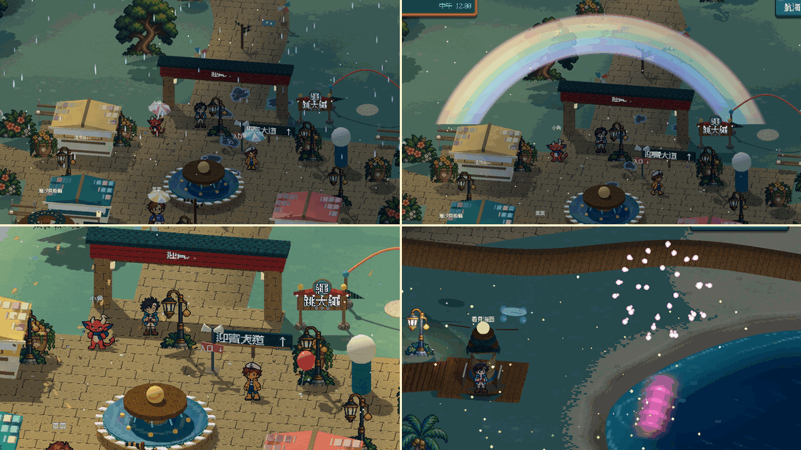

# [MAIN-62] 加入島上的天氣與傍晚事件

> 狀態：完成

## 內文

### 需求

島上每天的天氣與氣氛都一樣，走久了缺少意外。加入偶爾發生、看得到也玩得到的短事件，讓同一條路每次走都有點不同：午後陣雨（人群躲到屋簷下、地上積水可以踩出水花、雨停後出現彩虹可以拍照）、起風的下午（帽子、氣球、落葉被吹走，可以追回）、傍晚的海灣煙火（在指定觀景點按快門拍下最漂亮的一發）。

### 來源

2026-11-28 使用者要求盤點後多新增多樣化、不會讓人厭倦的內容。盤點時協作 session 列出「島上的天氣與時段事件」為尚無人負責的方向；參考 Bomberman Land 3 園區裡會不定時發生的小事件。

### 驗收條件

- [x] 至少三種事件：午後陣雨與雨後彩虹、起風追回被吹走的東西、傍晚海灣煙火；每種一到三分鐘，同一時間最多一種，兩次事件之間有足夠間隔，不會一直打斷遊玩。
- [x] 事件開始時有一行簡短提示與明顯的畫面變化；雨天的雨滴、積水、人群躲雨與雨後彩虹都看得到，煙火在夜空與海面都有反應。
- [x] 每種事件都有一個簡單的參與方式（踩水花、追回東西、拍到煙火），完成可得到一張不消耗的事件紀念拍貼；不參與也不會有任何損失。
- [x] 攤位、劇情互動、即玩小遊戲與怪盜在事件期間照常運作；進入小遊戲時事件暫停或結束，不會疊加音效與畫面。
- [x] 設定可關閉隨機事件；減少動態時雨滴、落葉與煙火改為低動態版本；畫質省電時粒子數量下降。
- [x] 事件只在玩家附近建立效果，結束後完全清除；節點、繪製與記憶體在預算內，切換時段與設定不會讓節點數持續增加。

### 測試流程

1. 用測試方式觸發三種事件，各自完整參與一次並取得紀念拍貼。
2. 事件進行中進入一款小遊戲再出來、打開選單、移到另一區。
3. 關閉隨機事件、開啟減少動態與省電畫質各看一次。

---

# 跟其他票的關係

- Blocks：無
- Blocked by：無
- Related：MAIN-60、MAIN-61、ART-39、ART-56

---

# Commit-1

## 內文

島上每天的天氣與氣氛都一樣，走久了沒有意外。
現在自由走動一陣子後，會依當下時段隨機發生一種島上事件，同一時間只有一種，結束後要再走好幾分鐘才會有下一個：
午後陣雨（凌晨、中午）：天色轉灰、鏡頭附近下雨，腳邊冒出幾灘積水，踩過會濺起水花並響起逐次升高的音；附近的島民撐起傘躲雨；雨停後天邊升起彩虹，踩滿三朵水花再拍下彩虹就得到紀念拍貼。
追風氣球（中午、傍晚）：一陣強風吹起落葉、草木搖得更厲害，一顆氣球從身邊被吹走，25 秒內追上碰到它就抓回；沒追上氣球會越飛越高，主角揮手道別，再來一陣風給第二次機會。
海灣煙火（傍晚、晚上）：提示到海風觀景台（地圖上以星星標示），煙火從潟湖升空開花，水面映出煙火的顏色、島上的光隨每一發閃動，傍晚時燈光會先暗下來；在觀景台於煙火開到最大時按 E 或 P 拍照，越接近最大越高分並保留最佳成績，拍到 60 分以上得到紀念拍貼。
三張紀念拍貼收在收藏簿「四時與事件」頁，只給一次、不消耗，也不算進遊戲拍貼數與開區門檻；不參與不會有任何損失。
打開選單、進入街機或即玩小遊戲時事件暫停並隱藏，回來後接著進行；切換到不屬於該事件的時段或在設定關閉「隨機事件」會立即結束。減少動態時不下雨滴、不飄落葉、不閃光，煙火改為緩慢亮起再淡去；畫質「省電」時雨滴與煙火火花減少。
以測試方式觸發三種事件各完整參與一次並取得紀念拍貼，另驗證選單與小遊戲暫停、設定開關、減少動態與省電畫質；每次事件結束後場景節點數回到原值。原生截圖檢查了中午廣場的雨、積水、撐傘與彩虹、起風的氣球，以及傍晚與晚上觀景台的煙火。這些是畫面與自動測試的確認，不是實際試玩。

### 測試結果

| 項目 | 結果 |
|---|---|
| 島上事件測試 | 通過 |
| 環境動態、怪盜、即玩小遊戲、主題區即玩小遊戲、島嶼佈局、主場景整合、場景規範、遊戲啟動 | 通過 |
| 收藏簿、像素介面收藏與設定、畫質、碼頭收藏（收藏簿時光頁改為七格並逐頁檢查） | 通過 |
| Python 單元測試 | 通過 217 / 217 |
| 資料驗證 | 0 錯誤 |
| 廣場繪製數（中午，平常 → 下雨 → 彩虹） | 942 → 950 → 949 |
| 觀景台繪製數（傍晚，平常 → 煙火） | 256 → 262 |
| 事件期間新增節點（陣雨／起風／煙火），結束後 | 13／7／4，回到原值 |

### 截圖

