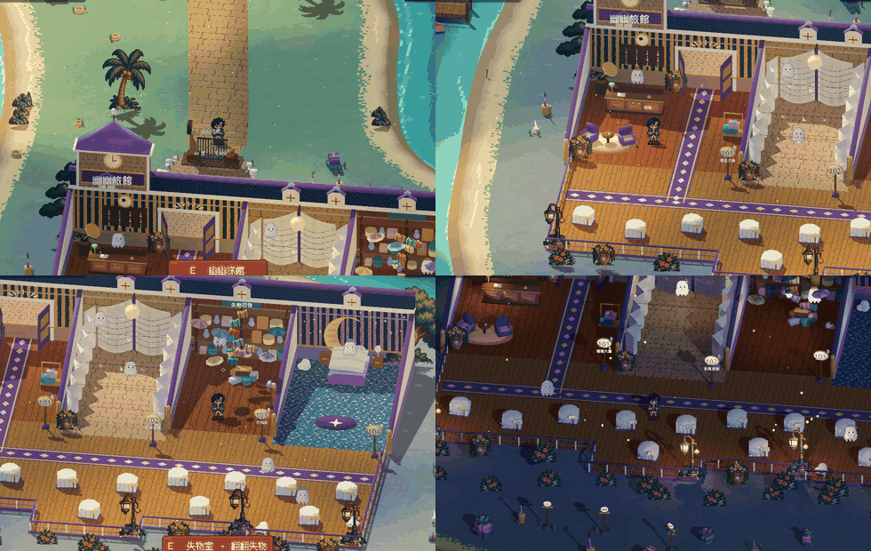

# [MAIN-63] 在大島上建造幽幽旅館主題區

> 狀態：完成

## 內文

### 需求

六個主題區都已接上大島，第三組區域（幽幽旅館、雲端遊樂場、星光影城）仍只有預留位置。先建幽幽旅館：在西堤南端長出一塊和大島相連的區域，有櫃檯大廳、折頁走廊、失物室與夢境客房四個區塊，主題是聲音、夢境與友善的鬼，從島上走過去就能進入，地面、植栽、光線與空氣逐漸轉換。區內預留十二個小遊戲攤位位置，之後的小遊戲票直接放進去。

### 來源

2026-11-28 使用者要求盤點後多新增多樣化的內容；協作 session 盤點時列出「尚未建造的旅館、天空、影城三區」為無人負責的方向。區域設定見 design/01-park/park.json 與 park-and-collection.md（幽幽旅館：櫃檯→門牌錨點→折頁走廊→夢境房，收藏 60 開放），位置見 island-master-plan.md（西堤南端，接海岸環線）。

### 驗收條件

- [x] 從迎賓區沿海岸環線可一路走到幽幽旅館，不切換場景；交界處有混合兩邊風格的過渡帶，沒有筆直的分界。
- [x] 收藏未達 60 時，入口是看得到裡面的柵門並顯示還差幾張；達到後永久開放，地圖、快速移動與區域名稱都包含旅館。
- [x] 區內有櫃檯大廳、折頁走廊、失物室、夢境客房四個可走的區塊，每個區塊有一眼認得出的地標；門牌有固定位置可當路標。
- [x] 風格是可愛、不嚇人的旅館與夢境：友善的小鬼、發光的門牌、會飄的行李與床單，有白天與夜晚的光線變化，符合場景搭建規範（無平色塊、影子正確、不漂浮）。
- [x] 預留十二個小遊戲攤位位置，分在四個區塊，彼此與道路、地標保持距離；尚未有遊戲的位置顯示「準備中」的告示，不能互動。
- [x] 區域在走近時才建立、遠離時休眠；節點與繪製數量在預算內，場景規範檢查沒有新增違規；其他六區與迎賓區不受影響。

### 測試流程

1. 用收藏不足與足夠的兩份測試存檔，從迎賓區走到旅館入口，各看一次柵門。
2. 進入後走過四個區塊，白天與夜晚各看一次，打開地圖與快速移動。
3. 往返迎賓區與其他主題區，確認休眠與重建正常。

---

# 跟其他票的關係

- Blocks：幽幽旅館的十二款小遊戲票（另開）
- Blocked by：無
- Related：MAIN-55、MAIN-56、MAIN-61

---

# Commit-1

## 內文

第三組區域只有預留位置，西堤南端只有一座寫著「準備中」的閘門，走過去什麼都沒有。
現在西堤往南長出一條旅館堤道，從海岸環線一路走到幽幽旅館的大門，不切換場景；堤道兩側的草地逐漸染上淡紫，散落行李箱、傘桶、紙鶴和會發光的房號小柱，和潮汐碼頭的木箱、繩圈交錯在一起，沒有筆直的分界。收藏未滿 60 張時，大門是一道看得進去的柵門，牌子寫著門檻，按下去會說還差幾張；滿 60 張後柵門打開並永久開放，島嶼地圖、快速移動與區域名稱都有幽幽旅館，旅館裡也有自己的平面圖和免費返回。
旅館是一棟剖開的海邊旅館：四間房並排朝南開向長長的外廊。櫃檯大廳有服務鈴、鑰匙牆、留聲機和鐘樓，按鈴時戴帽子的櫃檯小鬼會探出頭；折頁走廊兩側是像書頁一樣折起的紙牆，盡頭立著一本打開的大書和紙月亮燈，走過時紙牆會沙沙晃動；失物室的行李箱從地上的一堆盤旋飄上去，上方飄著幾把打開的傘；夢境客房有新月床頭、星星壁紙，床單和枕頭飄在床上方，戴睡帽的小鬼在上面睡覺。每間房前有固定位置、會發光的房號牌（101 到 104）。七隻友善的小鬼在各處飄，好奇的會飄到你身邊揮手。白天是淡紫色的薄霧，夜晚是靛藍色，外廊路燈、房裡的燈和星星會亮起來。
外廊預留十二個攤位位置，每區三個，彼此與通道、房號牌、路燈和互動點保持距離；沒有遊戲的位置是一個蓋著布、閉著眼睛打瞌睡的箱子，旁邊插著「準備中」的牌子，不能互動。
旅館在走近時才分幾個畫面建立，走遠後休眠；從碼頭出生點與廣場都不會預先建立。

### 測試結果

| 項目 | 結果 |
|---|---|
| 旅館區域檢查（房間、地標、攤位位置、小鬼、步行路線、平面圖） | 通過 |
| 島嶼佈局、主題區（建立、閘門、步行可達、光線混合、休眠） | 通過 |
| 區域移動、旅券地圖與收藏冊、主場景整合、遊戲啟動 | 通過 |
| 六個主題區各自的區域檢查、區域即時小遊戲、夜市、環境動態 | 通過 |
| 場景規範檢查（八個區域） | 旅館 0 違規，其他區域未增加 |
| 設計資料驗證、單元測試 | 通過 |
| 節點與繪製數（原生截圖） | 旅館 239 個節點；旅館內單一畫面最多約 480 次繪製 |
| 建立時間 | 分 12 個畫面建立，單一畫面最長約 26 毫秒 |

以上是自動檢查與原生截圖，不是實際遊玩。

### 截圖

