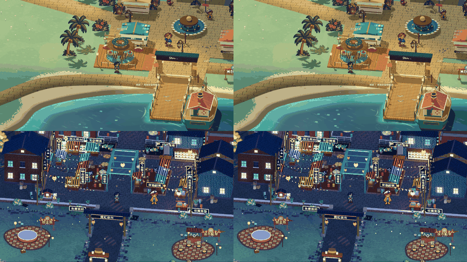

# [MAIN-64] 整座島的效能與記憶體整理

> 狀態：完成

## 內文

### 需求

大島最近長得很快：七個主題區、區與區之間的過渡帶、地圖上的即時小遊戲、到處跑的怪盜、天氣與煙火事件，之後還有旅館區。擁有者要求一開始就維持好的效能與低記憶體。實際量測整座島，找出最花成本的部分並修掉，最高畫質看起來不能變差，並留下便宜的檢查，避免數字之後又慢慢長回去。

### 來源

2026-11-28 協作 session 盤點島上新增內容後提出；擁有者要求效能良好、記憶體低。

### 驗收條件

- [x] 在真實顯示卡上，於全島約八個固定鏡頭位置、中午與晚上、三種畫質（高、平衡、省電）量測每幀時間、繪製次數、節點數、顯示記憶體與靜態記憶體，另量天氣事件與煙火的額外成本。
- [x] 依量測結果先修掉最大的成本來源，高畫質下畫面沒有可見的退步。
- [x] 在既有測試裡加入每區節點數與繪製次數的預算檢查，超出就失敗。
- [x] 票上記錄修改前後的數字對照表與一張截圖。
- [x] 反覆開關島嶼地圖、主題區地圖、設定、衣櫃、時段與成就六個面板，貼圖記憶體在最初幾輪之後維持平穩，並有測試防止回升。

### 測試流程

1. 一次只跑一個原生量測，視窗在螢幕外、低優先權、獨立存檔。
2. 修改後重跑同一組量測並對照。
3. 依序跑大島、主題區、場景規範、區域移動、畫質與遊戲啟動測試。
4. 先讓島閒置兩分鐘，再反覆開關六個面板十輪，記錄每輪的貼圖記憶體。

---

# 跟其他票的關係

- Blocks：無
- Blocked by：無
- Related：MAIN-56、MAIN-62、MAIN-63

---

# Commit-1

## 內文

在 RX 9070 XT 上，以 `game/tests/native_island_perf_probe.tscn`（螢幕外、低優先權、獨立存檔）量全島八個鏡頭點（歡迎區旋轉木馬、溫室步道、港口、夜市、玩具鎮、馬戲團、糖果工廠、溫室），中午與晚上，高、平衡、省電三種畫質；七區全部建好後量測。量測時旅館區尚未合併。

最大的成本是記憶體，不是畫面：
- 合併網格的 SceneryKit 雕刻在送出網格後仍留著整個 SurfaceTool，每個頂點約 270 位元組，六區共多佔 129 MB。改為送出後丟掉工具，六區從 194 MB 降到 65 MB。
- 主角的兩張斜向頭髮與帽子整張圖切完區塊後沒有再用，卻一直留在記憶體（12 MB），改為只留切好的區塊。

繪製次數約六成來自太陽陰影。高畫質不變；平衡與省電讓 1.2 公尺以下的小道具不投影、太陽陰影改兩段，切回高畫質會完整恢復。人物的陰影替身不受影響。

天氣事件與煙火本來就便宜，不需要修改：陣雨多 13 個節點、8 次繪製；強風多 7 個節點、5 次繪製；煙火多 4 個節點、1 次繪製；結束後全部歸零。

| 項目 | 修改前 | 修改後 |
|---|---|---|
| 靜態記憶體，啟動時 | 349 MB | 337 MB |
| 靜態記憶體，七區全建 | 556 MB | 414 MB |
| 顯示記憶體，高畫質中午／晚上 | 420／453 MB | 不變 |
| 節點數，全島 | 4429 | 4429 |
| 高畫質繪製次數，最多（中午／晚上） | 921／1425 | 不變 |
| 平衡繪製次數，最多（中午／晚上） | 921／1338 | 667／667 |
| 平衡繪製次數，平均（中午／晚上） | 443／653 | 350／397 |
| 省電繪製次數，最多（中午／晚上） | 918／1228 | 664／666 |
| 平衡三角形，最多（中午／晚上） | 43 萬／73 萬 | 32 萬／52 萬 |
| 投影物件，平衡與省電 | 1538 | 965 |
| 每幀時間，各畫質平均 | 1.5–1.8 ms | 1.5–1.7 ms |
| GPU 時間，最多 | 0.62 ms | 0.63 ms |

這張顯示卡上每幀時間本來就很低，所以繪製次數的改善主要是給較弱的電腦。

尚未處理的大項，留作後續：
- 角色圖集在 CPU 端還留著約 125 MB：主角組合圖 73 MB、NPC 動畫原圖 52 MB。要改成只留用到的區塊，需要整理角色管線與它的像素雜湊測試，牽涉範圍大，另開票處理。
- 世界建好後第一批畫面另外多出約 85 MB，推測是著色器管線，還沒有細分。

防止數字回升：區域測試加入每區預算（節點、繪製物件、投影物件、合併頂點），以今天的數字加約 15%；沒有自己那一列的新區（旅館、空中公園）用預設值。另外檢查雕刻送出網格後不再留著頂點。畫質測試檢查省電會關掉小道具投影、改兩段太陽陰影，切回高畫質會完整恢復。

驗證：區域、畫質、場景規範、區域移動、島上事件、島嶼路線與遊戲啟動測試逐一以 `--timeout-scale 3` 執行並通過。島嶼形狀測試在合併旅館區之前通過；合併後有一項岸邊距離檢查失敗（0.27 公尺，上限 0.25），與本票無關。截圖左邊是修改前、右邊是修改後，都是高畫質，中午與晚上看起來相同。這是畫面與數據檢查，不代表實際試玩。

---

# Commit-2

## 內文

協作 session 回報：每開關一輪六個面板（島嶼地圖、主題區地圖、設定、衣櫃、時段、成就），貼圖記憶體約多 13 MB。

在真實顯示卡上以 `game/tests/native_panel_texture_probe.tscn` 重量（螢幕外、獨立存檔），結果不是洩漏，而是兩種會停下來的暖機：

- 島嶼本身在開始後的前 90 秒，貼圖記憶體會多約 88 MB（人物動作圖第一次畫出來等），之後就不再增加。面板輪次如果剛好排在這段時間，看起來就像是每輪都在漲。
- 面板文字使用 12 px 像素中文字型的 39 種字級，每個字級的字第一次出現時會放進字型圖集。圖集從第一輪後的 41 MB 長到第三輪的 55 MB，就不再增加。主題區地圖前兩次打開時各多約 10 MB，也是這個原因。共用的像素貼圖快取一直是 15 筆，沒有增加。

| 項目（先閒置 120 秒，每個面板開 1.5 秒、關 0.5 秒） | 數值 |
|---|---|
| 第 0 輪（第一次開六個面板） | +29 MB |
| 第 1 輪 | +10 MB |
| 第 2 輪 | +4 MB |
| 第 3 到第 9 輪 | 每輪 0 MB，維持 342.17 MB |
| 快速開關十輪（閒置之後） | 每輪 0 MB，維持 322.55 MB |
| 像素字型圖集 | 41 → 51 → 55 MB，之後不變 |
| 共用像素貼圖快取 | 每輪都是 15 筆 |

因為沒有洩漏，程式不需要修改。之後可以考慮減少：介面用到 39 種像素字型字級，收斂成少數幾種，可以省下大部分約 55 MB 的字型圖集。這會改變文字外觀，屬於美術決定，另開票處理。

防止回升：新增「面板輪次測試」（無畫面執行），開關六個面板六輪，比較第一輪之後的節點數、物件數與像素快取。島嶼在這段時間會暫停，因為它本身會依時間產生物件，只有面板能改變這些數字。暫停後六輪的物件數完全相同。另外確認過：每次打開設定時多留下一張貼圖，測試就會失敗。無畫面執行讀不到貼圖記憶體，所以真實的記憶體數字由原生量測取得。

驗證：面板輪次、區域、畫質、場景規範與遊戲啟動測試逐一以 `--timeout-scale 3` 執行並通過。當時另一個 session 有八個 Godot 行程同時在跑，測試以低優先權執行時，乾淨匯入一直逾時，所以改用 `SNAPLAND_TEST_PRIORITY=normal`。
