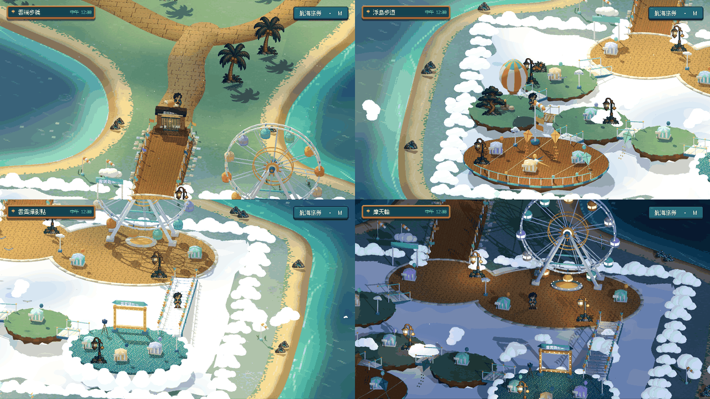

# [MAIN-65] 在大島上建造雲端遊樂場主題區

> 狀態：完成

## 內文

### 需求

幽幽旅館已接上大島，第三組區域還剩雲端遊樂場與星光影城。建造雲端遊樂場：在東堤南端長出一塊和大島相連的區域，主題是高低差、風與動量，有摩天輪、浮島步道、風箏台與雲霄攝影點四個區塊。從島上走過去就能進入，地面、植栽、光線與空氣逐漸轉換；區內預留十二個小遊戲攤位位置，之後的小遊戲票直接放進去。

### 來源

2026-11-28 使用者要求多新增多樣化的內容；MAIN-63 完成旅館後接著建第三組的第二區。設定見 design/01-park/park.json（雲端遊樂場：摩天輪、浮島步道、風箏台、雲霄攝影點；風旗預告、跳躍捷徑都有安全繞路、失足回平台不扣費），位置見 island-master-plan.md（東堤南端，接海岸環線）。

### 驗收條件

- [x] 從迎賓區沿海岸環線可一路走到雲端遊樂場，不切換場景；交界處有混合兩邊風格的過渡帶，沒有筆直的分界。
- [x] 收藏未達 60 時入口是看得到裡面的柵門並顯示還差幾張；達到後永久開放，地圖、快速移動、區域名稱與收藏冊都包含雲端遊樂場。
- [x] 區內有摩天輪、浮島步道、風箏台、雲霄攝影點四個可走的區塊，每個有一眼認得出的地標；有高低差的步道與台階，失足或走錯會安全回到平台，不需要跳躍也能走遍。
- [x] 有風的感覺：風旗與風箏隨風擺動並預告風向，雲朵在腳下與身邊飄過，摩天輪緩慢轉動；白天與夜晚光線不同，符合場景搭建規範（無平色塊、影子正確、不漂浮）。
- [x] 預留十二個小遊戲攤位位置，分在四個區塊，彼此與道路、地標保持距離；尚未有遊戲的位置顯示「準備中」，不能互動。
- [x] 區域走近時才建立、遠離時休眠；節點與繪製數量在預算內，場景規範沒有新增違規；其他區域不受影響。

### 測試流程

1. 用收藏不足與足夠的兩份測試存檔，從迎賓區走到入口，各看一次柵門。
2. 進入後走過四個區塊，白天與夜晚各看一次，打開地圖與快速移動。
3. 往返迎賓區、旅館與其他主題區，確認休眠與重建正常。

---

# 跟其他票的關係

- Blocks：雲端遊樂場的十二款小遊戲票（另開）
- Blocked by：無
- Related：MAIN-56、MAIN-63、MAIN-64

---

# Commit-1

## 內文

東堤南端只有一座寫著「準備中」的閘門，再往南就是海，第三組區域只剩旅館一區可以去。
現在東堤往南長出一座半島，海岸環線分出一條雲端步橋，一路走到雲端遊樂場，不切換場景；步橋接近時草地漸漸染上淡藍，散落著飄落在草上的小雲朵、指著風向的風向袋、風車和插在地上的小風箏，雲海邊緣是一圈蓬鬆的雲堤，半壓在草地上，沒有筆直的分界。收藏未滿 60 張時入口是看得進去的柵門並顯示還差幾張，滿 60 張後永久打開；島嶼地圖、快速移動、區域名稱與收藏冊都有雲端遊樂場，區內有自己的平面圖和免費返回。
整區浮在一片緩緩流動的雲海上，四個區塊各有地標：摩天輪廣場的白色摩天輪慢慢轉，彩色車廂一直保持水平，推一下會轉快、車廂晃起來；浮島步道是幾座底下垂著泥土與岩石、包著雲朵的草地浮島，用石階斜坡和繩橋相連，最大的那座綁著一顆條紋熱氣球；風箏台是木頭平台，中央立著掛風向袋與三面旗的旗桿，地板嵌著指向下風處的風向盤，南側欄杆放出四只風箏；最高的雲霄攝影點是一座雲朵堆成的平台，上面立著鑲燈泡的金色大相框和腳架相機，一條長長的雲梯掛著三角旗一路走回摩天輪。平台高度共六層，全部用斜坡與台階相連，不需要跳躍；走到平台邊緣會被擋住並冒出一小團雲，萬一站到平台外會回到最後站穩的位置。
所有旗子和風向袋都朝風吹去的方向，隨著全島同一陣風擺得更用力，風箏在線上隨風飄；雲朵在步道下方與身邊飄過，飄到人身邊會變淡，不會擋住人。白天是明亮的淡藍空氣，夜晚是深藍色，摩天輪的燈泡、車廂窗戶、相框燈泡與路燈亮起。
區內預留十二個攤位位置，每個區塊三個，彼此與步道、地標、路燈和互動點保持距離；尚未有遊戲的位置是一個罩著條紋帆布、綁著氣球的箱子，插著「準備中」的牌子，不能互動。
半島沙灘上的潮池石由雲端遊樂場自己佈置、跟著它休眠，大島不再在那一帶另放石頭與樹；島上散落的海草改成一次繪製，大島本身的節點數比加入前更少。走近時才分幾個畫面建立，遠離後休眠。

### 測試結果

| 項目 | 結果 |
|---|---|
| 雲端遊樂場區域檢查（平台與斜坡、邊緣接住、攤位位置、風與摩天輪、步行路線、平面圖） | 通過 |
| 島嶼佈局、主題區（建立、閘門、步行可達、光線混合、休眠） | 通過 |
| 區域移動、旅券地圖與收藏冊、主場景整合、遊戲啟動、區域進度 | 通過 |
| 六個主題區與旅館各自的區域檢查、區域即時小遊戲、環境動態 | 通過 |
| 場景規範檢查（九個區域） | 雲端遊樂場 0 違規，其他區域未增加 |
| 設計資料驗證、單元測試 | 通過 |
| 節點數 | 雲端遊樂場 187 個；大島本體 2628 個（加入前 2636） |
| 繪製數（原生截圖） | 區內單一畫面 147 到 628 次（含大島與醒著的旅館） |
| 建立時間 | 分 12 個畫面建立，單一畫面最長約 65 毫秒 |

以上是自動檢查與原生截圖，不是實際遊玩。

### 截圖

