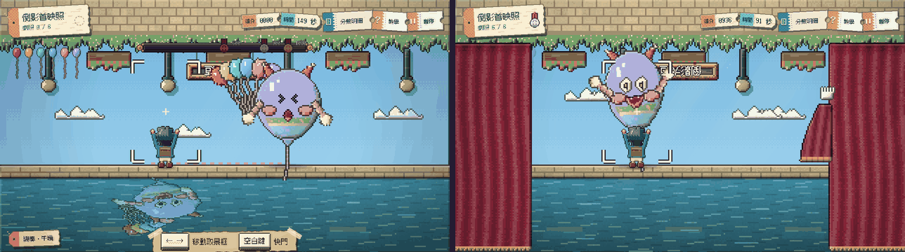

# [MAIN-66] 開放倒影大道與壓軸劇照

> 狀態：完成

## 內文

### 需求
迎賓大道的十二張小惡魔拍貼收齊後，應能進入該區的異空間「倒影大道」，並玩到看守演員倒倒的壓軸劇照：一場 2 到 3 分鐘、預告清楚、失敗好笑、動作流暢的頭目式演出。壓軸不是小遊戲，不計入 128 款，也不發收藏卡。

### 來源
2026-11-28 主持對話交辦異空間設計；規格見 `design/01-park/other-space.md` 第 3、5、6 節。

### 驗收條件
- [x] 十二張迎賓小惡魔拍貼未齊時，入口顯示還差幾張與缺少的設施；收齊後可進入
- [x] 入口與壓軸中任何時候都能退出回原區
- [x] 壓軸分三幕，倒影比本體先做出下一招與亮相位置，第三幕倒影左右顛倒
- [x] 每招都有預備與收招；被打中只讓相機暫時不能拍，不扣血、不結束
- [x] 亮相時把倒倒拍進取景框可拍下一張劇照，六張完成謝幕
- [x] 時間到未完成時，倒倒反拿相機自拍玩家的狼狽模樣，收進相簿
- [x] 首次完成把最佳劇照收進相簿的後台劇照，並給獎勵（獨立異空間貨幣上線前先發遊園幣）；不增加任何收藏分母
- [x] 模擬輸入可完成謝幕；不按任何鍵一定不會完成；減少動態與無畫面環境可執行
- [x] 遊戲數量、收藏數量與資料驗證不變

### 測試流程
1. 以測試存檔收齊迎賓十二張小惡魔拍貼後走到入口
2. 進入倒影大道，開始壓軸，依倒影預告移動並在亮相時拍照
3. 預期六張劇照後謝幕，相簿出現後台劇照；另一輪放著不玩，預期時間到後出現失敗自拍

---

# 跟其他票的關係

- Blocks：無
- Blocked by：ART-65
- Related：ART-65

---

# Commit-1

## 內文

迎賓大道的倒影大道入口原本只是一塊「正在準備」的告示，收齊十二張小惡魔拍貼也進不去。
現在門口會說還差幾張、哪幾個設施還沒有小惡魔；收齊後可直接進入或選輔助進入（倒影提早更多、亮相更久）。門後是倒過來的迎賓大道：招牌、路燈和花壇從天上吊下來，倒倒浮在倒過來的天空，主角拿著取景框站在噴泉邊。噴泉的倒影比倒倒早一步做出下一招，倒影先亮金光的位置就是倒倒等一下亮相的位置。招式有吹氣衝刺（鼓腮壓扁蓄力，池邊先標出衝刺路線）與彩紙雨（池面先起漣漪標出落點）；被撞到只會讓主角轉圈、相機暫時不能拍，被彩紙糊住鏡頭時左右晃兩下就擦乾淨。亮相時把倒倒框進取景框按快門就拍下一張劇照，倒倒害羞地飄走一顆劇團氣球；第二幕加入彩紙，第三幕倒倒跳進水裡，倒影改成左右顛倒。六張拍完帷幕半合謝幕，幕邊露出一角披風和白手套；時間用完則帷幕落下，倒倒拿走相機自拍一張主角滿頭彩紙的拍立得。
首次謝幕的劇照與倒倒的自拍都收進相簿小惡魔頁的最後（只在拿到後出現），首次謝幕給 80 遊園幣、之後每次 30 並記錄最佳分數；普通拍貼、小惡魔拍貼與開區門檻的數字都不變，壓軸不在小遊戲清單裡。離開沿用小遊戲暫停選單的離開。
在真實遊戲畫面上，以讀倒影的自動操作從入口走完整場（十一張時門不開、十二張時進入、三幕、謝幕、結算、相簿第四頁出現劇照），再放著不玩一輪確認以自拍收場；逐張看過截圖與衝刺的十二格連續畫面。

### 測試結果

| 項目 | 結果 |
|---|---|
| 壓軸規則（讀倒影的模擬操作三個種子含輔助都能謝幕、五十個種子不操作都不會完成且以自拍收場、倒影領先與第三幕鏡像、衝刺卡相機、彩紙擦鏡、未謝幕無獎牌、獎勵不動收藏數、無畫面與減少動態） | 通過 |
| 相簿與收藏頁（小惡魔頁維持十二張與穩定編號、翻頁） | 通過 |
| 街機共用流程 | 通過 |
| 場景檢查（八個區域） | 通過，違規數未增加 |
| 設計資料驗證 | 5 範圍通過 |
| Python 單元測試 | 217 / 217 |
| 原生整場（入口、三幕、謝幕劇照、相簿、自拍） | 通過，無 ERROR |

### 截圖

# Commit-2

## 內文

驗收時指出壓軸舞台太單薄：平塗的天空、幾朵小雲和一條磚帶，看不出是「鏡子裡的迎賓大道」。
現在天空是由深藍、天藍到暖色霧氣的漸層，太陽低低地停在水面上方；遠方的大道倒掛在頂上，有屋頂、倒過來的迎賓拱門、棕櫚與路燈的剪影，下緣映著池水的亮光；雲分遠近兩層，以不同速度飄。水池有兩層交錯滑動的光紋與陽光下的閃光。池邊坐著一排觀眾剪影，平時輕輕晃動，拍到劇照時跳起來，拍得好時舉手並冒出星星，被撞時縮一下，謝幕時站起來歡呼。減少動態時光紋、閃光、雲與觀眾都靜止。
在真實遊戲畫面上重跑整場（入口、三幕、謝幕、相簿、自拍），逐張看過截圖。

### 測試結果

| 項目 | 結果 |
|---|---|
| 壓軸規則（含無畫面與減少動態） | 通過 |
| 場景檢查（八個區域） | 通過，違規數未增加 |
| 設計資料驗證 | 5 範圍通過 |
| 原生整場 | 通過，無 ERROR |

### 截圖

