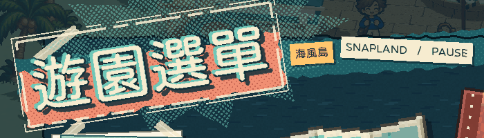

# [MAIN-67] 修正選單開關造成的顯示記憶體成長

> 狀態：完成

## 內文

### 需求

反覆打開與關閉暫停選單或其他面板時，顯示記憶體一直上升（五次開關由 334 MB 漲到 373 MB），節點數卻不變，代表有圖像資源每次重新產生而沒有釋放或重複使用。玩久了會越用越多記憶體。找出原因修掉，讓開關多少次記憶體都持平。

### 來源

2026-11-28 ART-62 與 ART-63 的量測都發現這個現象（改動前就存在）；使用者要求低記憶體，電腦記憶體使用量已到 99%。

### 驗收條件

- [x] 連續開關暫停選單、航海旅券、收藏冊、島嶼地圖、設定與衣櫃各 20 次後，顯示記憶體與靜態記憶體回到第一次開啟後的水準（容許 2 MB 內誤差），節點數不變。
- [x] 介面外觀、動畫與所有功能不變。
- [x] 加入一個不需要顯示卡的檢查：反覆開關面板後，產生的圖像資源數量不再增加，之後若有人再引入同樣的問題會失敗。
- [x] 票上記錄修改前後的數字。

### 測試流程

1. 原生量測：記錄第一次開啟後與第 20 次關閉後的顯示記憶體、靜態記憶體與節點數。
2. 跑介面相關的測試與新的檢查。

---

# 跟其他票的關係

- Blocks：無
- Blocked by：無
- Related：MAIN-64、ART-59、ART-62、ART-63

---

# Commit-1

## 內文

選單上方那行斜貼的大標題（例如「遊園選單」）會依版面空間決定字級，而面板滑入和輕輕晃動時，每一格畫面算出的字級都差一兩級。每多一種字級，字型就要另外產生一整套字形圖存在顯示記憶體裡，所以開關越多次、碰到的字級越多，記憶體就越漲。暫停選單最明顯，其他頁面也有少量累積。
現在大標題固定用幾種字級印出，再縮放成原本的大小。標題的尺寸、位置、動畫和功能都和原本一樣；連續開關同一頁，顯示記憶體在第一次開啟後就不再增加。
量測時也發現，遊戲剛啟動的前十幾秒，就算不開任何選單，顯示記憶體也會從約 319 MB 升到約 409 MB 後持平。這是角色動作畫格第一次用到時才產生，有固定上限，不是選單造成的。原本「五次開關從 334 漲到 373 MB」裡有一部分其實是這段啟動暖機；下表都是暖機結束後才開始量。

原生 1280×720，每頁連續開關 20 次，記錄第 1 次關閉後與第 20 次關閉後的數字：

| 頁面 | 修改前 顯示記憶體 | 修改前 靜態記憶體 | 修改後 顯示記憶體 | 修改後 靜態記憶體 | 節點數 |
|---|---|---|---|---|---|
| 暫停選單 | 416.5 → 441.5（+25.0）* | 404.5 → 432.3（+27.8）* | 417.5 → 417.5（0） | 408.2 → 408.2（0） | 不變 |
| 航海旅券 | 445.9 → 445.9（0） | 436.3 → 436.3（0） | 421.9 → 421.9（0） | 412.3 → 412.3（0） | 不變 |
| 收藏冊 | 446.5 → 448.0（+1.5） | 441.2 → 442.9（+1.7） | 423.0 → 423.0（0） | 417.7 → 417.8（+0.1） | 不變 |
| 島嶼地圖 | 450.5 → 451.5（+1.0） | 443.0 → 444.0（+1.0） | 426.5 → 426.5（0） | 418.9 → 418.9（0） | 不變 |
| 設定 | 455.7 → 457.7（+2.0） | 447.8 → 449.9（+2.1） | 427.2 → 427.2（0） | 419.3 → 419.3（0） | 不變 |
| 衣櫃 | 459.1 → 459.1（0） | 476.9 → 476.9（0） | 428.1 → 428.1（0） | 445.8 → 445.8（0） | 不變 |

單位 MB。*修改前只等了 10 秒暖機，暫停選單的 +25 MB 中約 20 MB 是標題字級，約 5 MB 是尚未結束的啟動暖機；修改後等 25 秒暖機。修改前六頁合計多出約 30 MB，修改後為 0。

### 測試結果

| 項目 | 結果 |
|---|---|
| 新的選單記憶體檢查（六頁各開關 10 次；標題漂移時新增字級） | 通過；拿掉修正時失敗（新增 16 種字級） |
| 介面動畫、像素介面外殼、收藏頁、旅券收藏頁、遊戲啟動、專案匯入 | 通過 6 / 6 |
| 執行 log | 無 ERROR |
| 原生量測（上表） | 六頁 20 次開關後與第一次相同（0 MB） |

### 截圖

修改後暫停選單的大標題（尺寸與樣式不變）：

