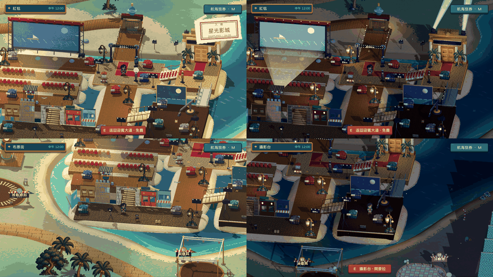

# [MAIN-68] 在大島上建造星光影城主題區

> 狀態：完成

## 內文

### 需求

第三組區域最後一區星光影城還只是預留位置。建在潟湖沙洲上，經沙洲木棧道和大島相連，主題是創作、演出與時間：布景街、攝影台、放映館、紅毯四個區塊，有自己的地形與高低差（例如階梯式的放映館座位、架高的攝影台、紅毯坡道）。從島上走過去就能進入，風格與相鄰區域漸進融合；區內預留十二個小遊戲攤位位置，地圖上也有可以直接玩的即玩小遊戲與小互動。

### 來源

2026-11-28 協作 session 依使用者要求安排第三組最後一區；設定見 design/01-park/park.json（星光影城）、位置見 island-master-plan.md（潟湖沙洲，沙洲木棧道）。

### 驗收條件

- [x] 從迎賓區經沙洲木棧道可一路走到影城，不切換場景；交界處有混合兩邊風格的過渡帶。
- [x] 收藏未達 60 時入口是看得到裡面的柵門並顯示還差幾張；達到後永久開放，地圖、快速移動、區域名稱與收藏冊都包含影城。
- [x] 布景街、攝影台、放映館、紅毯四個可走的區塊，各有一眼認得出的地標，並有高低差的地形，不需要跳躍也能走遍。
- [x] 有演出的氣氛：探照燈掃過天空、放映機光束、會倒帶的布景或場記板、紅毯閃光燈；白天與夜晚光線不同，符合場景搭建規範。
- [x] 預留十二個攤位位置，分在四個區塊；尚未有遊戲的位置顯示「準備中」。
- [x] 區內有兩款地圖上可直接玩的即玩小遊戲與兩處小互動，流程與其他區相同，玩法和既有的十七款不重複。
- [x] 走近時才建立、遠離時休眠；節點與繪製數量在預算內，場景規範沒有新增違規；其他區域不受影響。

### 測試流程

1. 用收藏不足與足夠的兩份測試存檔走到影城入口，各看一次柵門。
2. 進入後走過四個區塊，白天與夜晚各看一次；玩一次即玩小遊戲、試小互動。
3. 往返其他區域，確認休眠與重建正常。

---

# 跟其他票的關係

- Blocks：星光影城的十二款小遊戲票（另開）、終區劇場
- Blocked by：無
- Related：MAIN-61、MAIN-63、MAIN-65

---

# Commit-1

## 內文

第三組最後一區的星光影城原本只有島邊一座寫著「準備中」的柵門。
現在潟湖裡的沙洲上蓋起一座片場：沙洲木棧道走到盡頭，柵門後的棧橋直接走上紅毯廣場，不切換場景。紅毯沿著坡道鋪到首映宮的金色大門，兩旁有狗仔板人和閃光燈；西邊的露天放映館從銀幕前一路是階梯座位，最高處的放映台把光束投到銀幕上，銀幕放著四卷會換片的小電影；放映台的樓梯穿過布景街的城門布景，街上一排畫出來的假門面，從窗洞和縫隙看得到後面的木撐與沙包，城堡布景推一下會倒下再倒帶站回去；巷子往南接上架高的攝影台，有搖臂攝影機、背景幕與大燈，還有一條燈架步道繞回首映宮。每個區塊都有高低差，全靠坡道與樓梯相連，不必跳躍，走出沙洲邊會被接住放回去。夜晚首映宮兩側的探照燈掃過天空、放映光束與銀幕更亮。四個區塊各留三個蓋著絨布的「準備中」攤位。岸邊兩處外景片場是新的即玩小遊戲：「推軌跟拍」從後面推攝影車讓主角留在兩面黃旗之間，「躲道具」看影子閃開從燈架掉下來的泡棉道具；廣場有爆米花車、攝影台有大場記板可以玩。影城的過渡帶散著片盒、小場記板和地燈。
以下是自動檢查與原生截圖，不是實際遊玩。

### 測試結果

| 項目 | 結果 |
|---|---|
| 影城區域檢查（四區地標、坡道與樓梯不需跳躍、失足接回、十二攤位、演出動態、燈具預算、地圖） | 通過 |
| 區域建立與休眠、柵門、旅館與雲端遊樂場、夜市、島嶼配置、區域即時小遊戲（十四款與十四個小互動） | 通過 |
| 旅券地圖與收藏冊、環境動態、區域進度、核心、遊戲啟動 | 通過 |
| 場景規範檢查（十個區域） | 影城 0 違規，其他區域未增加 |
| 設計資料驗證、單元測試 217 項 | 通過 |
| 區域移動（含 800x600 地圖版面） | 通過 |
| 島形距離場抽樣（迎賓碼頭旁 0.27 公尺） | 未通過，主線上相同，與影城無關 |
| 節點與繪製數（原生截圖） | 影城 319 個節點；區內單一畫面白天約 390–460 次、夜晚約 520–620 次繪製 |
| 建立時間 | 分多個畫面建立，單一畫面最長約 54 毫秒 |

### 截圖

