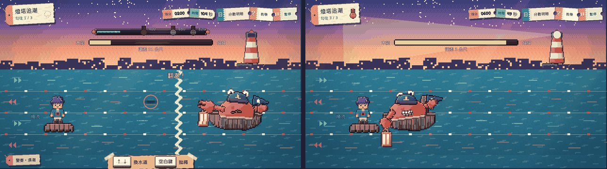
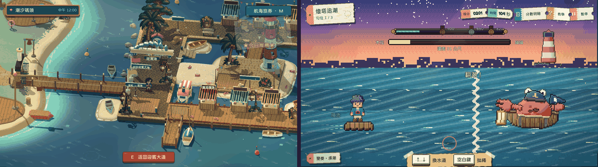

# [MAIN-69] 開放逆潮港與燈塔追潮

> 狀態：完成

## 內文

### 需求
潮汐碼頭的十二張小惡魔拍貼收齊後，應能進入該區的異空間「逆潮港」，玩看守演員錨錨的壓軸「燈塔追潮」：一場和迎賓拍照決鬥不同的追逐，潮水倒流，玩家換水道借順流追上偷走燈塔燈的錨錨並拋繩勾住牠。壓軸不是小遊戲，不計入 128 款，也不發收藏卡。

### 來源
2026-11-28 主持對話交辦下一區異空間，要求玩法和上一區不同；規格見 `design/01-park/other-space.md` 第 5b 節。

### 驗收條件
- [x] 十二張碼頭小惡魔拍貼未齊時，入口顯示還差幾張與缺少的設施；收齊後可進入，也可選輔助進入
- [x] 四條水道的順逆流看得出來，換到順流水道會追近、逆流會被拉開，距離一眼看得到
- [x] 錨錨丟木桶前有蓄力與落點陰影；撞到只會打轉並被拉開，不結束
- [x] 第二幕水道順逆流會對調，對調前有浪花線預告；第三幕起霧，只有燈塔燈掃到的地方看得見木桶
- [x] 追近時拋繩可勾住錨錨，三次後牠交還燈塔燈、燈塔亮起謝幕
- [x] 時間用完時錨錨開船離去，留下主角濕透的明信片並收進相簿
- [x] 謝幕照片收進相簿並給遊園幣；不增加任何收藏分母
- [x] 錨錨用部件骨架做出待機、丟木桶、衝刺、被勾住與交還燈的連續動作
- [x] 模擬輸入可完成；不按任何鍵一定不會完成；減少動態與無畫面環境可執行
- [x] 遊戲數量、收藏數量與資料驗證不變

### 測試流程
1. 以測試存檔收齊碼頭十二張小惡魔拍貼後到逆潮港入口
2. 進入燈塔追潮，換到順流水道追近，閃開木桶，追近時拋繩
3. 預期三次勾住後燈塔亮起謝幕，相簿出現謝幕照片；另一輪放著不玩，預期時間到後收到濕透的明信片

---

# 跟其他票的關係

- Blocks：無
- Blocked by：無
- Related：MAIN-66、ART-65

---

# Commit-1

## 內文

潮汐碼頭收齊十二張小惡魔拍貼後原本沒有任何異空間可去。
現在碼頭西側岸邊多了「查看逆潮港」的入口，未齊時說明還差幾張與缺少的設施，收齊後可進入或選輔助進入（逆流拉得慢、木桶漂得慢）。門後是黃昏的港灣，潮水倒著流：四條水道各有順流或逆流，浪花條紋與左側箭頭標出方向（青綠是順流、橘紅是逆流），上方繩索量尺顯示和錨錨還差幾公尺。換到順流的水道就會追近；追到身後時錨錨頭上亮起繩圈，按動作鍵拋繩勾住牠的船錨，牠嚇得眼睛彈起、帽子飛起，再甩開逃跑。錨錨會舉起大螯往後蓄力丟木桶，目標水道先出現落點圈與陰影，撞到只會讓木筏打轉、被拉開一段。勾住一次後進入第二幕，水道會在一道浪花牆掃過之後順逆對調；第二次後起霧，只有錨錨手上燈塔燈掃到的那條水道看得見木桶。勾住三次，錨錨把燈塔燈交還，燈塔重新亮起；時間用完則錨錨開船離去、木筏翻覆，寄來一張主角濕透的明信片。
錨錨是用部件骨架做的螃蟹船長，坐在半個木桶船裡，有眼柄、船長帽、小旗與提燈的大螯，做出待機、丟木桶、划水衝刺、被勾住與交還燈的連續動作。謝幕照片與明信片收進相簿碼頭的小惡魔頁最後（拿到後才出現），首次謝幕給 80 遊園幣、之後 30；收藏數與開區門檻不變。
在真實遊戲畫面上以挑水道的自動操作從入口走完整場（十一張時門不開、十二張時進入、三幕、謝幕、結算），再放著不玩一輪確認以明信片收場；逐張看過截圖與丟木桶的連續畫面。

### 測試結果

| 項目 | 結果 |
|---|---|
| 追潮規則（挑水道的模擬操作三個種子含輔助都能勾住三次、五十個種子不操作都不會完成且以明信片收場、水道快慢、木桶預告與擊退、翻潮預告、霧與燈光、未滿三次無獎牌、獎勵不動收藏數、無畫面與減少動態） | 通過 |
| 碼頭世界與收藏 | 通過 |
| 相簿收藏頁 | 通過 |
| 場景檢查（八個區域） | 通過，違規數未增加 |
| 設計資料驗證 | 5 範圍通過 |
| Python 單元測試 | 217 / 217 |
| 原生整場（入口、三幕、謝幕、明信片） | 通過，無 ERROR |

### 截圖

# Commit-2

## 內文

驗收指出三件事：碼頭多了入口後區域往返測試仍以十七個地點為準而失敗；逆潮港的入口只有互動標記，沒有門；追潮的海面像水道圖，平塗色帶加虛線與箭頭。
現在區域往返的碼頭地點改為十八個（多了逆潮港入口），800×600 的地圖仍然完整放得下。碼頭西岸架起一座「逆潮港」門：兩根纏繩的木樁，藤壺與海草長在樁頂而不是水線、橫梁上的海帶往上長、浪頭反向捲回岸上、船錨倒掛，下方掛著名牌，走道從兩樁之間穿過。追潮的海面改畫成真的水：每條水道是一片隨自己潮向捲動的浪紋，浪花是頭亮尾淡的長條、順著潮向流，靜止畫面也看得出方向；順流的水道較亮較平、逆流的較暗較碎；水道之間用浪谷分開，不再有虛線與箭頭；水面有黃昏的閃光，木筏與木桶船後方拖著尾浪，木桶落水時濺起一圈水花。減少動態時浪紋、浪花與閃光都靜止。
在真實遊戲畫面上走進碼頭看到這座門並觸發入口，再以挑水道的自動操作走完整場追潮（三幕、謝幕、結算）與放著不玩的明信片收場，逐張看過截圖。

### 測試結果

| 項目 | 結果 |
|---|---|
| 區域往返（含 800×600 地圖） | 通過 |
| 碼頭世界 | 通過 |
| 追潮規則 | 通過 |
| 場景檢查（八個區域） | 通過，違規數未增加 |
| 設計資料驗證 | 5 範圍通過 |
| 原生整場（碼頭門、入口、三幕、謝幕、明信片） | 通過，無 ERROR |

### 截圖

