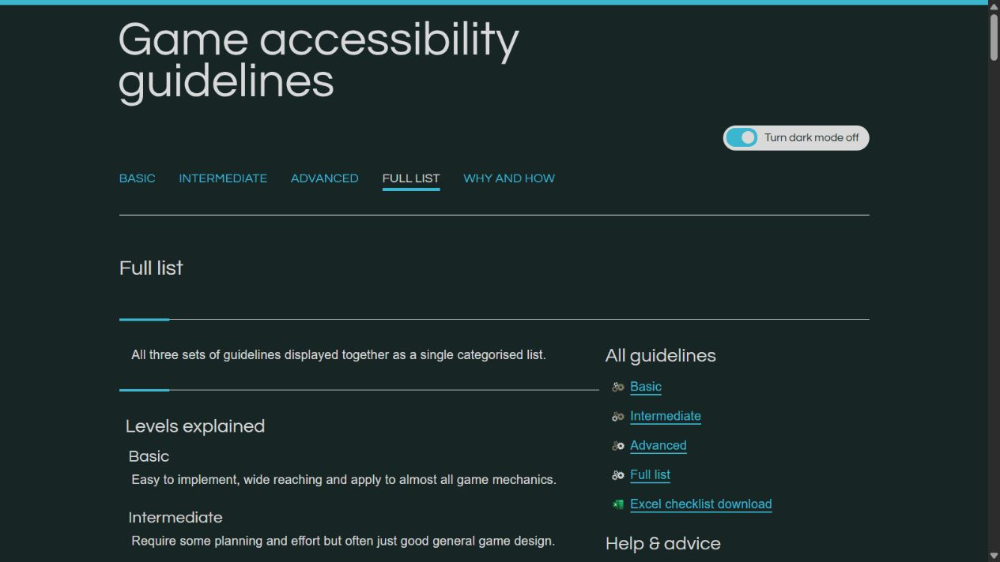
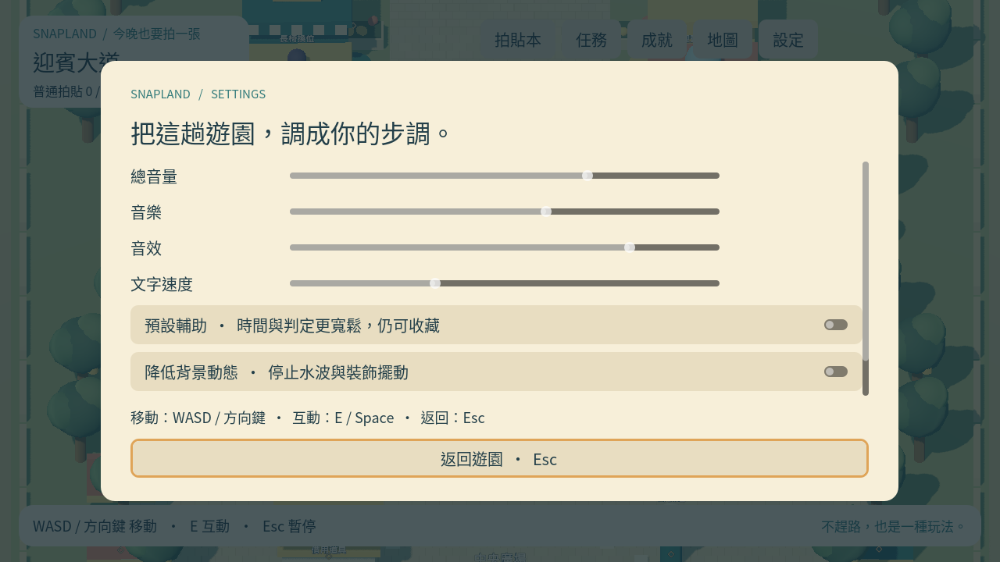

# [MAIN-6] 提供設定與安全存檔

> 狀態：進行中（base SHA：c1b7b19）

## 內文

### 需求

玩家能調整音量、顯示及輔助並保存收藏與進度。

### 來源

使用者於 2026-10-11（Asia/Taipei）要求從上島開始實作主區域、迎賓大道全部小遊戲及共用系統；其他園區先做路口。每項實作前研究業界實例並保存圖例；本票是可執行第一版，品質以實際驗收為準。

### 驗收條件

- [x] 設定可操作、持久保存；包含音量、減少動態、文字速度與遊戲輔助。
- [x] 重開後進度保持；損毀資料回到安全預設並提供具體錯誤位置。

### 測試流程

1. 啟動遊戲，進入本票內容，依畫面提示實際操作。
2. 核對本票每項驗收條件，測試返回、重試、重開與輔助情境。
3. 保存原生畫面截圖與局部測試摘要；無法確認的項目保持未勾選。

---

# 跟其他票的關係

- Blocks：無
- Blocked by：MAIN-3
- Related：MAIN-1、SG-1、ST-1

---

## 開始基準

c1b7b19；feature/island-first-park。

# Commit-1

## 內文

問題：收藏、任務與玩家設定尚未有持久保存。

改動：現在可調整音量、文字速度、動態、顯示與輔助，進度重開能接續，損毀檔案有具體位置與安全恢復。

驗收：保存／重開、欄位邊界、備份恢復與無備份預設通過；一次未隔離測試曾誤寫本機舊存檔，內容未能恢復，影響詳見交付紀錄。後續測試已強制隔離。

分支：`feature/island-first-park`；開始基準：`c1b7b19`；[程式 commit](https://github.com/deadline314/Snapland/commit/de7aefcf310c8cea710ac98e5a9d9af289ab3226)。

### 測試結果

| 項目 | 結果 |
|---|---|
| 受影響局部驗證 | 本票相關runtime與主場景整合通過 |
| 原生畫面 | GPU擷取並查看；程式化操作驗收 |
| 遠端CI | 帳戶限制，工作未啟動；未重試 |

### 研究與圖例

[核心與成就研究](../../design/runtime/core-research.md)。圖例為審閱參考，不是本作遊戲素材或試玩證據。

### 截圖

[整組驗收、票況與存檔事故紀錄](../first-playable-delivery.md)。
