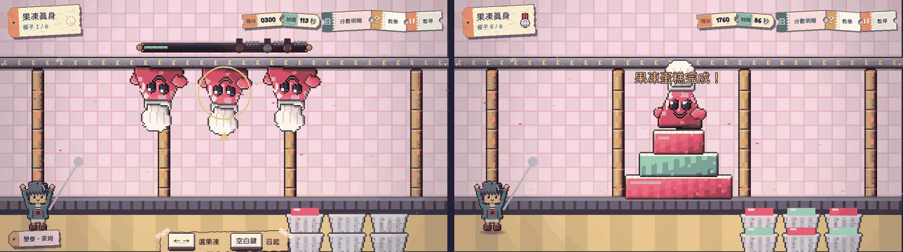
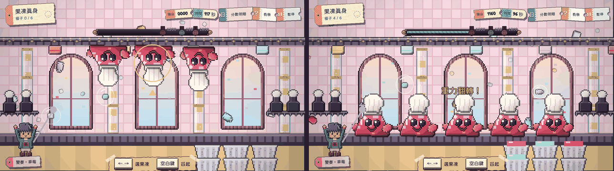

# [MAIN-70] 開放反重力糖廠與果凍真身

> 狀態：完成

## 內文

### 需求
糖果工廠的十二張小惡魔拍貼收齊後，應能進入該區的異空間「反重力糖廠」，玩看守演員啵啵的壓軸「果凍真身」：一場看穿與追蹤的遊戲，和迎賓的拍照決鬥、碼頭的水道追逐都不同。啵啵分裂成會換位的果凍分身，玩家看出慢半拍的真身並把牠舀進模子。壓軸不是小遊戲，不計入 128 款，也不發收藏卡。

### 來源
2026-11-28 主持對話交辦下一區異空間，要求玩法不是拍照決鬥也不是水道追逐；規格見 `design/01-park/other-space.md` 第 5c 節。

### 驗收條件
- [x] 十二張糖果工廠小惡魔拍貼未齊時，入口顯示還差幾張與缺少的設施；收齊後可進入，也可選輔助進入
- [x] 工廠裡有一座反重力主題的入口門，糖果往上掉
- [x] 分身跟同一個節奏抖動，真身慢半拍；開場真身拿著湯勺，之後分身會跳過彼此換位
- [x] 舀到真身就倒進模子並進到下一回合；舀到分身會爆開噴糖漿、主角黏住一下，回合不結束
- [x] 三幕的分身數與換位逐步增加，第三幕換位中途重力翻轉
- [x] 六個模子（每幕兩個）都滿時完成果凍蛋糕謝幕；時間用完主角被包成果凍，照片收進相簿
- [x] 謝幕照片收進相簿並給遊園幣；不增加任何收藏分母
- [x] 啵啵用部件骨架做出抖動、分裂、跳躍換位、被舀起與爆開的連續動作
- [x] 模擬輸入可完成；不按任何鍵一定不會完成；減少動態與無畫面環境可執行
- [x] 遊戲數量、收藏數量與資料驗證不變

### 測試流程
1. 以測試存檔收齊糖果工廠十二張小惡魔拍貼後到反重力糖廠入口
2. 進入果凍真身，盯住慢半拍的果凍，換位後選它並舀起
3. 預期六個模子滿後謝幕，相簿出現果凍蛋糕照；另一輪放著不玩，預期時間到後主角被包成果凍

---

# 跟其他票的關係

- Blocks：無
- Blocked by：無
- Related：MAIN-66、MAIN-69、ART-65

---

# Commit-1

## 內文

糖果工廠收齊十二張小惡魔拍貼後原本沒有異空間可去。
現在管道走廊的糖漿桶旁立起「反重力糖廠」門：兩根倒立的拐杖糖、往上流的糖漿、往上飄的軟糖與果凍塊。未齊時門會說還差幾張與缺少的設施，收齊後可進入或選輔助進入（真身慢得更明顯、換位更慢）。門後是上下顛倒的糖廠：糖漿沿銅管往上爬、糖粒往天花板落，果凍主廚啵啵倒掛在天花板的架子上分裂成三到五個分身。開場時拿著湯勺的就是真身，之後分身們互相跳過去換位；所有分身跟著同一個節奏抖，只有真身慢半拍。左右選、按動作鍵用長柄勺舀：舀到真身就倒進模子，舀到分身會噗地爆開、糖漿噴在主角身上黏住一下，但這一回合照樣繼續。每幕兩個模子，第二幕分身變四個、換位更多，第三幕五個分身並在換位途中重力翻轉，全部掉到地面的輸送帶上。六個模子滿了就倒出三層果凍蛋糕，啵啵站在頂上歡呼；時間用完，分身們撲上來把主角包成一大塊「果凍主角（請勿食用）」。
啵啵是用部件骨架做的果凍主廚（果凍圓頂、廚師高帽、小手、湯勺），抖動、分裂、跳躍換位、被舀起與爆開都是連續動作；真身與分身是同一套骨架、在不同的時間點計算，所以「慢半拍」就是動畫本身。謝幕照片與果凍主角照收進相簿糖果工廠的小惡魔頁最後（拿到後才出現），首次謝幕給 80 遊園幣、之後 30；收藏數與開區門檻不變。
在真實遊戲畫面上走進糖廠看到這座門並觸發入口，再以看誰慢半拍的自動操作走完整場（中途故意舀錯一次看爆開），以及放著不玩的果凍主角收場；逐張看過截圖與換位的連續畫面。

### 測試結果

| 項目 | 結果 |
|---|---|
| 果凍真身規則（看慢半拍的模擬操作三個種子含輔助都能裝滿六個模子且從不舀錯、五十個種子不操作都不會完成且以果凍主角收場、只有真身慢半拍、舀錯爆開與黏住、各幕分身與重力翻轉、未滿六個無獎牌、獎勵不動收藏數、無畫面與減少動態） | 通過 |
| 糖果工廠世界（互動點周圍淨空、地圖） | 通過 |
| 區域往返、相簿收藏頁 | 通過 |
| 場景檢查（八個區域） | 通過，違規數未增加 |
| 設計資料驗證 | 5 範圍通過 |
| Python 單元測試 | 217 / 217 |
| 原生整場（糖廠門、入口、三幕、蛋糕、果凍主角） | 通過，無 ERROR |

### 截圖

# Commit-2

## 內文

驗收指出糖廠舞台太單薄：平塗的粉紅磁磚牆、素面的柱子與籃子，看不出是反重力糖廠。
現在牆上開了三扇拱窗，窗外是粉橘到天藍的天空、糖果往上飄；銅柱換成頂天立地的玻璃管，管裡的糖漿與氣泡往上流，黃銅箍一節一節亮著。天花板是一條倒著跑的輸送帶，滾輪轉動、一盒盒糖果倒掛著被運過去。背景有兩層往上飄的包裝糖、方糖、軟糖與棒棒糖，遠層小而慢、近層大而快，邊飄邊轉；幾顆反重力泡泡包著糖果晃晃悠悠升起。兩側貓道上站著戴廚師帽的工人剪影，平常輕輕晃，舀到真身時跳起來舉手喊「好耶！」，舀到分身時垮下肩膀，謝幕時一起歡呼。減少動態時這些全部靜止。
在真實遊戲畫面上重跑整場（糖廠門、入口、三幕、蛋糕、果凍主角），逐張看過截圖。

### 測試結果

| 項目 | 結果 |
|---|---|
| 果凍真身規則（含無畫面與減少動態） | 通過 |
| 場景檢查（八個區域） | 通過，違規數未增加 |
| 原生整場 | 通過，無 ERROR |

### 截圖

