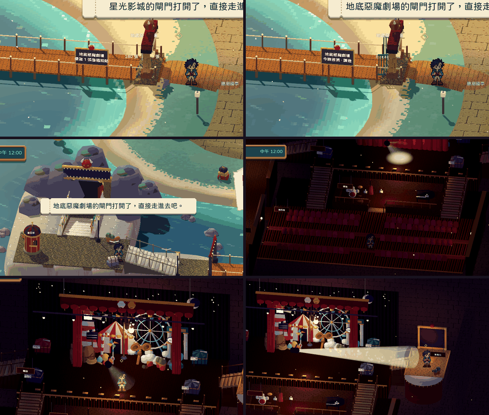

# [MAIN-71] 建造地底惡魔劇場終區

> 狀態：完成

## 內文

### 需求

十區都已接上大島，最後只剩終區「地底惡魔劇場」。它是收齊十區一百八十張普通拍貼後才開放的可選終區，幕幕劇團用整本相冊當節目素材辦一場首演。建造這個終區：從島上的一處離島入口往下走進地底，經過後台走廊到一座大劇場，舞台、觀眾席、樂池、後台與謝幕台都在，借來的東西掛回台上當布景。整體要有「最後一場演出」的收尾感：入場前的期待、走進劇場時燈光漸暗、舞台在中心最亮。預留八個劇場短遊戲的位置，之後的小遊戲票直接放進去。

### 來源

2026-11-28 協作 session 依使用者要求安排的最後一區；設定見 design/03-story/story.md「地底首演」、staging-research.md「可選終區（首演）」、design/01-park/park.json（theatre：8 款、需要 180 張普通拍貼）、island-master-plan.md（預留：劇場，離島）。

### 驗收條件

- [x] 島上有一處看得到的離島入口（橋或棧道接過去），往下走進地底的劇場，不切換場景或以短暫、明確的轉場進入；入口標示需要一百八十張普通拍貼，未達時看得到裡面但進不去並顯示還差幾張，達到後永久開放。
- [x] 地底有後台走廊、觀眾席、樂池、舞台與謝幕台等可走區塊，有高低差（階梯觀眾席、升起的舞台），不需要跳躍也能走遍；各區塊一眼認得出。
- [x] 舞台布景用十區的代表物件拼成（燈塔、糖果、燈籠、帳篷、發條、花、旅館門牌、摩天輪、場記板等），像整本相冊變成了節目。
- [x] 燈光有劇場感：走進觀眾席時周圍漸暗、舞台聚光最亮、布幕可以開合；地底的光線與空氣和地面上明顯不同，但仍符合場景搭建規範（無平色塊、影子正確、不漂浮）。
- [x] 預留八個劇場短遊戲位置，沿著舞台與後台安排；尚未有遊戲的位置顯示「準備中」。
- [x] 謝幕台留一個合照位置，之後劇情可以在這裡拍最後的合照；本票不做劇情演出。
- [x] 地圖、快速移動、區域名稱與收藏冊都包含劇場；走近時才建立、遠離時休眠；節點與繪製數量在預算內，其他區域不受影響。

### 測試流程

1. 用 179 張與 180 張普通拍貼的兩份測試存檔走到劇場入口，各看一次。
2. 進入後走遍後台、觀眾席、樂池、舞台與謝幕台，看燈光變化與布幕開合。
3. 往返其他區域，確認休眠與重建正常。

---

# 跟其他票的關係

- Blocks：劇場八款短遊戲（另開）、首演劇情
- Blocked by：無
- Related：MAIN-63、MAIN-65、MAIN-68、ST-13

---

# Commit-1

## 內文

十區都接上大島後，終區「地底惡魔劇場」還沒有地方可去。
現在西灣最裡面多了一條短棧道與閘門，長棧橋跨過海灣接到一座岩石離島；閘門旁的節目看板寫著還差幾張普通拍貼，一百八十張時閘門打開、看板改成「今晚首演 · 請進」，收藏不消耗所以之後一直開著。離島上有售票亭、海報牆夾著的大階梯，往下走進岩壁裡的跑馬燈拱門，畫面短暫淡出（不到一秒）就站在地底的後台走廊；走廊南端的出口走出去會回到離島。地底是同一張大島底下的另一層：後台走廊掛著十區借來的戲服、堆著道具箱和化妝鏡，坡道上到升起的舞台；舞台前有樂池（鋼琴、鼓、低音提琴），兩側樓梯下到觀眾席，後面是兩層階梯座位，最後一排留著一盞亮著的座位。舞台布景是燈塔、帳篷、摩天輪、迎賓拱門四塊彩繪布景板，前面擺著各區的道具：糖果杖與口香糖球、夜市燈籠、發條鑰匙、花盆、旅館門牌與皮箱、雲朵、場記板、漁網箱與繩圈。舞台右側是謝幕台，金星標出合照位置，後面立著金框。地底沒有陽光，走進觀眾席周圍漸暗；跟隨聚光燈在舞台與謝幕台上追著主角，走近舞台布幕拉開、離開後合上。後台與舞台兩翼共留八個蓋著絨布的「準備中」攤位。地圖顯示主角所在那一層的平面，旅券、快速移動、區域名稱與收藏冊都有劇場。
以下是自動檢查與原生截圖，不是實際遊玩；目前遊戲內實際能收的普通拍貼還湊不到一百八十張，開門是用測試直接設定張數確認的。

### 測試結果

| 項目 | 結果 |
|---|---|
| 劇場區域檢查（兩層地板、往返淡出、坡道不需跳躍、失足擋回、八個攤位、演出動態、觀眾席漸暗、燈具預算、兩層場景規範、地圖） | 通過 |
| 區域建立與休眠、179／180 張閘門、島嶼配置、島形、區域移動、旅券地圖與收藏冊、環境動態、影城、區域進度、遊戲啟動 | 通過 |
| 場景規範檢查（十一個區域） | 劇場 0 違規，其他區域未增加 |
| 設計資料驗證、單元測試 217 項 | 通過 |
| 節點與繪製數（原生截圖） | 劇場 208 個節點；地底白天約 150–200 次、夜晚約 550 次繪製；島嶼本體因第十道閘門預算由 2700 調為 2750 |
| 建立時間 | 分 11 個畫面建立，單一畫面最長約 75 毫秒 |

### 截圖

