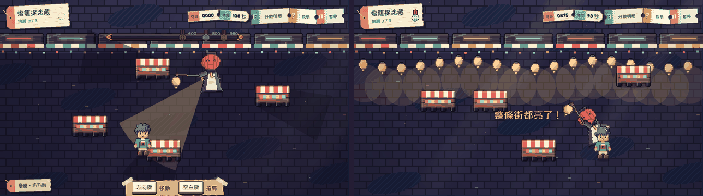

# [MAIN-72] 開放午夜移動市與燈籠捉迷藏

> 狀態：完成

## 內文

### 需求
霓虹夜市的十二張小惡魔拍貼收齊後，應能進入該區的異空間「午夜移動市」，玩看守演員燈燈的壓軸「燈籠捉迷藏」：一場潛行，和迎賓的拍照決鬥、碼頭的水道追逐、糖廠的找真身都不同。玩家躲在會照時刻表換位的攤車後，避開燈燈掃動的燈光，繞到牠背後拍肩。壓軸不是小遊戲，不計入 128 款，也不發收藏卡。

### 來源
2026-11-28 主持對話交辦下一區異空間，要求每區玩法不同；規格見 `design/01-park/other-space.md` 第 5d 節。

### 驗收條件
- [x] 十二張夜市小惡魔拍貼未齊時，入口顯示還差幾張與缺少的設施；收齊後可進入，也可選輔助進入
- [x] 夜市裡有一座「午夜移動市」主題的入口門
- [x] 燈燈的燈光扇形掃動、攤車擋得住燈光；轉向前有停頓預告
- [x] 攤車移動前地上先標出要去的位置
- [x] 走到燈燈背後、不在燈光裡時拍肩算一次；被燈光照到會定格並被送回起點附近，不結束
- [x] 三幕依序加入攤車滑動與第二盞浮空燈籠
- [x] 拍三次完成、整條街亮起謝幕；時間用完主角被掛成燈籠，照片收進相簿
- [x] 謝幕照片收進相簿並給遊園幣；不增加任何收藏分母
- [x] 燈燈用部件骨架做出巡視、轉頭預告、被拍肩嚇到與謝幕的連續動作
- [x] 模擬輸入可完成；不按任何鍵一定不會完成；減少動態與無畫面環境可執行
- [x] 遊戲數量、收藏數量與資料驗證不變

### 測試流程
1. 以測試存檔收齊夜市十二張小惡魔拍貼後到午夜移動市入口
2. 進入燈籠捉迷藏，等燈光掃過去，沿著攤車影子繞到燈燈背後拍肩
3. 預期三次後整條街亮起謝幕，相簿出現照片；另一輪放著不玩，預期時間到後主角被掛成燈籠

---

# 跟其他票的關係

- Blocks：無
- Blocked by：無
- Related：MAIN-66、MAIN-69、MAIN-70、ART-65

---

# Commit-1

## 內文

霓虹夜市收齊十二張小惡魔拍貼後原本沒有異空間可去。
現在夜市西側街上立起「午夜移動市」門：兩根裝在車輪上的燈柱、停在十二點的時鐘、霓虹名牌與搖晃的紙燈籠。未齊時門會說還差幾張與缺少的設施，收齊後可進入或選輔助進入（燈光掃得慢、拍肩搆得遠、被照到送得不遠）。門後是從上往下看的雨夜街道，石板積水映著霓虹。燈燈（燈籠頭的攤販）伸出長桿燈籠，一扇暖光左右掃動；攤車擋得住光，在光裡投出影子，那就是躲的地方。燈燈要把燈猛地轉到另一邊之前會先停下來「嗯？」一聲。方向鍵移動、空白鍵拍肩，只有在牠背後、不在光裡時才拍得到；被照到會「喀嚓」閃光、被拍下來並送回起點附近，不扣分也不結束。拍到一次後攤車開始照時刻表滑動，地上先畫出它們要去的位置；拍到兩次後空中多了一盞會繞圈的浮空燈籠。拍滿三次，燈籠從街頭一路亮到街尾，燈燈鞠躬謝幕；時間用完則主角被掛在攤棚下當一盞燈籠。
燈燈是用部件骨架做的（燈籠頭、袍子與圍裙、手臂、長桿與吊燈），巡視搖擺、轉頭前的「嗯？」、猛轉、被拍肩時跳起來與謝幕鞠躬都是連續動作。謝幕照片與燈籠主角照收進相簿夜市的小惡魔頁最後（拿到後才出現），首次謝幕給 80 遊園幣、之後 30；收藏數與開區門檻不變。
在真實遊戲畫面上走進夜市看到這座門並觸發入口，再以避開燈光、從側面繞到背後的自動操作走完整場，以及放著不玩的燈籠主角收場；逐張看過截圖與燈燈被拍肩跳起來的連續畫面。

### 測試結果

| 項目 | 結果 |
|---|---|
| 燈籠捉迷藏規則（避光繞背的模擬操作三個種子含輔助都能拍滿三次、五十個種子不操作都不會完成且以燈籠主角收場、燈光只照到扇形且攤車擋光、只有背後拍得到、被照到送回起點、每次猛轉前都有「嗯？」、攤車先標位置再滑動與浮空燈籠、未滿三次無獎牌、獎勵不動收藏數、無畫面與減少動態） | 通過 |
| 夜市世界（互動點、地圖） | 通過 |
| 相簿收藏頁 | 通過 |
| 場景檢查（八個區域） | 通過，違規數未增加 |
| 設計資料驗證 | 5 範圍通過 |
| Python 單元測試 | 217 / 217 |
| 原生整場（夜市門、入口、三幕、亮街、燈籠主角） | 通過，無 ERROR |

### 截圖

