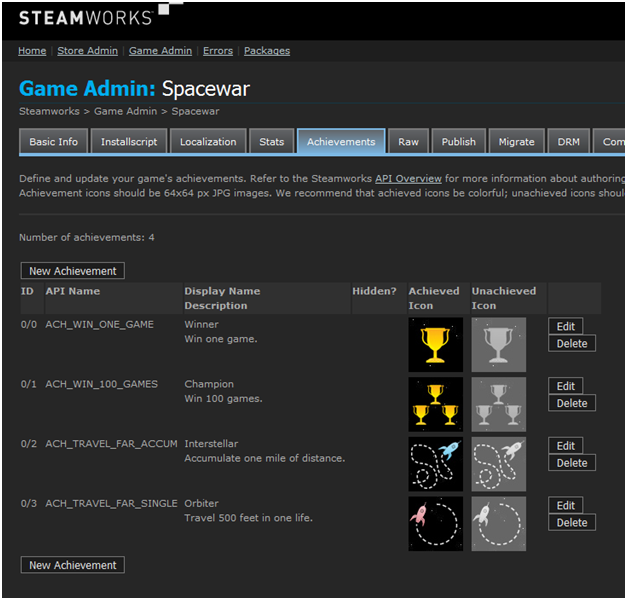
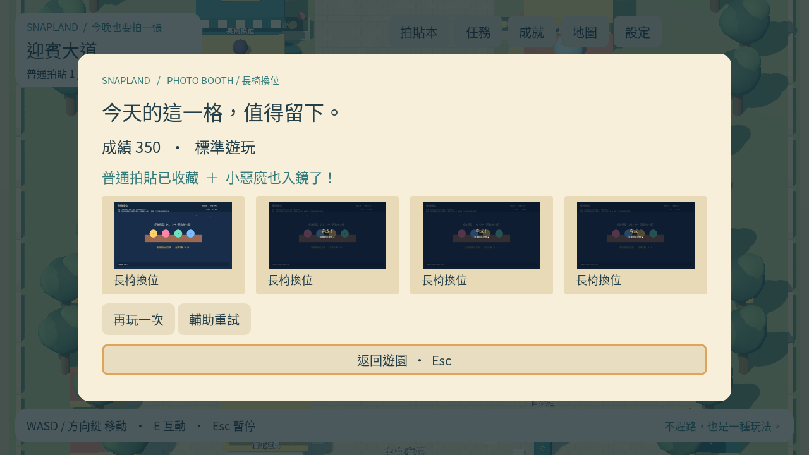
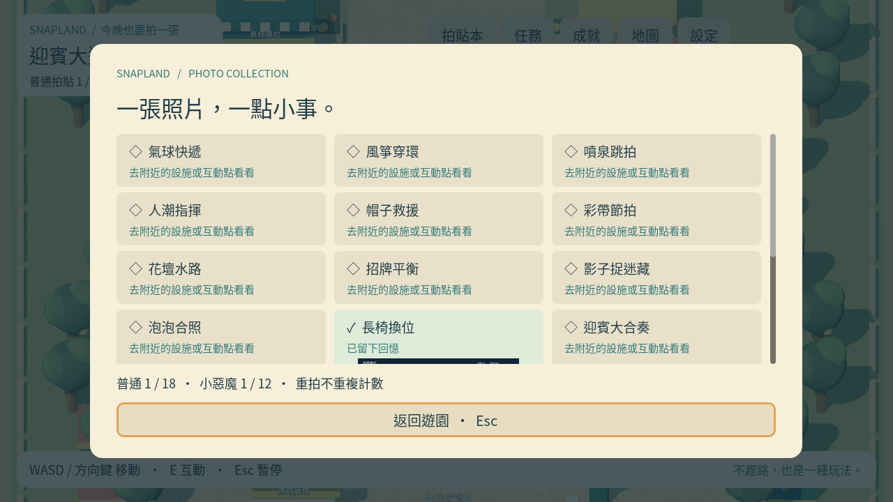

# [MAIN-7] 建立拍貼結算與收藏冊

> 狀態：完成

## 內文

### 需求

每款遊戲結算可收藏拍貼，普通與惡魔資格獨立且重玩不重複計數。

### 來源

使用者於 2026-10-11（Asia/Taipei）要求從上島開始實作主區域、迎賓大道全部小遊戲及共用系統；其他園區先做路口。每項實作前研究業界實例並保存圖例；本票是可執行第一版，品質以實際驗收為準。

### 驗收條件

- [x] 可查看十二設施、三探索、一主線、二支線的固定收藏來源。
- [x] 結算可重試或返回，普通與惡魔卡片不重複增計。

### 測試流程

1. 啟動遊戲，進入本票內容，依畫面提示實際操作。
2. 核對本票每項驗收條件，測試返回、重試、重開與輔助情境。
3. 保存原生畫面截圖與局部測試摘要；無法確認的項目保持未勾選。

---

# 跟其他票的關係

- Blocks：無
- Blocked by：MAIN-3
- Related：MAIN-1、SG-1、ST-1

---

## 開始基準

c1b7b19；feature/island-first-park。

# Commit-1

## 內文

問題：通關尚無實際拍貼與收藏冊。

改動：現在結算保存實際遊戲畫面，可重試／返回；普通與小惡魔獨立收藏，重玩不重複增加張數。

驗收：原生12款鍵鼠通關與存圖通過；固定18來源、去重與重開保存局部檢查通過。

分支：`feature/island-first-park`；開始基準：`c1b7b19`；[程式 commit](https://github.com/deadline314/Snapland/commit/f2d6b84919a91d534082660a12aec5a9b44eaa2c)。

### 測試結果

| 項目 | 結果 |
|---|---|
| 受影響局部驗證 | 本票相關runtime與主場景整合通過 |
| 原生畫面 | GPU擷取並查看；程式化操作驗收 |
| 遠端CI | 帳戶限制，工作未啟動；未重試 |

### 研究與圖例

[園區與介面研究](../../design/runtime/world-research.md)。圖例為審閱參考，不是本作遊戲素材或試玩證據。

### 截圖

[整組驗收、票況與存檔事故紀錄](../first-playable-delivery.md)。

# 2026-10-20 現行第一版結案

重新核對十二設施、三探索、一主線、二支線的固定18來源與普通／惡魔去重；核心、收藏、原圖保護與Main整合回歸通過。本輪MAIN-13／16已從實際輸入完成普通與惡魔正式收藏、三張原圖／縮圖共用及真正新程序重開，沒有重複增計。ART-24／26重驗空收藏、分類、原圖檢視器、結果返回與練習頁；其中合成UI資料未當自然通關。

[實際普通／惡魔收藏與重開](images/MAIN-13-shared-20261020-verification.json) · [目前收藏頁](../Snapland-art/images/ART-24-verify-20261020.json) · [結果／返回](../Snapland-art/images/ART-26-verify-20261020.json)。既有實作與原程式f2d6b84已在main，本輪核對當前規則及證據，不把早期feature狀態當目前阻塞。舊Windows圖仍屬歷史；本輪無頭功能檢查、原生自動輸入與合成UI各按實際範圍記錄，沒有新Windows EXE、真人試玩或聽感認證。

本票按第一版路口／收藏流程範圍結案；MAIN-11完整探索、ART-1光影／ART-17動畫、各玩法精修及更豐富的世界互動仍照各票驗收。
