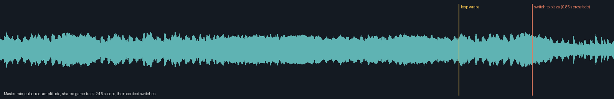

# [MIC-1] 製作首區音樂與互動音效

> 狀態：進行中

## 內文

### 需求

碼頭、廣場與遊戲有原創音樂、環境聲與可辨識互動回饋。

### 來源

使用者於 2026-10-11（Asia/Taipei）要求從上島開始實作主區域、迎賓大道全部小遊戲及共用系統；其他園區先做路口。每項實作前研究業界實例並保存圖例；本票是可執行第一版，品質以實際驗收為準。

### 驗收條件

- [x] 遊園音樂與遊戲音樂可循環且切换平順；互動、命中、結算有音效。
- [x] 音量設定生效，暫停／退出時音樂狀態正確。
- [ ] 有產權紀錄、業界研究與實際試聽驗收。

### 測試流程

1. 啟動遊戲，進入本票內容，依畫面提示實際操作。
2. 核對本票每項驗收條件，測試返回、重試、重開與輔助情境。
3. 保存原生畫面截圖與局部測試摘要；無法確認的項目保持未勾選。

---

# 跟其他票的關係

- Blocks：無
- Blocked by：MAIN-3
- Related：MAIN-1、SG-1、ST-1

---

## 開始基準

c1b7b19；feature/island-first-park。

# Commit-1

## 內文

問題：碼頭、園區與小遊戲尚無音樂與聲音回饋。

改動：現在有三首原創循環、海風、互動與快門等音效，節拍與合奏會發出實際音高。

驗收：12個WAV資源、PCM飽和樣本0，音量、切換、循環與暫停局部測試通過；待本機喇叭／耳機試聽，音樂平順聽感與完整試聽條件保持未勾選。

分支：`feature/island-first-park`；開始基準：`c1b7b19`；[程式 commit](https://github.com/deadline314/Snapland/commit/f2d6b84919a91d534082660a12aec5a9b44eaa2c)。

### 測試結果

| 項目 | 結果 |
|---|---|
| 受影響局部驗證 | 本票相關runtime與主場景整合通過 |
| 原生畫面 | 實際試聽未完成 |
| 遠端CI | 帳戶限制，工作未啟動；未重試 |

### 研究與圖例

[劇情與音訊研究](../../design/runtime/story-audio-research.md)。圖例為審閱參考，不是本作遊戲素材或試玩證據。

### 截圖

[原創音樂與聲音紀錄](../../assets/audio/README.md)；設定畫面見MAIN-6。

[整組驗收、票況與存檔事故紀錄](../first-playable-delivery.md)。

# Commit — 2026-11-06 音樂循環無縫與切換驗收

固定開始 SHA：`aeb9100`；分支：`feature/gracious-archimedes-nmdgcm`。

## 問題

音樂循環是直接從檔尾跳回檔頭。量測出貨的 13 首：接縫取樣跳差最高 0.056，足以聽成爆音；多首以淡出結尾（遊園曲最後約 3.9 秒近乎無聲），循環時先安靜再突然重來，不算「可循環且平順」。

## 改動

準備工具裁掉頭尾靜音後，把每首最後 1 秒與最前 1 秒等功率交疊，讓循環點兩側成為原曲裡相鄰的聲音；量測結果寫進來源目錄並以測試綁定出貨檔。執行端維持單一播放器原生循環，記憶體與播放器數量不變。新增原生循環錄音檢查與分析工具，以及對應的反例測試。

## 驗收

| 項目 | 結果 |
|---|---|
| 13 首出貨音樂接縫 | 取樣跳差全部 ≤ 0.0083（原 0.056）；接縫前後音量變化與原曲同位置相差 ≤ 0.54 dB |
| 原生 Main 錄音（PulseAudio 驅動、虛擬輸出） | 共用遊戲曲 24.5 秒實際循環一次（觀測 24.64 秒）並切到遊園曲；無超過 20 ms 的靜音、循環點最大步進 0.016 低於曲子本身 0.027、交叉淡入最低 -40.2 dB（前 -31.9／後 -49.5） |
| 分析工具反例 | 插入爆音、20 ms 以上靜音、交叉淡入破洞皆被抓到；4 項通過 |
| 互動、命中、結算音效 | 既有音效測試與十二款路由審閱通過；十款各有自己的操作／命中／失誤聲 |
| 受影響 Godot 套件 | 音效、島嶼聲音動態、主場景整合、十二款小遊戲、彩帶 Session 全部通過 |
| Python 全套／設計驗證 | 全部通過；5 範圍通過 |

雲端沒有喇叭，原生錄音走 PulseAudio 虛擬輸出；這是技術驗證，**不是試聽**。「實際試聽驗收」條件維持未勾選，需要人耳確認曲風、接縫聽感與耐聽度。

[接縫量測表](images/MIC-1-loop-20261106-seams.json) · [原生錄音 MP3](images/MIC-1-loop-20261106-native-mix.mp3) · [錄音紀錄](images/MIC-1-loop-20261106-native-report.json) · [分析結果](images/MIC-1-loop-20261106-analysis.json) · [方法說明](../../design/runtime/cc0-audio-selection.md)

