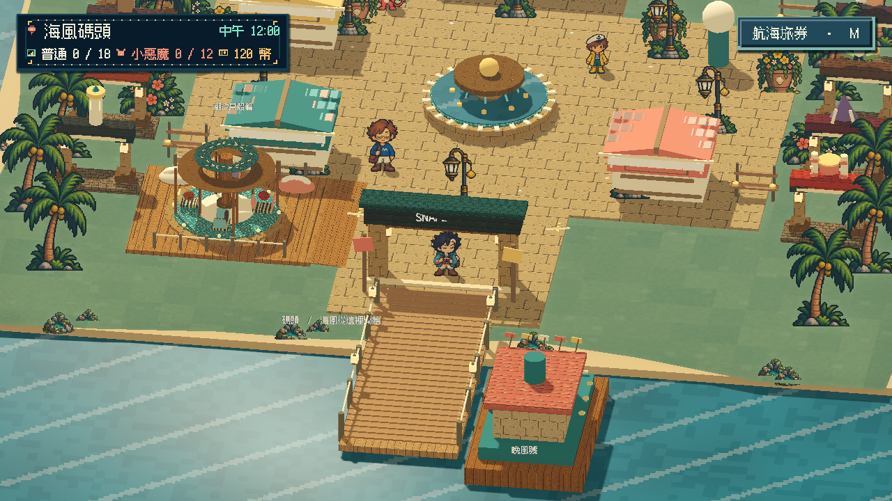
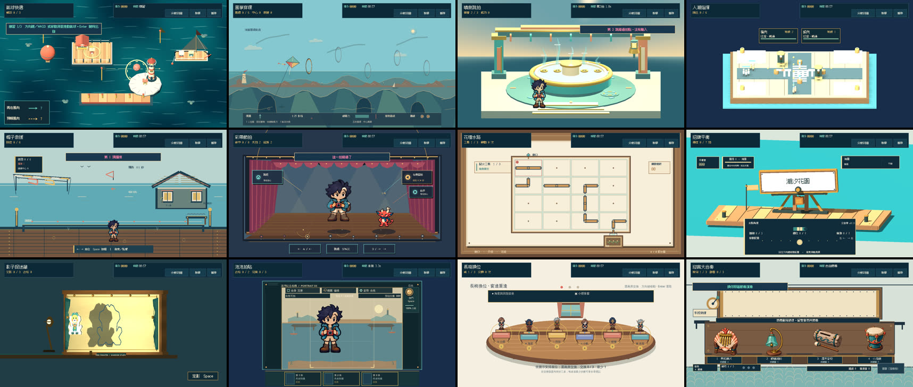
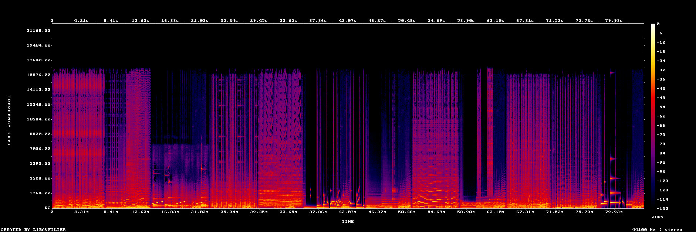

# [MIC-2] 完善首區音樂與動作音效

> 狀態：進行中

## 內文

### 需求
逐步完善首區探索、日夜、角色互動、十二款小遊戲和結算的音樂與音效，形成原創海港遊樂園聲音。聲音提供操作、節奏和成果線索，密度與音量有取捨，不用大量音效掩蓋簡略玩法。

### 來源
2026-10-12（Asia/Taipei）使用者要求全面重新審閱 UI 和小遊戲，提升目標、計分及操作手感；先廣泛 survey，減少遊戲當下提示，提供含截圖的完整教學。使用者授權自行決定設計，強調循序完善、細節有主次且不雜亂，以可面向大眾的品質驗收。

### 驗收條件
- [x] 至少六個不同團隊的音樂、音效及互動聲音來源實際閱讀或試聽，記錄查閱範圍與採用理由。
- [x] 首區和十二款各有適合場景及玩法的聲音，音樂、節拍與實際動作同步。
- [x] 連續命中、失誤、對話、時段切換及結算音量舒適且不重疊失控，設定與靜音可用。
- [ ] 原生完整試聽並核對靜音、重試、離開和重開，保存試聽紀錄、影片及測試。

### 測試流程
1. 查看本票研究紀錄與圖例，核對採用的原則和原生前後比較。
2. 使用隔離存檔實際操作本票完整流程，核對各項驗收條件。
3. 核對重試、返回、重開與相關設定，保存原生截圖、影片和受影響測試摘要。

---

# 跟其他票的關係

- Blocks：無
- Blocked by：無
- Related：MIC-1、ART-21、SG-14、ST-4

---

## 2026-10-14 接續基準

固定開始 SHA：`4d0a2a814860e54243dd116bed54c564233c0aa0`。本輪接續既有角色完整動畫、服裝同步與島嶼聲音驗收；使用者要求持續修正實際問題，不能把階段素材或局部驗證當成整島完成。

## Commit — 2026-10-14 補齊島上日夜與對話混音

**問題：** 島上的海浪與背景音樂缺少日夜層次，對話也沒有讓出音量；首次到碼頭與重新進場時，聲音可能沒有採用該場景的正確音量。

**改動：** 碼頭與廣場隨時段平順調整海浪和音樂，夜間降低聲音密度；對話時背景音樂稍微退後，結束後恢復。保留既有可核對的 CC0 聲音；首次入場、重新進場、暫停與靜音都能回到正確狀態。本輪沒有宣稱重新完成十二款小遊戲的選曲。

**驗收：** 既有聲音功能與新的日夜／對話／重新進場局部檢查通過，0 ERROR。實際 Main 在 WASAPI 下錄得 25.71 秒混音，場景交互段 22.61 秒；碼頭與廣場的中午、晚上四個區間都有真實聲音樣本，對話逐字期間有六次嗶聲播放，靜音區間內部樣本全為零。主 Session 檢視三張實際場景截圖；數值與錄音驗證不當作真人試聽或音色品質完成。

### 測試結果

| 項目 | 結果 |
|---|---|
| 既有聲音功能／日夜與對話動態 | 2 項局部測試通過，0 ERROR |
| 實際音效驅動 | WASAPI；未以 Dummy 或 headless 充當聲音證據 |
| 四個場景與時段錄音 | 均有非零 PCM；錄音長度與實際時間一致 |
| 靜音 | 扣除兩端各 100ms 的排程／音訊緩衝邊界後，40,795 音框全零 |
| 語音嗶聲／恢復與暫停 | 實際 Main 操作狀態與播放邊緣條件通過 |
| 主觀音色與全小遊戲選曲 | 未驗收；相關條件未勾選 |

### 截圖與錄音

[夜間切換圖](images/MIC-2-dynamics-v1-harbor-night.png) · [對話圖](images/MIC-2-dynamics-v1-dialogue-open.png) · [完整原生混音 WAV](images/MIC-2-dynamics-v1-main-master-mix.wav) · [原生錄音報告與 CC0 出處](images/MIC-2-dynamics-v1-audio-dynamics-report.json) · [局部驗證摘要](images/MIC-2-dynamics-v1-verification.json)

錄音是整體混音，不能把音樂與海浪各自的音色從 RMS 推斷出來。固定基準：`4d0a2a814860e54243dd116bed54c564233c0aa0`；分支：`feature/island-experience`；票況：進行中。保留待本機耳機／喇叭試聽、完整選材與十二款小遊戲聲音的驗收。

本輪程式與原生錄音證據已推送：[629da35](https://github.com/deadline314/Snapland/commit/629da35d2ff6d7f33e9337c24b735b31beeccb15)。

# Commit — 2026-10-23 十二款小遊戲各自的聲音身分

固定開始 SHA：`2e95cc6`；分支：`feature/gracious-archimedes-nmdgcm`。

## 問題

十二款小遊戲共用同一首 25 秒嘉年華短循環，命中、失誤與操作也共用同一組介面音；換了玩法，聲音沒有任何差別。

## 改動

氣球、風箏、噴泉、人潮、帽子、水路、招牌、影子、泡泡、長椅十款，各自有一首 CC0 配樂與一組依場景材質挑選的操作／命中／失誤聲（帆布、玻璃水滴、號誌金屬、木招牌、紙偶等），從遊戲開始到離開都使用該組，換遊戲時交叉淡入，離開回到島上聲景。彩帶節拍與迎賓大合奏的聲音要和拍點、樂器綁定，留給 SG-21／SG-27 在遊戲內處理，暫用原共用組。設定錯誤或缺檔時安全退回共用組，不會擋住遊戲。音量、靜音、暫停沿用原設定。

研究七個不同團隊與來源（節奏天國音效總監、A Short Hike 作曲、Celeste 對話聲、動物森友會時段音樂、打擊感研究、無障礙聲音指南、Godot 音訊同步），採用「每款一種材質、少量但一致的回饋」與「解謎曲不催促、追逐曲有推進」。頻譜顯示偏亮的兩首先保守降低高頻。

## 驗收

| 項目 | 結果 |
|---|---|
| CC0 來源／雜湊／路由 | 新增 14 個來源（10 首曲、4 套 Kenney），40 個出貨音檔；Python 6 項通過，含每款三種回饋不重複 |
| 局部聲音測試 | 原有檢查保留並新增每款路由、換遊戲、退回共用組、離開清除與錯誤路徑拒收；exit 0、0 ERROR |
| 原生 Main 十二款 | 經正式啟動流程依序開啟十二款，12／12 播放正確曲目與回饋聲，離開後回到島上聲景；exit 0、0 ERROR |
| Python 全套／設計驗證 | 147 項通過；5 範圍通過 |
| 人耳試聽 | 未進行 |

雲端沒有音效卡，原生錄音用 Dummy 驅動；機器高負載時軟體混音時鐘落後（305 秒音訊對 328 秒事件），所以錄音只證明路由與有聲，不拿來判斷拍點或音量感受。另以出貨檔案、遊戲預設音量離線混出逐款試聽表（每款 9.6 秒：配樂、第 5.0 秒操作、6.2 秒命中、7.4 秒失誤）。**以上都不是試聽**：曲風是否合適、是否刺耳、循環接縫、密集操作的疲勞度仍需人耳驗收，相關條件維持未勾選；十二款音樂與節拍同步也待 SG-18／21／27 合併後再核對。

[研究與決策](../../design/runtime/game-audio-profiles.md) · [逐檔來源與雜湊](../../assets/audio/cc0/catalog.json) · [逐款試聽表 MP3](images/MIC-2-game-audio-listening-sheet.mp3)（[時間點](images/MIC-2-game-audio-listening-sheet.json)） · [原生十二款混音 MP3](images/MIC-2-native-game-mix.mp3)（[事件時間軸](images/MIC-2-native-game-timeline.json)） · [局部測試紀錄](images/MIC-2-audio-runtime-tests.log)

來源頁截圖：[Sunflower Valley](images/MIC-2-source-sunflower-valley.jpg) · [choco bird's run](images/MIC-2-source-choco-birds-run.jpg) · [Jungle Simple Style 1](images/MIC-2-source-jungle-simple-style-1.jpg) · [Children's March](images/MIC-2-source-childrens-march-theme.jpg) · [Rolling Circus](images/MIC-2-source-rolling-circus.jpg) · [Calm Piano 1](images/MIC-2-source-calm-piano-1-vaporware.jpg) · [Taking you to the Circus](images/MIC-2-source-taking-you-to-the-circus.jpg) · [Exploration Theme](images/MIC-2-source-exploration-theme.jpg) · [Sandy Seaside 2](images/MIC-2-source-sandy-seaside-2.jpg) · [Bossa Nova](images/MIC-2-source-bossa-nova.jpg) · [Kenney Music Jingles](images/MIC-2-source-kenney-music-jingles.jpg) · [Kenney Impact](images/MIC-2-source-kenney-impact.jpg) · [Kenney RPG](images/MIC-2-source-kenney-rpg.jpg) · [Kenney Digital](images/MIC-2-source-kenney-digital.jpg)

# Commit — 2026-11-06 十二款節拍同步與密集操作混音控管

固定開始 SHA：`37af23a`；分支：`feature/gracious-archimedes-nmdgcm`。

## 問題

迎賓大合奏雖有遊戲自己的樂器聲，背景仍播放共用的 25 秒嘉年華曲，與要記憶的樂句速度互相干擾。彩帶伴奏以峰值正規化到接近滿刻度，比其他遊戲大約 6 dB，所有音量拉滿時密集命中的峰值只剩 0.2 dB 餘裕。「音量舒適、不重疊失控」也還沒有可核對的量測。

## 改動

- 合奏與彩帶一樣，由遊戲本身的音樂取代共用曲；十二款審閱逐款核對共用曲是否被靜音。
- 彩帶伴奏峰值降到與其他出貨音樂相同的約 -6 dBFS。
- 十二款審閱加入密集段：每款連續 12 次命中／失誤（間隔略大於重複閘門），再播完整結算曲；可選擇所有音量拉滿錄製。
- 新增混音量測工具，以 ITU-R BS.1770 量測整體響度、響度範圍與每款密集段真峰值，依公開的主機遊戲響度建議判定；附解析與判定的單元測試。

## 驗收

| 項目 | 結果 |
|---|---|
| 十二款聲音身分 | 十款各自配樂與材質回饋聲；彩帶以節拍表生成伴奏（SG-21 已驗每個音落在拍點），合奏以四件樂器演奏並在完成樂句後合奏回放（SG-27），噴泉以數拍音提示起跳（SG-18）；兩款自帶音樂的遊戲實際靜音共用曲，其餘十款不靜音 |
| 回饋時機 | 命中、失誤、操作聲由遊戲事件實際觸發；十二款原生審閱逐款核對播放的檔案 |
| 所有音量拉滿（原生 Main、PulseAudio 虛擬輸出） | 整體 -22.1 LUFS（建議 -23 ±2）；響度範圍 5.4 LU（上限 20）；每款密集段真峰值最高 -4.9 dBTP（上限 -1） |
| 預設音量 | 整體 -28.5 LUFS；響度範圍 6.9 LU；密集段真峰值最高 -12.8 dBFS |
| 對話與時段 | 島上審閱：對話時音樂退後、結束恢復；中午與晚上增益不同且平滑過渡；主音量靜音錄到完整數位靜音（見 MIC-3） |
| 不重疊失控 | 回饋聲共用單一播放器、同源 40 ms 重複閘門；對話滴滴聲獨立且有說話者間隔 |
| 受影響 Godot 套件／Python／設計 | 彩帶、合奏、十二款小遊戲、音效、島上聲音動態、小遊戲介面全部通過；Python 與設計驗證通過 |

量測依據：GANG IESD 與 Sony WWS 的主機遊戲整體響度 -23 LUFS ±2、真峰值 -1 dBTP；Sony ASWG 響度範圍上限 20 LU（[Designing Sound 整理](https://designingsound.org/2013/02/loudness-in-game-audio/)、[Garry Taylor 訪談](https://designingsound.org/2012/07/30/video-games-and-loudness-standards-interview-with-sonys-garry-taylor/)）。錄音走虛擬輸出，這些是量測，**不是試聽**；「原生完整試聽」條件維持未勾選。

試聽表已改為從實際引擎錄音裁切（所有音量拉滿），每款依序包含配樂、三種回饋、密集段與結算曲：[逐款試聽表 MP3](images/MIC-2-game-audio-listening-sheet.mp3)（[時間點](images/MIC-2-game-audio-listening-sheet.json)）。

[拉滿音量量測](images/MIC-2-mix-20261106-full-volume.json) · [預設音量量測](images/MIC-2-mix-20261106-default-volume.json) · [十二款事件時間軸](images/MIC-2-mix-20261106-full-volume-timeline.json) · [混音決策](../../design/runtime/game-audio-profiles.md)

