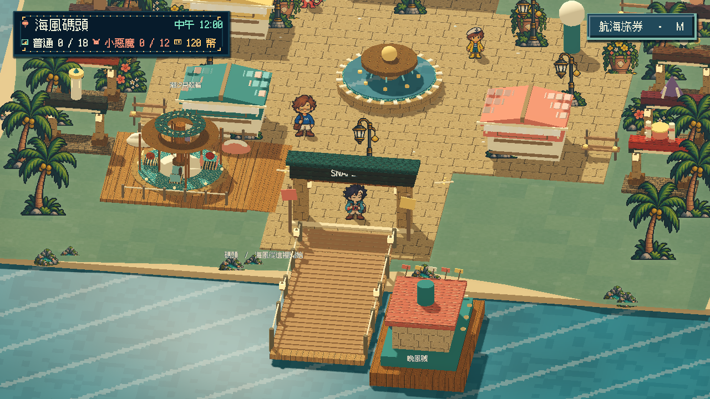

# [MIC-2] 完善首區音樂與動作音效

> 狀態：進行中

## 內文

### 需求
逐步完善首區探索、日夜、角色互動、十二款小遊戲和結算的音樂與音效，形成原創海港遊樂園聲音。聲音提供操作、節奏和成果線索，密度與音量有取捨，不用大量音效掩蓋簡略玩法。

### 來源
2026-10-12（Asia/Taipei）使用者要求全面重新審閱 UI 和小遊戲，提升目標、計分及操作手感；先廣泛 survey，減少遊戲當下提示，提供含截圖的完整教學。使用者授權自行決定設計，強調循序完善、細節有主次且不雜亂，以可面向大眾的品質驗收。

### 驗收條件
- [ ] 至少六個不同團隊的音樂、音效及互動聲音來源實際閱讀或試聽，記錄查閱範圍與採用理由。
- [ ] 首區和十二款各有適合場景及玩法的聲音，音樂、節拍與實際動作同步。
- [ ] 連續命中、失誤、對話、時段切換及結算音量舒適且不重疊失控，設定與靜音可用。
- [ ] 原生完整試聽並核對靜音、重試、離開和重開，保存試聽紀錄、影片及測試。

### 測試流程
1. 查看本票研究紀錄與圖例，核對採用的原則和原生前後比較。
2. 使用隔離存檔實際操作本票完整流程，核對各項驗收條件。
3. 核對重試、返回、重開與相關設定，保存原生截圖、影片和受影響測試摘要。

---

# 跟其他票的關係

- Blocks：無
- Blocked by：無
- Related：MIC-1、ART-21、SG-14、ST-4

---

## 2026-10-14 接續基準

固定開始 SHA：`4d0a2a814860e54243dd116bed54c564233c0aa0`。本輪接續既有角色完整動畫、服裝同步與島嶼聲音驗收；使用者要求持續修正實際問題，不能把階段素材或局部驗證當成整島完成。

## Commit — 2026-10-14 補齊島上日夜與對話混音

**問題：** 島上的海浪與背景音樂缺少日夜層次，對話也沒有讓出音量；首次到碼頭與重新進場時，聲音可能沒有採用該場景的正確音量。

**改動：** 碼頭與廣場隨時段平順調整海浪和音樂，夜間降低聲音密度；對話時背景音樂稍微退後，結束後恢復。保留既有可核對的 CC0 聲音；首次入場、重新進場、暫停與靜音都能回到正確狀態。本輪沒有宣稱重新完成十二款小遊戲的選曲。

**驗收：** 既有聲音功能與新的日夜／對話／重新進場局部檢查通過，0 ERROR。實際 Main 在 WASAPI 下錄得 25.71 秒混音，場景交互段 22.61 秒；碼頭與廣場的中午、晚上四個區間都有真實聲音樣本，對話逐字期間有六次嗶聲播放，靜音區間內部樣本全為零。主 Session 檢視三張實際場景截圖；數值與錄音驗證不當作真人試聽或音色品質完成。

### 測試結果

| 項目 | 結果 |
|---|---|
| 既有聲音功能／日夜與對話動態 | 2 項局部測試通過，0 ERROR |
| 實際音效驅動 | WASAPI；未以 Dummy 或 headless 充當聲音證據 |
| 四個場景與時段錄音 | 均有非零 PCM；錄音長度與實際時間一致 |
| 靜音 | 扣除兩端各 100ms 的排程／音訊緩衝邊界後，40,795 音框全零 |
| 語音嗶聲／恢復與暫停 | 實際 Main 操作狀態與播放邊緣條件通過 |
| 主觀音色與全小遊戲選曲 | 未驗收；相關條件未勾選 |

### 截圖與錄音

[夜間切換圖](images/MIC-2-dynamics-v1-harbor-night.png) · [對話圖](images/MIC-2-dynamics-v1-dialogue-open.png) · [完整原生混音 WAV](images/MIC-2-dynamics-v1-main-master-mix.wav) · [原生錄音報告與 CC0 出處](images/MIC-2-dynamics-v1-audio-dynamics-report.json) · [局部驗證摘要](images/MIC-2-dynamics-v1-verification.json)

錄音是整體混音，不能把音樂與海浪各自的音色從 RMS 推斷出來。固定基準：`4d0a2a814860e54243dd116bed54c564233c0aa0`；分支：`feature/island-experience`；票況：進行中。保留待本機耳機／喇叭試聽、完整選材與十二款小遊戲聲音的驗收。
