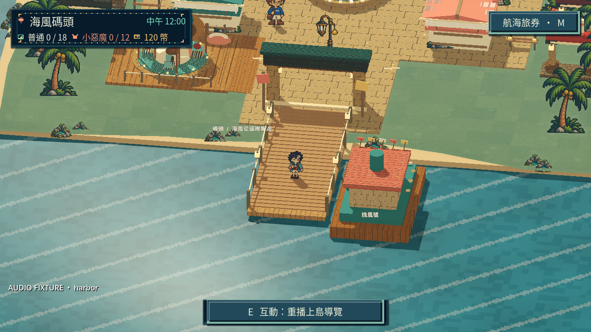
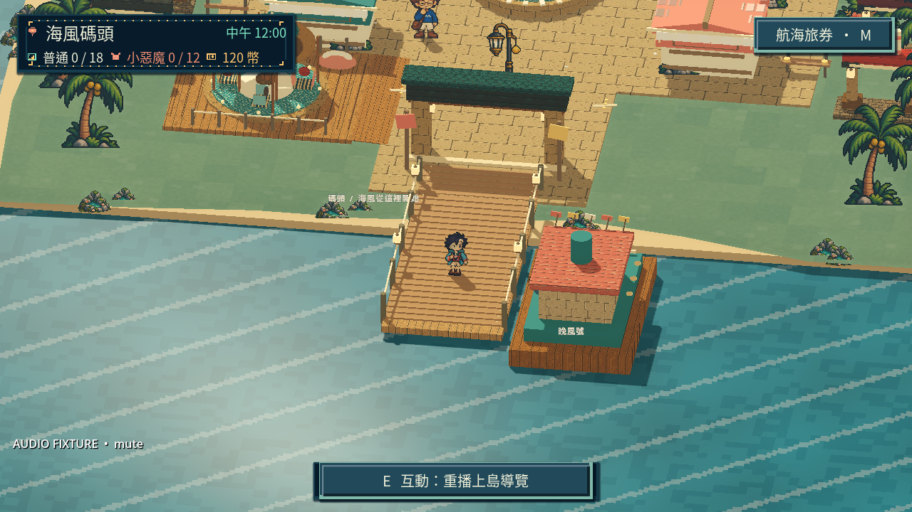

# [MIC-3] 精選並接入首區CC0聲音

> 狀態：進行中

## 內文

### 需求

首區背景音樂、環境聲與共用操作音效改用可追溯的 CC0 素材。依海港遊樂園氛圍與玩家操作選擇，保留比較、排除理由及原始授權證據；不能把免費或免版稅等同 CC0。十二款各別配器與節奏的整體完善仍由 MIC-2 驗收。

### 來源

2026-10-14（Asia/Taipei）使用者要求音效及背景音樂全部使用 CC0，並用心挑選真正適合的聲音。沿用至少六個不同來源的研究要求，及未實際試聽不可宣稱聽感通過的驗收規則。

### 驗收條件

- [x] 至少比較六位不同創作者的第一手素材頁，記錄實際閱讀或試聽範圍及採用、排除理由。
- [x] 本票接入的音樂、環境聲及音效均有 CC0 來源、作者、授權證據及檔案雜湊，可核對每一個實際使用素材。
- [ ] 碼頭、遊園與小遊戲各有符合用途的背景聲音，操作、拍貼、成功及失誤回饋可區分；音量、靜音、切換、暫停及離開正常。
- [ ] 原生喇叭或耳機實際試聽完整循環、音樂切換、密集操作、對話與玩法節奏，確認不刺耳、不掩蓋重要聲音；保存試聽紀錄與可播放證據。

### 測試流程

1. 查看比較表、授權原始頁及來源紀錄，核對實際素材與 CC0 證據。
2. 使用隔離存檔進入碼頭、廣場與遊戲，操作互動、拍貼、成功及失誤，檢查聲音及切換。
3. 測試主音量、音樂、音效、靜音、暫停、恢復、重試及退出。
4. 以喇叭或耳機至少聽完每首兩次循環及密集操作，記錄時點、聽感、修正與證據；技術檢查不當成試聽。

---

# 跟其他票的關係

- Blocks：無
- Blocked by：無
- Related：MIC-1、MIC-2、ART-23、ART-26

---

## 開始基準

`89bf0b4`；`feature/island-experience`。

# Commit-1

## 內文

問題：首區目前的聲音缺少逐素材 CC0 紀錄，命中和整局完成也共用同一種成功回饋，無法據此判定適合正式交付。

改動：碼頭、遊園與共用遊戲初始曲改接三首 CC0 候選，加入實錄海浪及一套操作聲。命中使用短音，結算與任務達成才使用完整成功曲；對話與四個旋律音高保留各自用途。比較十一位外部創作者、記錄採用及排除理由，並保存作者、原始授權頁、來源與素材雜湊。使用者的全 CC0 要求已記入指南。

驗收：三項遊戲局部測試與十八項 Python 檢查通過。主 Session 使用原生 Forward+／WASAPI 從同一個 Main 場景錄製約 32.8 秒混音，核對實際來源切換、完整結算短曲、靜音及恢復；PCM 無飽和，靜音中段峰值為零，恢復音量與原值一致，並實際看過原生截圖。此為腳本驅動的音訊技術驗收，沒有把它描述成三區走訪或小遊戲試玩。**待本機原生耳機／喇叭試聽完整兩次循環、音色、密集操作與耐聽度**，相關條件未勾選；十二款獨立配樂與日夜完整聲景仍依 MIC-2 驗收。

分支：`feature/island-experience`；固定開始基準：`89bf0b4`；[開票 commit](https://github.com/deadline314/Snapland/commit/4916828bb3e75a2783bcd1fbec55fa6a63cead22)。

跨組最小變動：[主場景的發音連接](../../game/main.gd) 將小遊戲命中與完整結算聲分開；沒有以本票宣稱角色動畫或美術已驗收。

### 測試結果

| 項目 | 結果 |
|---|---|
| CC0 來源／雜湊／音檔檢查 | 5 項通過，涵蓋全部 13 個實際音檔及原創角色滴滴聲聲明 |
| 安全啟動入口 | 13 項通過 |
| 音訊、對話、Main 整合 | 3 套通過，0 ERROR；原音訊斷言保留並擴充 |
| 原生混音 | Forward+／WASAPI 錄製；48kHz 立體聲、PCM 無飽和、靜音中段零訊號；不是聽感判斷 |
| 正式存檔及備份 | 雜湊與開始前一致；所有執行均指定隔離存檔 |
| 完整循環與耳機／喇叭聽感 | 未完成，保持未勾選 |
| 完整 CI | 交由遠端 CI；本輪未以局部檢查冒充完整通過 |

[精簡驗收摘要](images/MIC-3-verification.json)；[原生事件時間軸](images/MIC-3-native-timeline.json)；[原始 PCM 核對](images/MIC-3-native-pcm-check.json)。既有 NPC 動作與遮擋材質警告不屬於本票已解決範圍。

### 可播放錄音與原生截圖

[混音試聽 MP3](images/MIC-3-native-mix-preview.mp3)；[原始遊戲輸出 WAV](images/MIC-3-native-mix.wav)。這段短錄音包含三個音樂情境與操作、命中、失誤、快門、完整結算及靜音；不包含每首完整兩次循環。

[遊園音樂情境畫面](images/MIC-3-plaza.png)；[遊戲音樂情境畫面](images/MIC-3-game.png)。畫面都來自同一個 Main 場景，音樂情境以時間軸核對。

### 研究與授權佐證

[完整選材比較與實際查閱範圍](../../design/runtime/cc0-audio-selection.md)；[逐素材來源與雜湊](../../assets/audio/cc0/catalog.json)。以下是來源頁截圖，不是本作素材或試玩證據：

- [Kenney 操作音](images/MIC-3-reference-kenney.png)
- [Zane Little 遊園候選](images/MIC-3-reference-apple-cider.png)
- [Tarush Singhal 碼頭候選](images/MIC-3-reference-ukulele.png)
- [Écrivain 嘉年華短循環](images/MIC-3-reference-carnival.png)
- [jasinski 海浪擷取頁](images/MIC-3-reference-waves.png)／[原作者 CC0 頁](images/MIC-3-reference-waves-original.png)
- [Fupi 結算候選](images/MIC-3-reference-win.png)／[快步調小鎮替代候選](images/MIC-3-reference-loop-town.png)
- [Cleyton Kauffman 探索替代候選](images/MIC-3-reference-exploration.png)
