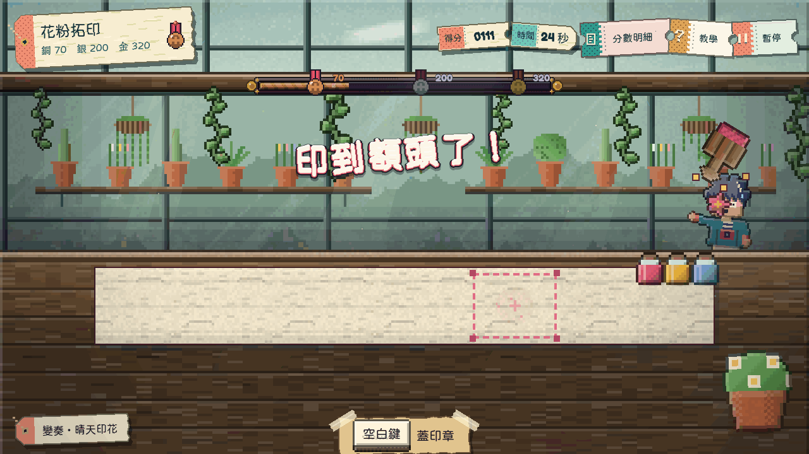

# [SG-100] 實作花粉拓印

> 狀態：完成

## 內文

### 需求

印章在紙上方左右擺動，看準時機按下把花朵印在虛線框裡，越正越高分。佔用苔光溫室的 game-083 位置，取代原本偏向規劃與多按鈕的設計。

### 來源

2026-11-28 使用者要求持續精進遊戲內容與畫面、做到票都完成後繼續找可做的事；苔光溫室十二格只開放了一部分。依 design/00-principles/simple-fun-minigames.md 改寫為單一動詞的街機式小遊戲（Bomberman Land 3 方向）。

### 驗收條件

- [x] 紙也開始移動，後段框越來越小。
- [x] 失手時印章蓋在主角額頭上，留下一朵大花印。
- [x] 整款只用方向鍵與一到兩顆按鍵，畫面上沒有操作按鈕面板；進場五秒內開始操作，沒有強制教學頁。
- [x] 一回合不超過 60 秒，回合內速度或變化明顯升級；至少兩種隨機出現的變奏。
- [x] 結算只顯示一個分數、銅銀金獎牌與一句評語；銅牌取得普通拍貼，未用輔助的金牌取得小惡魔拍貼。
- [x] 玩法物件達到街機小遊戲的畫面下限：沒有大面積純色、有材質與受光、描邊、接地陰影，色調與背景一致。
- [x] 鍵盤與手把都能完成；開啟減少動態後仍可遊玩。
- [x] 通過稽核十問，結果寫在設計目錄的該款說明；該區原有互動與其他小遊戲不受影響。

### 測試流程

1. 從區域攤位進場，不看說明直接玩一回合。
2. 故意失敗一次，再玩到銅牌與金牌。
3. 開啟減少動態與手把各玩一回合，確認拍貼入冊與重開後保留。

---

# 跟其他票的關係

- Blocks：無
- Blocked by：無
- Related：SG-66、ART-57

---

# Commit-1

## 內文

設計目錄的 game-083 還是植物工藝桌上多步驟拓印創作的舊案，苔光溫室第十一格沒有可玩的遊戲。
現在溫室北邊夜芽庭西側多了一座屋頂吊著一顆木頭花朵印章、下面一張印好粉紅花的紙，櫃台擺著三罐墨水的攤位，開放「花粉拓印」。畫面是溫室的花藝工作桌：後面是溫室玻璃與一排排盆栽、陽光光束和飄著的灰塵，上方一根木樑垂著幾串輕輕擺動的常春藤，銅勾吊著一條繩子，繩子下面是一顆大大的木頭花朵印章，左右擺來擺去。桌上鋪著一長張有纖維紋路、淡淡格線和鉛筆葉子草稿的米色紙，紙上有一個粉紅虛線框，四角有記號、中央有十字；印章的影子落在紙上，越低越小越深。按空白鍵（或 Enter、手把 A 鈕、點畫面）印章就停下、直直蓋下去，在紙上印出一朵帶點斑駁墨色的粉紅五瓣花：印進框裡就有分，越靠近中央越高，正中跳出「正中！」並閃一下，連續正中再加分。印完紙就捲過去，下一個框從右邊滑進來。主角站在工作桌另一頭探頭看，桌角排著三罐墨水，右下角是一盆小雛菊。印到框外時，印章彈起來越過桌子，「咚」地蓋在主角額頭上，主角嚇一跳、頭上轉著星星，額頭留下一朵粉紅小花，之後每印歪一次額頭多一朵、一直留到回合結束。沒碰過按鍵的回合一分都不得。
一回合 45 秒，印章越擺越快、框越來越小，四成場後紙開始左右飄。每回合隨機一種變奏：晴天印花、急性子印章（擺得更快）、紙飄日（一開始紙就會飄）。倒數時印章自己在框框正上方蓋下一朵花示範，開始時印章擺在離新框很遠的一端。第一次印歪不算失誤。輔助讓正中的範圍寬一點、印章擺慢一點，輔助回合不發小惡魔拍貼。
在原生畫面走過倒數示範、擺動、正中、印到額頭，依美術標準逐張檢查後修掉了：紙是一大片幾乎沒有變化的淡色（加上纖維、格線、鉛筆草稿和從左上到右下的光線明暗）、滑走的框和印到框外的花畫到紙外面蓋住盆栽（只畫在紙上）、倒數的大字橫幅蓋住紙和示範的框（整張工作桌往上移）、前景的盆栽壓到變奏標籤（移到右下角）。

### 測試結果

| 項目 | 結果 |
|---|---|
| 花粉拓印規則 | 通過：倒數示範、鍵盤與手把蓋章、蓋下時印章停住、蓋下期間再按無效、印完紙捲到新框、越靠中央分越高、連續正中、印歪蓋額頭與第一次不算失誤、額頭的花會累積、擺動加快與框縮小、後段紙會飄、三種變奏、輔助、不按不得分、金牌與銅牌整回合 |
| 局部回歸 | 遊戲目錄、溫室世界（走得到新攤位、原有路線不受影響）、街機共用流程、場景規範全部通過 |
| 設計與資料驗證 | 5 個範圍通過；Python 測試 217 / 217 |
| 原生畫面 | 遊玩、正中、印到額頭與減少動態過程沒有腳本錯誤；攤位在白天畫面看得到、靠近時跳出「玩花粉拓印」 |

規則測試以模擬按鍵玩整回合，每種情況取四個固定種子的平均：看到印章經過框框中央就立刻蓋下（延遲 0.02 秒）的玩家在三種變奏都拿到金牌（平均 378、394、427 分）、晚 0.09 秒才蓋的玩家拿到銅牌（163、93、165、132 分）、完全不按 0 分（另以 80 個固定種子、有無輔助各 40 回合確認完全不按都是 0 分），輔助回合到金牌也不發小惡魔拍貼。手把以模擬的 A 鈕事件確認能蓋章，沒有接實體手把；減少動態以原生畫面確認常春藤不擺、紙張直接換頁、星星不轉，仍可照常遊玩。分數門檻依模擬玩家訂定，難度與「看一眼就懂」尚未由真人試玩。

### 截圖

