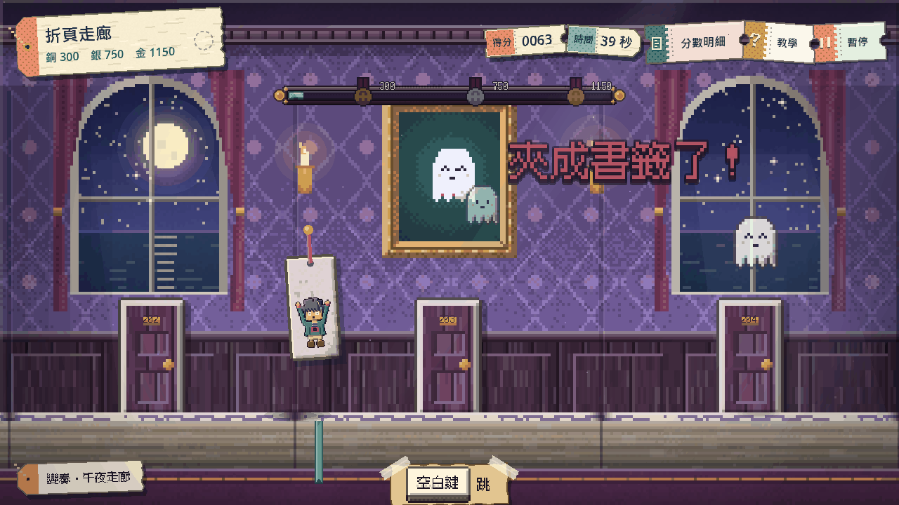

# [SG-103] 實作摺頁走廊

> 狀態：完成

## 內文

### 需求

走廊像書頁一樣一摺一摺闔起來，主角在走廊上奔跑，在牆面闔上的瞬間按鍵跳過摺痕。佔用幽幽旅館的 game-085 位置，取代原本偏向規劃與多按鈕的設計。

### 來源

2026-11-28 使用者要求持續精進遊戲內容與畫面、做到票都完成後繼續找可做的事；幽幽旅館剛開放，十二格小遊戲都還是空的。依 design/00-principles/simple-fun-minigames.md 改寫為單一動詞的街機式小遊戲（Bomberman Land 3 方向）。

### 驗收條件

- [x] 摺頁越來越快，偶爾兩頁連摺或停頓假動作。
- [x] 沒跳過時主角被夾進書頁，壓成一張扁扁的書籤飄出來。
- [x] 整款只用方向鍵與一到兩顆按鍵，畫面上沒有操作按鈕面板；進場五秒內開始操作，沒有強制教學頁。
- [x] 一回合不超過 60 秒，回合內速度或變化明顯升級；至少兩種隨機出現的變奏。
- [x] 結算只顯示一個分數、銅銀金獎牌與一句評語；銅牌取得普通拍貼，未用輔助的金牌取得小惡魔拍貼。
- [x] 玩法物件達到街機小遊戲的畫面下限：沒有大面積純色、有材質與受光、描邊、接地陰影，色調與背景一致。
- [x] 鍵盤與手把都能完成；開啟減少動態後仍可遊玩。
- [x] 通過稽核十問，結果寫在設計目錄的該款說明；該區原有互動與其他小遊戲不受影響。

### 測試流程

1. 從區域攤位進場，不看說明直接玩一回合。
2. 故意失敗一次，再玩到銅牌與金牌。
3. 開啟減少動態與手把各玩一回合，確認拍貼入冊與重開後保留。

---

# 跟其他票的關係

- Blocks：無
- Blocked by：無
- Related：SG-66、ART-57

---

# Commit-1

## 內文

幽幽旅館剛開放，十二個攤位都蓋著布、掛著「準備中」，旅館還沒有任何可玩的小遊戲；設計目錄的 game-085 還是要摺門牆、留書籤、接通三間房的舊案。
現在折頁走廊前的露臺多了第一座攤位：頂上攤著一本書頁正要闔起來的大書，書脊後探出一隻小幽靈，櫃台疊著幾本書和一條書籤緞帶，開放「折頁走廊」。畫面是旅館夜晚的走廊：月光從拱窗照進來，燭台的火苗一閃一閃，牆上掛著幽靈館主的金框肖像，小幽靈沿著牆飄過；地板是一本攤開的大書，一頁一頁往後捲，牆上的客房門牌號碼越數越大。地上每一道摺痕跑到主角腳下時，兩邊書頁會啪地闔起來，按空白鍵（或 ↑、手把 A 鈕）跳起來，闔上那一刻人在空中就跳過了；跳到最高點時剛好闔上會跳出「剛好！」加大分，連跳越多音越高、分數加成越多。沒跳過時主角被兩頁夾扁、只剩頭髮露在書頁上面，接著變成一張印著自己的書籤、掛著緞帶飄上去，然後從原地爬起來繼續跑。沒有書頁可跳時亂跳會踩空站不穩，所以一直按跳贏不了。
一回合 45 秒，走廊越跑越快、摺痕越來越密；後段有的摺痕會停在腳下、兩頁翹著發抖，往下一沉才闔上；有的會提早抽動一下騙你跳；還有兩頁連摺。小幽靈會飄到下一個要耍詐的摺痕上方偷笑，主角被夾時牠笑瞇了眼。每回合隨機一種變奏：午夜走廊、連摺之夜（連摺多又早）、頑皮鬼翻頁（發抖和假動作多又早）。倒數時主角自己跳過第一道摺痕示範，開始時第一道摺痕在一秒半以外。每回合第一次被夾不算失誤。輔助讓走廊跑慢一點、跳得久一點，輔助回合不發小惡魔拍貼。名稱沿用旅館房間的「折頁走廊」寫法。
旅館的街機小遊戲現在共用一張夜晚旅館背景：深紫天花板與齒狀飾條、淡紫花紋壁紙、兩扇看得見滿天星星與月光海面的拱窗和絲絨窗簾、幽靈館主的金框肖像、兩盞燭台與深色護牆板，星星會閃、燭火會晃、月暈會呼吸，還有小幽靈沿著牆慢慢飄過。
在原生畫面走過倒數示範、跳過書頁、發抖的摺痕、被夾扁、書籤飄走、後段加速與結算，逐張看過後修掉了：書頁太薄太短、闔起來時比主角小太多看不出來，地板是一整片灰白看不出是書，跑步時手一直往旁邊指像在指路。規則測試以模擬按鍵在三種變奏都拿到金牌（1515、1675、1355 分）、時機常差到三成秒的玩家拿到銅牌 387 分、完全不按 0 分，五十組種子放著不玩都是 0 分，一直按跳會踩空並被夾，輔助金牌不發小惡魔拍貼。手把只以模擬的 A 鈕事件確認能跳，沒有接實體手把；減少動態只以原生畫面確認主角不晃、書頁不抖、書籤不擺盪，發抖摺痕往下一沉的提示仍在，沒有真人實際操作。難度與「看一眼就懂」依畫面與模擬輸入判斷，尚未由真人試玩。

### 測試結果

| 項目 | 結果 |
|---|---|
| 折頁走廊規則 | 通過：倒數示範、跳躍與闔頁、剛好加分、被夾成書籤、踩空、發抖摺痕、假動作、連摺、加速、三種變奏、金牌與銅牌整回合、不操作不得分 |
| 局部回歸 | 遊戲目錄、旅館世界、街機共用流程、失敗拍貼、場景規範、區域往返、啟動全部通過 |
| 設計與資料驗證 | 5 個範圍通過；Python 測試 217 / 217 |
| 原生畫面 | 遊玩、減少動態與結算過程無 ERROR；攤位在旅館露臺看得到，互動點可走到 |

### 截圖

