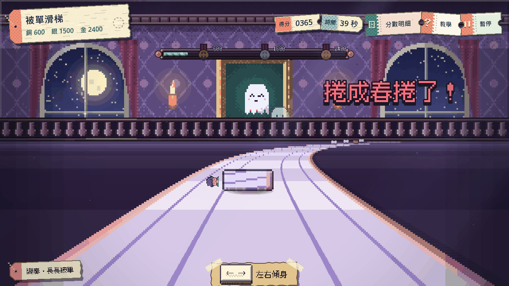

# [SG-104] 實作被單滑梯

> 狀態：完成

## 內文

### 需求

坐在床單上從長長的被單滑梯溜下來，左右偏移撿枕頭，閃過睡著的貓。佔用幽幽旅館的 game-086 位置，取代原本偏向規劃與多按鈕的設計。

### 來源

2026-11-28 使用者要求持續精進遊戲內容與畫面、做到票都完成後繼續找可做的事；幽幽旅館剛開放，十二格小遊戲都還是空的。依 design/00-principles/simple-fun-minigames.md 改寫為單一動詞的街機式小遊戲（Bomberman Land 3 方向）。

### 驗收條件

- [x] 坡度越來越陡，出現會翻身擋路的貓與分岔。
- [x] 撞到時主角被床單捲成一條春捲一路滾到底。
- [x] 整款只用方向鍵與一到兩顆按鍵，畫面上沒有操作按鈕面板；進場五秒內開始操作，沒有強制教學頁。
- [x] 一回合不超過 60 秒，回合內速度或變化明顯升級；至少兩種隨機出現的變奏。
- [x] 結算只顯示一個分數、銅銀金獎牌與一句評語；銅牌取得普通拍貼，未用輔助的金牌取得小惡魔拍貼。
- [x] 玩法物件達到街機小遊戲的畫面下限：沒有大面積純色、有材質與受光、描邊、接地陰影，色調與背景一致。
- [x] 鍵盤與手把都能完成；開啟減少動態後仍可遊玩。
- [x] 通過稽核十問，結果寫在設計目錄的該款說明；該區原有互動與其他小遊戲不受影響。

### 測試流程

1. 從區域攤位進場，不看說明直接玩一回合。
2. 故意失敗一次，再玩到銅牌與金牌。
3. 開啟減少動態與手把各玩一回合，確認拍貼入冊與重開後保留。

---

# 跟其他票的關係

- Blocks：無
- Blocked by：無
- Related：SG-66、ART-57

---

# Commit-1

## 內文

幽幽旅館只有折頁走廊一款可玩，夢境客房前的攤位還蓋著布；設計目錄的 game-086 還是要拉床單兩角把枕頭滑送到床頭的舊案。
現在夢境客房前的露臺多了一座攤位：頂上一張小床、條紋床單從床上一路垂下來當滑梯，上面睡著一隻橘貓，櫃台擺著枕頭和疊好的被子，開放「被單滑梯」。畫面從主角背後往下看：旅館大廳的拱窗與迴廊欄杆在上方，一條長長的條紋床單滑梯從迴廊底下一路往夜色裡延伸，遠處左右彎來彎去，床單條紋一路往身後飛。主角坐在床單一角往下溜，按住 ← 或 → 往那邊傾身，撿起排在路上的枕頭，連撿越多音越高、分數加成越多，漏掉一個就斷掉連撿。睡著的貓縮成一團、頭上冒 z，枕頭會排成弧線繞在貓的空的那一邊；撞到貓或棉被堡，床單一捲把主角包成春捲，只露出頭，一路滾到滑梯盡頭，被撞到的貓嚇得跳下滑梯，然後主角從中間重新溜。
一回合 45 秒，滑梯越溜越陡越快、東西越排越密；後段有會翻身的貓，翻身前先抖尾巴、冒驚嘆號，再朝主角那邊滾過來；還有一疊疊彩色棉被堡把滑梯分成左右兩條，枕頭只排在其中一條。每回合隨機一種變奏：長長被單、貓咪午睡會（貓多、早早就會翻身）、棉被堡迷宮（棉被堡多又早）。倒數時主角自己繞過第一隻貓示範，開始時正前方一隻貓、旁邊一串枕頭指路。每回合第一次捲成春捲不算失誤。輔助讓滑梯溜慢一點，輔助回合不發小惡魔拍貼。
在原生畫面走過倒數示範、撿枕頭、貓抖尾巴、捲成春捲、春捲滾走、棉被堡、後段加速與結算，逐張看過後修掉了：滑梯盡頭和大廳之間是一整條平平的紫色帶子，改成迴廊的雕花欄杆；被撞到的貓在主角前面擋住捲春捲的畫面，改成嚇得跳下滑梯；主角太大，正前方的枕頭看起來像疊在頭上，縮小並往下移。規則測試以模擬按鍵在三種變奏都拿到金牌（3976、2538、2840 分）、反應慢又常偏掉的騎手拿到銅牌 1429 分、完全不按 0 分，五十組種子放著不玩都是 0 分，輔助金牌不發小惡魔拍貼。手把只以模擬的左搖桿與十字鍵事件確認能傾身，沒有接實體手把；減少動態只以原生畫面確認主角不晃、枕頭不跳、貓不轉圈、沒有速度線、春捲不轉，仍照常遊玩，沒有真人實際操作。難度與「看一眼就懂」依畫面與模擬輸入判斷，尚未由真人試玩。

### 測試結果

| 項目 | 結果 |
|---|---|
| 被單滑梯規則 | 通過：倒數示範、左右傾身與手把、撿枕頭與連撿、漏撿斷連撿、撞貓捲春捲、翻身的貓、棉被堡、加速、三種變奏、金牌與銅牌整回合、不操作不得分 |
| 局部回歸 | 遊戲目錄、旅館世界、街機共用流程、失敗拍貼、場景規範、區域往返、啟動全部通過 |
| 設計與資料驗證 | 5 個範圍通過；Python 測試 217 / 217 |
| 原生畫面 | 遊玩、減少動態與結算過程無 ERROR |

### 截圖

