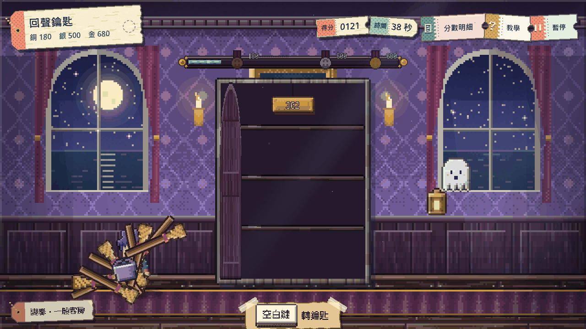

# [SG-105] 實作回聲鑰匙

> 狀態：完成

## 內文

### 需求

門鎖上的轉圈一直轉，在缺口對準鑰匙孔的瞬間按鍵，一圈一圈解開房門。佔用幽幽旅館的 game-087 位置，取代原本偏向規劃與多按鈕的設計。

### 來源

2026-11-28 使用者要求持續精進遊戲內容與畫面、做到票都完成後繼續找可做的事；幽幽旅館剛開放，十二格小遊戲都還是空的。依 design/00-principles/simple-fun-minigames.md 改寫為單一動詞的街機式小遊戲（Bomberman Land 3 方向）。

### 驗收條件

- [x] 轉速越來越快，後段會反轉或忽快忽慢。
- [x] 解錯時門一開掉出一櫃掃把，把主角埋在底下。
- [x] 整款只用方向鍵與一到兩顆按鍵，畫面上沒有操作按鈕面板；進場五秒內開始操作，沒有強制教學頁。
- [x] 一回合不超過 60 秒，回合內速度或變化明顯升級；至少兩種隨機出現的變奏。
- [x] 結算只顯示一個分數、銅銀金獎牌與一句評語；銅牌取得普通拍貼，未用輔助的金牌取得小惡魔拍貼。
- [x] 玩法物件達到街機小遊戲的畫面下限：沒有大面積純色、有材質與受光、描邊、接地陰影，色調與背景一致。
- [x] 鍵盤與手把都能完成；開啟減少動態後仍可遊玩。
- [x] 通過稽核十問，結果寫在設計目錄的該款說明；該區原有互動與其他小遊戲不受影響。

### 測試流程

1. 從區域攤位進場，不看說明直接玩一回合。
2. 故意失敗一次，再玩到銅牌與金牌。
3. 開啟減少動態與手把各玩一回合，確認拍貼入冊與重開後保留。

---

# 跟其他票的關係

- Blocks：無
- Blocked by：無
- Related：SG-66、ART-57

---

# Commit-1

## 內文

幽幽旅館櫃檯大廳前的攤位還蓋著布；設計目錄的 game-087 還是要敲門、聽回聲找出三個空腔再轉鎖圈的舊案。
現在櫃檯大廳前的露臺多了一座攤位：頂上一個大大的黃銅圓鎖、幾圈銅環、鑰匙插在上方的鑰匙孔，櫃台擺著一串鑰匙和一把小掃把，開放「回聲鑰匙」。畫面是旅館夜晚的走廊，一扇拱形客房門立在紫色地毯上，門上掛著房號牌，中間一個黃銅圓鎖，裡面好幾圈銅環在轉，每圈有一個發淡紫光的缺口；鑰匙從上方插進來，鑰匙尖抵著正在開的那一圈。缺口快轉到鑰匙底下時，鑰匙孔冒出一圈圈回聲、經過時滴答一聲；這時按空白鍵（或 ↑、手把 A 鈕）喀啦一聲，那圈變成金色停住、鑰匙往裡推一格，剛好對準加分最多、連開越多加成越多。最後一圈打開時門往後一甩，露出點著燈的溫暖客房，主角高興得跳起來，提燈的幽靈服務生笑瞇瞇，接著換下一扇門、房號往上數。缺口不在鑰匙下面時按，門一開是黑漆漆的掃把櫃，一堆掃把和水桶飛出來把主角埋住，這扇門重新上鎖。
一回合 45 秒，鎖圈越轉越快，一扇門從三圈加到五圈；後段有的鎖圈會先抖一下、冒出「反轉！」再反方向轉，有的忽快忽慢。每回合隨機一種變奏：一般客房、倒轉鎖（早早就會反轉）、醉醺醺的鎖（一直忽快忽慢）。倒數時鎖自己打開第一圈示範，開始時每個缺口都離鑰匙很遠。每回合第一次被掃把埋住不算失誤。輔助讓鎖圈轉慢一點、對準範圍寬一點，輔助回合不發小惡魔拍貼。
在原生畫面走過倒數示範、回聲、開門、反轉前的抖動、掃把櫃、被埋住、後段與結算，逐張看過後修掉了：銅環和黃銅鎖板同色，幾圈糊成一團看不出缺口在哪圈，改成鎖板中間是深色凹槽、缺口加大；房號牌被上方的獎牌條擋住，移到門的拱頂；門後的客房是一整片橘色，加上條紋壁紙、地毯和燈光。規則測試以模擬按鍵在三種變奏都拿到金牌（975、861、717 分）、手抖的玩家拿到銅牌 468 分、完全不按 0 分，五十組種子放著不玩都是 0 分，亂按會一直被掃把埋住，輔助金牌不發小惡魔拍貼。手把只以模擬的 A 鈕事件確認能轉鑰匙，沒有接實體手把；減少動態只以原生畫面確認回聲不擴散、鎖圈不抖但「反轉！」仍在、門直接開關、掃把直接落下，仍照常遊玩，沒有真人實際操作。難度與「看一眼就懂」依畫面與模擬輸入判斷，尚未由真人試玩。

### 測試結果

| 項目 | 結果 |
|---|---|
| 回聲鑰匙規則 | 通過：倒數示範、開鎖圈與剛好加分、開門換門、掃把櫃與重新上鎖、亂按、反轉與忽快忽慢、加速與圈數增加、三種變奏、金牌與銅牌整回合、不操作不得分 |
| 局部回歸 | 遊戲目錄、旅館世界、失敗拍貼、街機共用流程、場景規範通過 |
| 設計與資料驗證 | 5 個範圍通過；Python 測試 217 / 217 |
| 原生畫面 | 遊玩、減少動態與結算過程無 ERROR |

### 截圖

