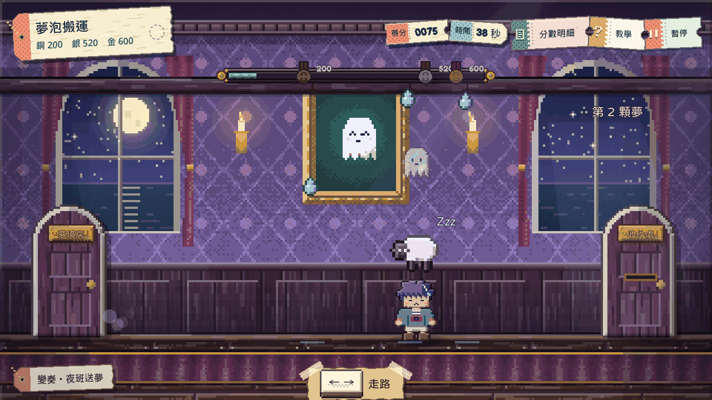

# [SG-106] 實作夢泡搬運

> 狀態：完成

## 內文

### 需求

頭頂著一顆夢泡泡左右走過走廊，避開滴水與搖晃的吊燈，走太快泡泡會晃得厲害。佔用幽幽旅館的 game-088 位置，取代原本偏向規劃與多按鈕的設計。

### 來源

2026-11-28 使用者要求持續精進遊戲內容與畫面、做到票都完成後繼續找可做的事；幽幽旅館剛開放，十二格小遊戲都還是空的。依 design/00-principles/simple-fun-minigames.md 改寫為單一動詞的街機式小遊戲（Bomberman Land 3 方向）。

### 驗收條件

- [x] 泡泡越搬越大越難平衡，出現會吹風的通風口。
- [x] 泡泡破掉時夢裡的綿羊掉下來坐在主角頭上。
- [x] 整款只用方向鍵與一到兩顆按鍵，畫面上沒有操作按鈕面板；進場五秒內開始操作，沒有強制教學頁。
- [x] 一回合不超過 60 秒，回合內速度或變化明顯升級；至少兩種隨機出現的變奏。
- [x] 結算只顯示一個分數、銅銀金獎牌與一句評語；銅牌取得普通拍貼，未用輔助的金牌取得小惡魔拍貼。
- [x] 玩法物件達到街機小遊戲的畫面下限：沒有大面積純色、有材質與受光、描邊、接地陰影，色調與背景一致。
- [x] 鍵盤與手把都能完成；開啟減少動態後仍可遊玩。
- [x] 通過稽核十問，結果寫在設計目錄的該款說明；該區原有互動與其他小遊戲不受影響。

### 測試流程

1. 從區域攤位進場，不看說明直接玩一回合。
2. 故意失敗一次，再玩到銅牌與金牌。
3. 開啟減少動態與手把各玩一回合，確認拍貼入冊與重開後保留。

---

# 跟其他票的關係

- Blocks：無
- Blocked by：無
- Related：SG-66、ART-57

---

# Commit-1

## 內文

夢境客房前的第二座攤位還蓋著布；設計目錄的 game-088 還是要托泡、調呼吸並穿門的舊案。
現在夢境客房前的露臺多了一座攤位：頂上一顆大大的夢泡泡、裡面縮著一隻小綿羊，櫃台擺著枕頭和睡帽，開放「夢泡搬運」。畫面是旅館夜晚的走廊，左邊「夢境房」的門縫冒出淡紫色的雲，右邊是有黃銅投信口的「收件處」。主角雙手舉著、頭頂一顆會閃虹光的夢泡泡，泡泡裡飄著睡著的綿羊和星星；按住 ← 或 → 走路，起步時泡泡往後歪、停步時往前甩，全速走的腳步剛好和泡泡同拍，一直按住會越晃越大，走一走、停一停最穩。天花板的裂縫會先冒出水珠再滴下來，吊燈前後擺，後段地上的通風口會噴蒸氣把泡泡吹歪。送到收件處時泡泡飄進投信口，全程沒晃過一半還有「穩穩送達」加分，下一顆泡泡更大、送到也更值錢。泡泡晃掉或被滴水、吊燈碰到時亮晶晶地碎開，夢裡的綿羊掉下來坐在主角頭上打呼，夢沒了，下一顆又從小泡泡開始。
一回合 45 秒，泡泡越送越大越難平衡，後段多了吊燈、會吹風的通風口和更多障礙。每回合隨機一種變奏：夜班送夢、漏風走廊（通風口多又早）、雨夜滴水（滴水多又快）。倒數時主角自己走幾步讓泡泡晃給你看，開始時回到夢境房門口。每回合第一次破掉不算失誤。輔助讓泡泡晃得輕一點，輔助回合不發小惡魔拍貼。
試算時發現原本的規則下完全不管障礙、一路衝的玩法分數最高，於是改成泡泡破掉時下一顆從小泡泡重來、越大的泡泡送到越值錢，小心送的人能一路把泡泡養大。在原生畫面走過倒數示範、走路晃動、送達、更大的泡泡、滴水破泡、綿羊坐頭、後段與結算，逐張看過後修掉了：吊燈太小像小籃子，放大並加上燭光；失敗字句太長，改成「泡泡破了！」，綿羊的笑點交給畫面。規則測試以模擬按鍵在三種變奏都拿到金牌（685、830、955 分）、完全不管障礙一路衝的玩家拿到銅牌 500 分、完全不動 0 分，五十組種子放著不玩都是 0 分，全速衝大泡泡會晃掉、走走停停能送到，輔助金牌不發小惡魔拍貼。手把只以模擬的左搖桿與十字鍵事件確認能走，沒有接實體手把；減少動態只以原生畫面確認主角不晃、星星不閃、綿羊不搖，水珠與吊燈照實際位置顯示，仍照常遊玩，沒有真人實際操作。難度與「看一眼就懂」依畫面與模擬輸入判斷，尚未由真人試玩。

### 測試結果

| 項目 | 結果 |
|---|---|
| 夢泡搬運規則 | 通過：倒數示範、走路與手把、起步停步晃動、全速衝會晃掉、走走停停送得到、送達與泡泡變大、滴水、吊燈、通風口、綿羊坐頭、加速、三種變奏、金牌與銅牌整回合、不操作不得分 |
| 局部回歸 | 遊戲目錄、旅館世界、失敗拍貼、街機共用流程、場景規範通過 |
| 設計與資料驗證 | 5 個範圍通過；Python 測試全數通過 |
| 原生畫面 | 遊玩、減少動態與結算過程無 ERROR |

### 截圖

