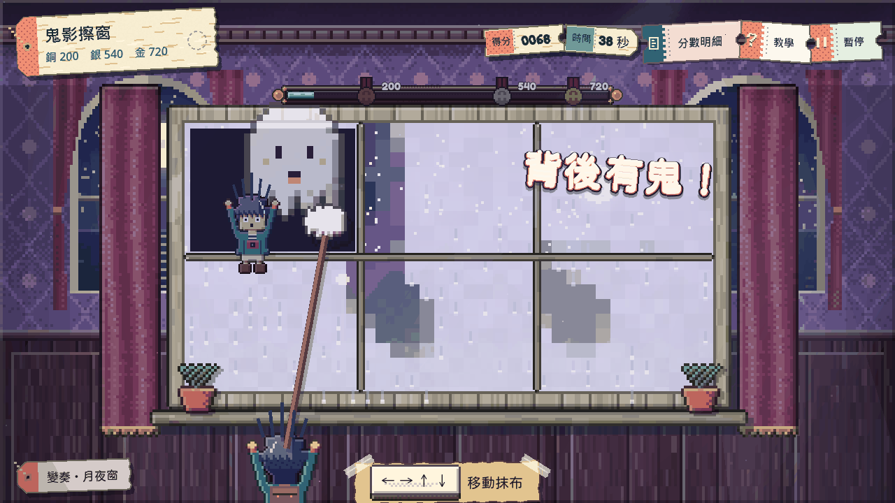

# [SG-107] 實作鬼影擦窗

> 狀態：完成

## 內文

### 需求

移動抹布擦掉起霧的窗戶，在小鬼的臉淡掉前擦出來讓他打招呼得分。佔用幽幽旅館的 game-089 位置，取代原本偏向規劃與多按鈕的設計。

### 來源

2026-11-28 使用者要求持續精進遊戲內容與畫面、做到票都完成後繼續找可做的事；幽幽旅館剛開放，十二格小遊戲都還是空的。依 design/00-principles/simple-fun-minigames.md 改寫為單一動詞的街機式小遊戲（Bomberman Land 3 方向）。

### 驗收條件

- [x] 霧起得越來越快，小鬼會在不同窗格閃現。
- [x] 擦錯時擦出的是主角自己的倒影，背後還站著一隻鬼，嚇得頭髮豎起。
- [x] 整款只用方向鍵與一到兩顆按鍵，畫面上沒有操作按鈕面板；進場五秒內開始操作，沒有強制教學頁。
- [x] 一回合不超過 60 秒，回合內速度或變化明顯升級；至少兩種隨機出現的變奏。
- [x] 結算只顯示一個分數、銅銀金獎牌與一句評語；銅牌取得普通拍貼，未用輔助的金牌取得小惡魔拍貼。
- [x] 玩法物件達到街機小遊戲的畫面下限：沒有大面積純色、有材質與受光、描邊、接地陰影，色調與背景一致。
- [x] 鍵盤與手把都能完成；開啟減少動態後仍可遊玩。
- [x] 通過稽核十問，結果寫在設計目錄的該款說明；該區原有互動與其他小遊戲不受影響。

### 測試流程

1. 從區域攤位進場，不看說明直接玩一回合。
2. 故意失敗一次，再玩到銅牌與金牌。
3. 開啟減少動態與手把各玩一回合，確認拍貼入冊與重開後保留。

---

# 跟其他票的關係

- Blocks：無
- Blocked by：無
- Related：SG-66、ART-57

---

# Commit-1

## 內文

失物室前的攤位還蓋著布；設計目錄的 game-089 還是要移刮片、噴霧並借月光讓窗紋透光的舊案。
現在失物室前的露臺多了一座攤位：頂上一扇起霧的小四格窗，其中一格擦亮、小鬼從裡面探頭，櫃台擺著水桶、抹布和粉紅毛巾，開放「鬼影擦窗」。畫面是旅館夜晚的大廳，兩片絲絨窗簾中間一扇六格大窗，窗外是有月亮、樹林和路燈的花園；玻璃上一塊一塊起霧、還會流下水痕。主角站在窗前，拿著綁著抹布的長竿，用方向鍵移動抹布，抹布走過的地方就擦掉霧。小鬼會躲在某一格窗後偷看，那一格透出淡紫光，快淡掉時光越來越弱；把那格擦乾淨，小鬼穿過玻璃笑著揮手、冒出金色亮點，越快擦出來分數越高，連續擦出還有加成。霧會一直長回來。路過別格擦到一點沒關係，但在沒有小鬼的那一格擦得太乾淨、或一直待在那格擦，那格就變成鏡子：看到自己嚇壞的倒影，背後站著一隻咧嘴笑的大鬼，房裡的主角跳起來、頭髮全豎起來。
一回合 45 秒，霧長回來越來越快，小鬼待的時間越來越短，後段會一陣煙閃到別格。每回合隨機一種變奏：月夜窗、雙胞胎小鬼（有時兩隻一起來）、濃霧夜（霧長得更快、早早就會閃格）。倒數時抹布自己擦出第一隻小鬼示範，開始時整扇窗重新起霧。每回合第一次被嚇到不算失誤。輔助讓霧長得慢一點、小鬼待久一點，輔助回合不發小惡魔拍貼。
在原生畫面走過倒數示範、擦到一半、小鬼揮手、擦錯格的倒影、後段與結算，逐張看過後修掉了：新的字句樣式變大後，「哈囉！」和「背後有鬼！」被畫面右邊切掉，改成擺在窗戶另一側的上方窗格，不會蓋住小鬼或倒影；主角從底下伸出一條拉長的藍色手臂很怪，改成拿著綁抹布的木頭長竿。規則測試以模擬按鍵在三種變奏都拿到金牌（990、876、805 分）、反應慢的玩家拿到銅牌 401 分、完全不動 0 分，五十組種子放著不玩都是 0 分，靜止的抹布擦不掉霧，點一下方向鍵抹布會小移一下，輔助金牌不發小惡魔拍貼。手把只以模擬的左搖桿事件確認能移動抹布，沒有接實體手把；減少動態只以原生畫面確認小鬼不晃、光不閃、抹布不歪、主角不跳，仍照常遊玩，沒有真人實際操作。難度與「看一眼就懂」依畫面與模擬輸入判斷，尚未由真人試玩。

### 測試結果

| 項目 | 結果 |
|---|---|
| 鬼影擦窗規則 | 通過：倒數示範、移動抹布與手把、擦霧與霧長回來、小鬼揮手與快擦加分、小鬼淡掉、閃格、擦錯格的倒影、加速、三種變奏、金牌與銅牌整回合、不操作不得分 |
| 局部回歸 | 遊戲目錄、旅館世界、失敗拍貼、街機共用流程、場景規範通過 |
| 設計與資料驗證 | 5 個範圍通過；Python 測試全數通過 |
| 原生畫面 | 遊玩、減少動態與結算過程無 ERROR |

### 截圖

