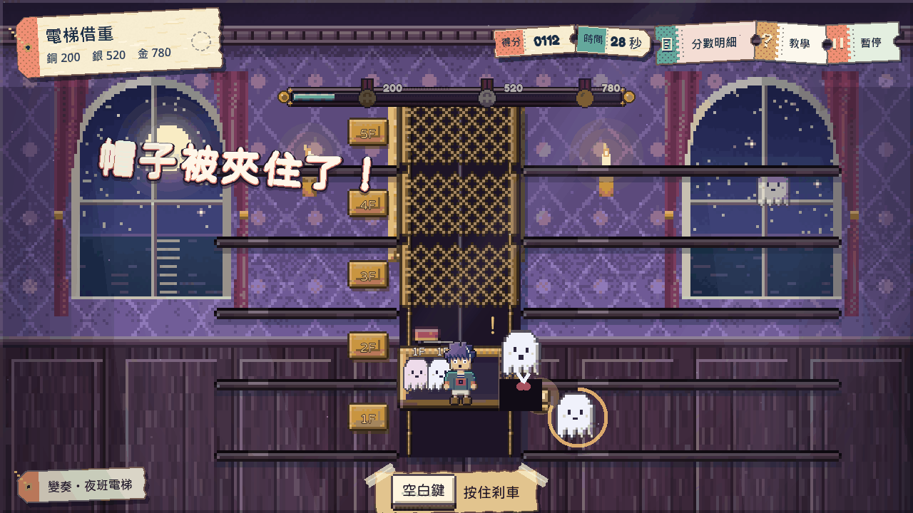

# [SG-108] 實作電梯借重

> 狀態：完成

## 內文

### 需求

電梯一直上上下下，按鍵在電梯剛好對齊樓層時停下讓客人進出。佔用幽幽旅館的 game-090 位置，取代原本偏向規劃與多按鈕的設計。

### 來源

2026-11-28 使用者要求持續精進遊戲內容與畫面、做到票都完成後繼續找可做的事；幽幽旅館剛開放，十二格小遊戲都還是空的。依 design/00-principles/simple-fun-minigames.md 改寫為單一動詞的街機式小遊戲（Bomberman Land 3 方向）。

### 驗收條件

- [x] 電梯越跑越快，偶爾有急著上樓的客人催促。
- [x] 停在兩層中間時客人的腳在半空晃，門還把主角的帽子夾住。
- [x] 整款只用方向鍵與一到兩顆按鍵，畫面上沒有操作按鈕面板；進場五秒內開始操作，沒有強制教學頁。
- [x] 一回合不超過 60 秒，回合內速度或變化明顯升級；至少兩種隨機出現的變奏。
- [x] 結算只顯示一個分數、銅銀金獎牌與一句評語；銅牌取得普通拍貼，未用輔助的金牌取得小惡魔拍貼。
- [x] 玩法物件達到街機小遊戲的畫面下限：沒有大面積純色、有材質與受光、描邊、接地陰影，色調與背景一致。
- [x] 鍵盤與手把都能完成；開啟減少動態後仍可遊玩。
- [x] 通過稽核十問，結果寫在設計目錄的該款說明；該區原有互動與其他小遊戲不受影響。

### 測試流程

1. 從區域攤位進場，不看說明直接玩一回合。
2. 故意失敗一次，再玩到銅牌與金牌。
3. 開啟減少動態與手把各玩一回合，確認拍貼入冊與重開後保留。

---

# 跟其他票的關係

- Blocks：無
- Blocked by：無
- Related：SG-66、ART-57

---

# Commit-1

## 內文

櫃檯大廳的第二座攤位還蓋著布；設計目錄的 game-090 還是只有標題、沒有逐款規格。
現在櫃檯大廳前的露臺多了一座攤位：頂上一座小小的黃銅鐵籠電梯，掛著鋼索、上面有指針錶，裡面坐著一隻幽靈，櫃台擺著紅色門僮帽，開放「電梯借重」。畫面是旅館大廳剖開的五層電梯井：深色木頭樓板、每層一塊黃銅樓層牌，黃銅鐵籠電梯吊在鋼索上一直上上下下，主角戴著紅色門僮帽在裡面開電梯。按住空白鍵（或 ↓、手把 A 鈕）剎車，兩邊導軌冒火花，電梯會滑一段才停；停得剛好對齊樓層時叮一聲、鐵門摺開，等在旁邊亮著呼叫燈的幽靈客人飄進來，頭上冒出要去的樓層，送到那層再停一次讓他出去得分，停得一絲不差跳出「剛剛好！」加分。電梯裡每多一位客人就更重，剎車滑得更遠，載滿時要更早按，這就是題目的「借重」。停在兩層中間時門照開：客人的小腳懸在縫上晃，主角的帽子被鐵門夾住拉走。
一回合 45 秒，電梯越跑越快、客人越叫越密；等太久的客人會走樓梯，後段有喊「快！」的客人，送到加倍。每回合隨機一種變奏：夜班電梯、退房潮（客人多、急著走的多）、胖胖幽靈團（每位客人更重）。倒數時電梯自己停到第一位客人的樓層示範，開始時從一樓出發。每回合第一次夾到帽子不算失誤。輔助讓電梯跑慢一點、對齊範圍寬一點，輔助回合不發小惡魔拍貼。
在原生畫面走過倒數示範、剎車火花、對齊停靠、載滿客人、停在兩層中間、後段與結算，逐張看過後修掉了：最頂樓被上方的獎牌條擋住，整座電梯井往下移、樓層間距縮小；電梯自己的鐵門關著時把整個車廂蓋住，看不到主角和客人，改成半透明的鐵門。規則測試以模擬按鍵在三種變奏都拿到金牌（867、907、799 分）、估錯滑行距離的玩家拿到銅牌 479 分、完全不按 0 分，五十組種子放著不玩都是 0 分，載滿時滑行距離明顯變長，輔助金牌不發小惡魔拍貼。手把只以模擬的 A 鈕事件確認能剎車，沒有接實體手把；減少動態只以原生畫面確認客人不晃、沒有火花、門直接開關，仍照常遊玩，沒有真人實際操作。難度與「看一眼就懂」依畫面與模擬輸入判斷，尚未由真人試玩。

### 測試結果

| 項目 | 結果 |
|---|---|
| 電梯借重規則 | 通過：倒數示範、自己上下與轉向、剎車滑行、客人越多滑越遠、對齊載客與送客、剛剛好加分、沒人的樓層、停在兩層中間夾帽子、等太久走樓梯、急著走的客人加倍、加速、三種變奏、金牌與銅牌整回合、不操作不得分 |
| 局部回歸 | 遊戲目錄、旅館世界、失敗拍貼、街機共用流程、場景規範通過 |
| 設計與資料驗證 | 5 個範圍通過；Python 測試全數通過 |
| 原生畫面 | 遊玩、減少動態與結算過程無 ERROR |

### 截圖

