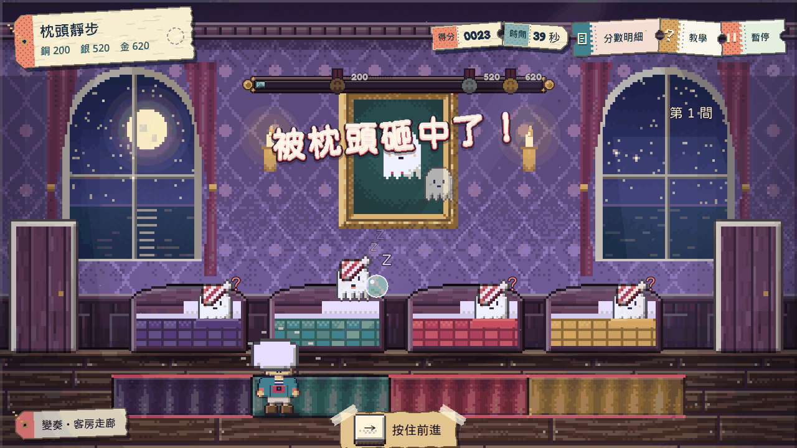

# [SG-109] 實作枕頭靜步

> 狀態：完成

## 內文

### 需求

客人打呼的時候可以往前走，打呼一停立刻站住，躡手躡腳穿過整排客房。佔用幽幽旅館的 game-091 位置，取代原本偏向規劃與多按鈕的設計。

### 來源

2026-11-28 使用者要求持續精進遊戲內容與畫面、做到票都完成後繼續找可做的事；幽幽旅館剛開放，十二格小遊戲都還是空的。依 design/00-principles/simple-fun-minigames.md 改寫為單一動詞的街機式小遊戲（Bomberman Land 3 方向）。

### 驗收條件

- [x] 打呼節奏越來越不規則，有客人會假裝睡著偷看。
- [x] 被發現時客人坐起來一顆枕頭砸在主角臉上。
- [x] 整款只用方向鍵與一到兩顆按鍵，畫面上沒有操作按鈕面板；進場五秒內開始操作，沒有強制教學頁。
- [x] 一回合不超過 60 秒，回合內速度或變化明顯升級；至少兩種隨機出現的變奏。
- [x] 結算只顯示一個分數、銅銀金獎牌與一句評語；銅牌取得普通拍貼，未用輔助的金牌取得小惡魔拍貼。
- [x] 玩法物件達到街機小遊戲的畫面下限：沒有大面積純色、有材質與受光、描邊、接地陰影，色調與背景一致。
- [x] 鍵盤與手把都能完成；開啟減少動態後仍可遊玩。
- [x] 通過稽核十問，結果寫在設計目錄的該款說明；該區原有互動與其他小遊戲不受影響。

### 測試流程

1. 從區域攤位進場，不看說明直接玩一回合。
2. 故意失敗一次，再玩到銅牌與金牌。
3. 開啟減少動態與手把各玩一回合，確認拍貼入冊與重開後保留。

---

# 跟其他票的關係

- Blocks：無
- Blocked by：無
- Related：SG-66、ART-57

---

# Commit-1

## 內文

夢境客房的第三座攤位還蓋著布；設計目錄的 game-091 還是只有標題、沒有逐款規格。
現在夢境客房前的露臺多了一座攤位：頂上一張小床，幽靈客人戴著條紋睡帽蓋著紅被子睡覺、頭上一個大大的 Z，櫃台擺著枕頭和被子，開放「枕頭靜步」。畫面是旅館夜晚的客房，後牆前一排四張床，床上的幽靈客人戴著睡帽、蓋著拼布被，鼻子吹著鼻涕泡泡一鼓一縮、頭上飄著 Z。主角從左邊的門躡手躡腳走到右邊的門：按住 → 往前走，放開立刻站住。每張床前有一塊地毯，那是那位客人看得到的地方；客人打呼時可以走，泡泡縮小、Z 變小寫就是快醒了，醒來時睜開眼睛冒出問號、地毯邊緣發紅光，醒來的一瞬間還來得及站住，之後還在走就會被發現：客人坐起來，一顆枕頭旋轉著飛過來砸在主角臉上、羽毛四散，主角往後退一點。走過一張床得分，連過越多加成越多，走到對面的門再換下一間。
一回合 45 秒，打呼越來越短、越來越不規則；後段有客人假裝睡著，閉著一隻眼睛偷看，這時也不能動。每回合隨機一種變奏：客房走廊、淺眠客人（打呼更短）、偷看大會（假睡的客人多又早）。倒數時主角自己趁打呼走幾步示範，開始時回到門口、客人都是真睡。每回合第一次挨枕頭不算失誤。輔助讓醒來後停下的反應時間長一點，輔助回合不發小惡魔拍貼。
在原生畫面走過倒數示範、趁打呼前進、客人醒來時站住、假睡偷看、枕頭飛來與砸在臉上、後段與結算，逐張看過後修掉了：幽靈客人被畫在床頭板後面，只看得到睡帽，改成躺在枕頭上、被子蓋到下巴。試算時原本前進太慢、淺眠客人那一種幾乎拿不到分，調快前進速度、縮短醒著的時間後，三種變奏難度接近。規則測試以模擬按鍵在三種變奏都拿到金牌（745、645、745 分）、反應慢的玩家拿到銅牌 477 分、完全不動 0 分，五十組種子放著不玩都是 0 分，醒來的一瞬間站住不會被抓，輔助金牌不發小惡魔拍貼。手把只以模擬的左搖桿事件確認能前進，沒有接實體手把；減少動態只以原生畫面確認泡泡固定大小、Z 不飄、主角不晃，醒著與睡著仍看得出來，沒有真人實際操作。難度與「看一眼就懂」依畫面與模擬輸入判斷，尚未由真人試玩。

### 測試結果

| 項目 | 結果 |
|---|---|
| 枕頭靜步規則 | 通過：倒數示範、前進與手把、打呼時前進、醒來一瞬間可站住、醒著還走挨枕頭、站著不動安全、假睡偷看、過床與換間、打呼越來越不規則、三種變奏、金牌與銅牌整回合、不操作不得分 |
| 局部回歸 | 遊戲目錄、旅館世界、失敗拍貼、街機共用流程、場景規範通過 |
| 設計與資料驗證 | 5 個範圍通過；Python 測試全數通過 |
| 原生畫面 | 遊玩、減少動態與結算過程無 ERROR |

### 截圖

