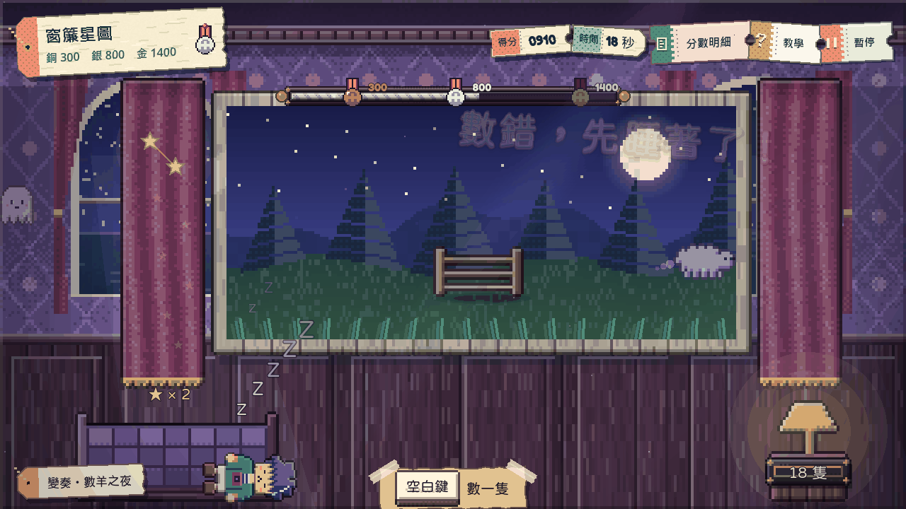

# [SG-110] 實作窗簾星圖

> 狀態：完成

## 內文

### 需求

窗外的羊一隻隻跳過柵欄，每跳過一隻真的羊就按一下數羊，混在裡面的小鬼羊不能數。佔用幽幽旅館的 game-092 位置，取代原本偏向規劃與多按鈕的設計。

### 來源

2026-11-28 使用者要求持續精進遊戲內容與畫面、做到票都完成後繼續找可做的事；幽幽旅館剛開放，十二格小遊戲都還是空的。依 design/00-principles/simple-fun-minigames.md 改寫為單一動詞的街機式小遊戲（Bomberman Land 3 方向）。

### 驗收條件

- [x] 羊越跳越快，小鬼羊越偽裝越像。
- [x] 數錯時主角先睡著了，冒出一大串 Zzz 從床上滾下來。
- [x] 整款只用方向鍵與一到兩顆按鍵，畫面上沒有操作按鈕面板；進場五秒內開始操作，沒有強制教學頁。
- [x] 一回合不超過 60 秒，回合內速度或變化明顯升級；至少兩種隨機出現的變奏。
- [x] 結算只顯示一個分數、銅銀金獎牌與一句評語；銅牌取得普通拍貼，未用輔助的金牌取得小惡魔拍貼。
- [x] 玩法物件達到街機小遊戲的畫面下限：沒有大面積純色、有材質與受光、描邊、接地陰影，色調與背景一致。
- [x] 鍵盤與手把都能完成；開啟減少動態後仍可遊玩。
- [x] 通過稽核十問，結果寫在設計目錄的該款說明；該區原有互動與其他小遊戲不受影響。

### 測試流程

1. 從區域攤位進場，不看說明直接玩一回合。
2. 故意失敗一次，再玩到銅牌與金牌。
3. 開啟減少動態與手把各玩一回合，確認拍貼入冊與重開後保留。

---

# 跟其他票的關係

- Blocks：無
- Blocked by：無
- Related：SG-66、ART-57

---

# Commit-1

## 內文

失物室的第二座攤位還蓋著布；設計目錄的 game-092 還是只有標題、沒有逐款規格。
現在失物室前的露臺多了一座攤位：頂上一段小木柵欄，一隻綿羊正跳過去，旁邊一彎月亮和一顆星，櫃台擺著睡帽和小黑板，開放「窗簾星圖」。畫面是旅館夜晚的臥室，兩片絲絨窗簾中間一扇大窗，窗外分三層：星星一閃一閃的夜空和遠山、一排杉樹的草地、前景會擺動的草叢與一段木柵欄。主角坐在床上看著窗外數羊：羊一隻隻跑過來跳過柵欄，在草地上留下影子；真的羊跳到柵欄上時按一下（空白鍵、↑ 或手把 A 鈕），那隻羊微微發金光，左邊窗簾上縫上一顆金色星星、星星連成線，八顆完成一個星座加大獎；跳到最高點時按還有「剛好！」加分。混在羊群裡的小鬼羊顏色淡、會飄、拖著煙霧尾巴，而且永遠沒有影子；數到小鬼羊，或柵欄上沒有羊時亂按，主角就先睡著了：冒出一大串 Z，從床上翻滾到地毯上躺著打呼。
一回合 45 秒，羊越跑越快、越來越密，後段小鬼羊混進來、會和真的羊兩隻一起跳，而且越扮越像（後段甚至長出腳），但還是沒有影子。每回合隨機一種變奏：數羊之夜、羊群大遷徙（兩隻一起跳的多）、鬼羊派對（小鬼羊多又早、扮得更像）。倒數時自己數第一隻羊示範，開始時草地上還沒有羊。每回合第一次數錯不算失誤。輔助讓羊跑慢一點、按的時間寬一點，輔助回合不發小惡魔拍貼。
依新的畫面標準在原生畫面走過倒數示範、羊跳柵欄、小鬼羊、數錯睡著、滾到地上、後段與結算，逐張看過後修掉了：窗外的樹原本是平塗的三角形，改成有受光面的像素杉樹；羊腳因為程式錯誤沒畫出來；主角被畫在床後面，數錯滾下床時完全看不到，改成坐起來看得到上半身、滾到床前的地毯上；床頭燈和計數牌擋到下方的操作提示，移到右下角。同一次也把枕頭靜步被枕頭砸中時臉上那顆枕頭補上條紋、縫線與陰影，並更新了那款的教學圖與票上截圖。規則測試以模擬按鍵在三種變奏都拿到金牌（2260、2410、2060 分）、時機抓不準又常被小鬼羊騙的玩家拿到銅牌 458 分、完全不按 0 分，五十組種子放著不玩都是 0 分，一直按會一直睡著，輔助金牌不發小惡魔拍貼。手把只以模擬的 A 鈕事件確認能數羊，沒有接實體手把；減少動態只以原生畫面確認羊不跑步、星星不閃、草不晃、主角直接滾到地上，仍照常遊玩，沒有真人實際操作。難度與「看一眼就懂」依畫面與模擬輸入判斷，尚未由真人試玩。

### 測試結果

| 項目 | 結果 |
|---|---|
| 窗簾星圖規則 | 通過：倒數示範、跳到柵欄上時數羊與剛好加分、縫星星與完成星座、漏數斷連數、數到小鬼羊與亂按算數錯、睡著時按鍵不算、加速與小鬼羊越扮越像、三種變奏、金牌與銅牌整回合、不操作不得分 |
| 局部回歸 | 遊戲目錄、旅館世界、失敗拍貼、街機共用流程、場景規範、枕頭靜步通過 |
| 設計與資料驗證 | 5 個範圍通過；Python 測試全數通過 |
| 原生畫面 | 遊玩、減少動態與結算過程無 ERROR |

### 截圖

