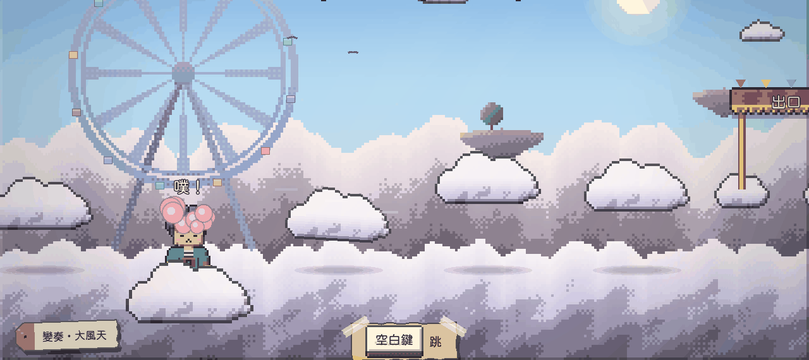

# [SG-115] 實作雲梯換層

> 狀態：完成

## 內文

### 需求

雲台在不同高度上下浮動，在自己腳下的雲台和下一座雲台剛好同高的瞬間按鍵跳過去，一路跳到出口。佔用雲端遊樂場的 game-097 位置，攤位在浮島群，取代原本偏向規劃與多按鈕的設計。

### 來源

2026-11-28 雲端遊樂場（MAIN-65）完成，十二個攤位都還是準備中。使用者要求小遊戲單純好玩、玩法多變、不要枯燥的射擊；依 design/00-principles/simple-fun-minigames.md 改寫為單一動詞的街機式小遊戲（Bomberman Land 3 方向）。

### 驗收條件

- [x] 雲台浮動週期各不相同，後段有會縮小與被風吹歪的雲台。
- [x] 踩空時主角掉進雲裡，從雲底冒出一顆沾滿棉花糖的頭。
- [x] 整款只用方向鍵與一到兩顆按鍵，畫面上沒有操作按鈕面板；進場五秒內開始操作，沒有強制教學頁。
- [x] 一回合不超過 60 秒，回合內速度或變化明顯升級；至少兩種隨機出現的變奏。
- [x] 結算只顯示一個分數、銅銀金獎牌與一句評語；銅牌取得普通拍貼，未用輔助的金牌取得小惡魔拍貼。
- [x] 玩法物件達到街機小遊戲的畫面下限：沒有大面積純色、有材質與受光、描邊、接地陰影，色調與雲端遊樂場背景一致。
- [x] 鍵盤與手把都能完成；開啟減少動態後仍可遊玩；沒有按鍵就不得分。
- [x] 通過稽核十問，結果寫在設計目錄的該款說明；雲端遊樂場原有互動與其他小遊戲不受影響。

### 測試流程

1. 從浮島群的攤位進場，不看說明直接玩一回合。
2. 故意失敗一次，再玩到銅牌與金牌。
3. 開啟減少動態與手把各玩一回合，確認拍貼入冊與重開後保留。

---

# 跟其他票的關係

- Blocks：無
- Blocked by：無
- Related：MAIN-65、SG-66、ART-57

---

# Commit-1

## 內文

雲端遊樂場十二個攤位都還是準備中，設計目錄的 game-097 是偏向規劃、多按鈕的舊案。
現在浮島群最西邊那座攤位掀開了遮布，頂上立著一朵小雲台，開放「雲梯換層」。畫面是雲端遊樂場的天空：遠處摩天輪的車廂慢慢轉、小雲飄過、兩隻鳥滑過，下面是一整片雲海。主角站在一朵雲台上，前面一排雲台各自用不同的速度上下浮動，最後是掛著彩旗的「出口」拱門。腳下的雲和下一朵之間有一條虛線，兩朵同高時虛線變金色、跳出「跳！」，這時按空白鍵（或 →、手把 A 鍵）就跳過去；越接近同高分數越多，連跳會疊加分數，跳到出口再加分並換一條更長的新雲梯。後段會出現粉紅色、寫著「會消失」的雲台，站上去後慢慢縮小，以及被風吹得上下亂晃、帶著風痕的雲台。沒對齊就跳、或站在消失的雲台上太久，主角會掉進雲海，再從雲底冒出一顆沾滿粉紅棉花糖的頭「噗！」。站著不按不會得分，完全不按的回合一定是零分。
一回合 45 秒，雲台由 5 朵增加到 8 朵、浮動越來越快、要對得越來越準。每回合隨機一種變奏：雲梯換層、消失雲台（常出現會消失的雲台）、大風天（常出現被吹歪的雲台）。倒數時主角自己等兩朵雲對齊跳一次示範。第一次掉下去不算失誤。
這次也做了雲端遊樂場小遊戲共用的天空背景（藍天、太陽光暈、遠方摩天輪、浮島、雲海，以及可重複使用的卡通雲朵圖），之後的雲端小遊戲沿用同一張。
在原生畫面以實際按鍵事件走過倒數示範、跳躍、會消失與被風吹的雲台、掉進雲裡與結算。逐張看過後把方塊狀的雲台改成有圓鼓包、底部扁平、下方帶淡紫陰影的卡通雲朵，並把摩天輪與車廂調淡成遠景，讓前景雲台更清楚。規則測試以模擬輸入在三種變奏都在接近同高時跳的玩法拿到金牌（1647 至 1906 分），等到幾乎完全對齊才跳、偶爾亂跳的玩家拿到銅牌 203 分，完全不按 0 分；輔助金牌不發小惡魔拍貼。手把以十字鍵與 A 鍵對應同一組按鍵驗證，沒有接實體手把；減少動態以畫面的靜止分支檢查（摩天輪、飄雲、跳躍與掉落直接到定位）。難度與「看一眼就懂」依畫面與模擬輸入判斷，尚未由真人試玩。

### 測試結果

| 項目 | 結果 |
|---|---|
| 雲梯換層規則 | 通過：雲台浮動、同高才能跳、越準越多分、連跳、出口加分與新雲梯、會消失與被風吹的雲台、掉進雲裡、加速、三種變奏、金牌與銅牌整回合、不按零分 |
| 局部回歸 | 遊戲目錄（含同區已上線的羽球上升流）、雲端遊樂場世界（攤位互動點即站點本身）、教學頁、街機共用流程與場景規範測試通過（以既有匯入快取直接執行） |
| 區域往返 | 未全過：只有「港口使用全部十七個地點」一項失敗；港口在 MAIN-69 改版後地點數變了，這次沒有動港口，另外回報 |
| 設計與資料驗證 | 5 個範圍通過 |
| 原生畫面 | 遊玩與結算過程無 ERROR；攤位在浮島群，互動點可走到 |

### 截圖

