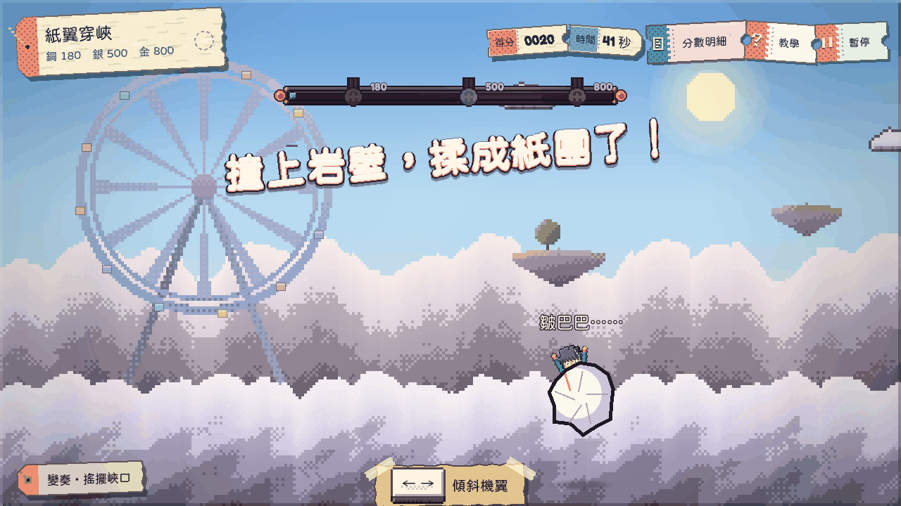

# [SG-116] 實作紙翼穿峽

> 狀態：完成

## 內文

### 需求

乘著紙飛機在雲峽間滑翔，左右傾斜機翼穿過一道道峽口的風環。佔用雲端遊樂場的 game-098 位置，攤位在風箏露台，取代原本偏向規劃與多按鈕的設計。

### 來源

2026-11-28 雲端遊樂場（MAIN-65）完成，十二個攤位都還是準備中。使用者要求小遊戲單純好玩、玩法多變、不要枯燥的射擊；依 design/00-principles/simple-fun-minigames.md 改寫為單一動詞的街機式小遊戲（Bomberman Land 3 方向）。

### 驗收條件

- [x] 峽口越來越窄並開始左右移動，偶爾有一陣側風把機身推開。
- [x] 撞上岩壁時紙翼皺成紙團，主角被包在紙團裡滾下去。
- [x] 整款只用方向鍵與一到兩顆按鍵，畫面上沒有操作按鈕面板；進場五秒內開始操作，沒有強制教學頁。
- [x] 一回合不超過 60 秒，回合內速度或變化明顯升級；至少兩種隨機出現的變奏。
- [x] 結算只顯示一個分數、銅銀金獎牌與一句評語；銅牌取得普通拍貼，未用輔助的金牌取得小惡魔拍貼。
- [x] 玩法物件達到街機小遊戲的畫面下限：沒有大面積純色、有材質與受光、描邊、接地陰影，色調與雲端遊樂場背景一致。
- [x] 鍵盤與手把都能完成；開啟減少動態後仍可遊玩；沒有按鍵就不得分。
- [x] 通過稽核十問，結果寫在設計目錄的該款說明；雲端遊樂場原有互動與其他小遊戲不受影響。

### 測試流程

1. 從風箏露台的攤位進場，不看說明直接玩一回合。
2. 故意失敗一次，再玩到銅牌與金牌。
3. 開啟減少動態與手把各玩一回合，確認拍貼入冊與重開後保留。

---

# 跟其他票的關係

- Blocks：無
- Blocked by：無
- Related：MAIN-65、SG-66、ART-57

---

# Commit-1

## 內文

雲端遊樂場的 game-098 還是要同時調傾角、俯衝蓄速又顧高度的舊案，風箏露台最西邊那座攤位一直是準備中。
現在那座攤位頂上插著一架大紙飛機，開放「紙翼穿峽」。畫面從主角背後看出去：主角坐在一架大紙飛機上，滑過雲端遊樂場的天空，遠處是摩天輪和浮島。一道道淡紫色的岩石峽口從遠方的霧裡浮出來、從雲海裡長出來，越飛越近；每道峽口中間有一圈轉著白色氣流的薄荷色風環。按住 ← 或 →（A D、手把十字鍵或左搖桿）機翼就往那邊傾斜、整架滑過去，放開就回正；從峽口穿過去得分，正好穿過風環會冒金色火花、喊「穿環！」，連續穿過越多每道越多分。每道峽口都開在你現在要去的地方以外，一定要動才過得去。撞上岩壁時紙飛機連人揉成一顆紙球，只露出主角舉著雙手的頭，「皺巴巴……」地滾進雲裡，再換一架新的飛回來。完全不按的回合一定是零分。
一回合 45 秒，峽口由寬變窄、來得越來越快，後段峽口會左右擺動；偶爾有一陣側風把機身推開，來之前畫面會先掃過風痕、寫著「側風 →」。每回合隨機一種變奏：紙翼穿峽、側風峽谷（側風多）、搖擺峽口（一開始就擺動）。倒數時紙飛機自己傾斜穿過一道寬峽口示範。第一次撞到不算失誤。
在原生畫面以實際按鍵事件走過倒數示範、穿峽、穿環、側風、撞成紙團、後段窄峽與結算，並確認攤位在風箏露台、走到互動點會出現「E 玩紙翼穿峽」。逐張看過後：把整片蓋住畫面、有明顯拼接格線的峽谷牆，改成從雲海裡長出來的岩柱；岩石改成一塊塊錯開堆疊、有受光面的石材紋理，靠近缺口的一側有亮面或陰影；把太細看不清的風環加粗成有描邊與光暈的轉動氣流環；撞擊時主角原本橫著卡在紙團旁邊，改成整個人包在紙團裡、只露出頭和手。規則測試以模擬輸入在三種變奏都看準下一道峽口、對準風環的玩法拿到金牌（910 至 960 分），等峽口很近才開始動、只求穿過缺口的玩家拿到銅牌 354 分，完全不按 0 分；輔助金牌不發小惡魔拍貼。手把以十字鍵與左搖桿對應同一組按鍵驗證，沒有接實體手把；減少動態以畫面的靜止分支檢查（風環不轉、岩石不從身邊飛過、紙團不滾）。難度與「看一眼就懂」依畫面與模擬輸入判斷，尚未由真人試玩。

### 測試結果

| 項目 | 結果 |
|---|---|
| 紙翼穿峽規則 | 通過：傾斜加速與回正、穿峽與穿環得分、連穿、撞岩與第一次免失誤、峽口不會開在正前方、變窄變快與擺動、側風預告與推力、三種變奏、金牌與銅牌整回合、不按零分 |
| 局部回歸 | 遊戲目錄、雲端遊樂場世界、區域往返、教學頁、街機共用流程與場景規範測試通過（以既有匯入快取直接執行） |
| 設計與資料驗證 | 5 個範圍通過 |
| 原生畫面 | 遊玩與結算過程無 ERROR；攤位在風箏露台，互動點可走到 |

### 截圖

